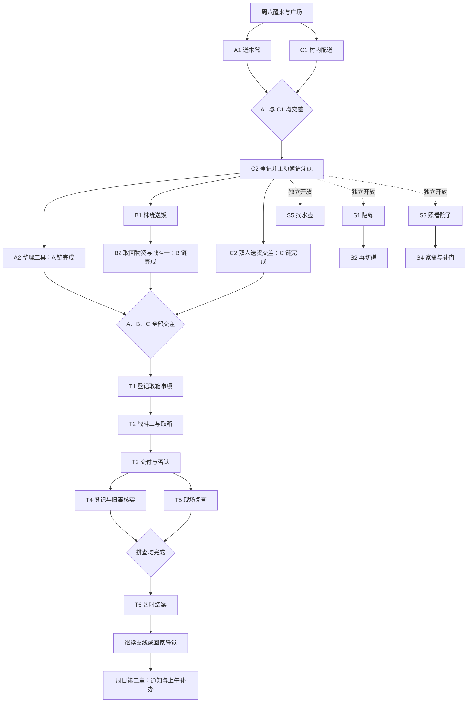

# 第一章细案：周六的委托与旧工具箱

`[已实现]` 2026-10-04：已接入开场的口语、事项与再访反馈按实际进度润色，原故事结果不变。取回路上暂放的木凳由主角自语，不借远处彭师傅发言；许婆婆只有凳子已放好才提出试坐；村长在共同送货交差后才提沈砚独立酬金。J／Y 事项和分段位置跟踪见[工程说明](../engineering/quest-tracking-typography.md)。下列未接入后续内容仍为草案。

> `[已实现]` 2026-10-02 后续正式开发授权：本文六场开场的功能版已接入两种醒来和既有醒后档。七位功能 NPC、送凳／订货／邀请／共同推车、事项记录、交差领款与恢复可运行。正文原 `[可调整草案]` 保留作对白与后续制作基准；功能版采用 17 段事件对白和独立问答菜单，不代表全部文稿逐字定稿。见[接入说明](../engineering/village-opening.md)和[运行验收](../production/village-opening-validation.md)。30–40 分钟仍待真实游玩验证。

> 2026-10-02 文稿更新：新增本文“村内开场逐场文稿”与“开场之后的人物任务纲要”，覆盖七位 NPC、两件独自短活及首次共同送货。新增正文均为 `[可调整草案]`，30–40 分钟仅为写作目标；不是可玩内容或最终对白。纸面走查见[文档验收](../production/chapter-one-doc-validation.md)。

> 2026-09-14 后续更新：[醒来与正式村庄探索](../engineering/village-wake.md)已接入。两条梦境路线均可进入住宅和村庄，并保存位置与门灯；第一章委托、居民与第二章仍未接入。本文原制作／设计轮的“独立预览、止于 ExitOpened、仅文档、存档不变”等范围描述保留为当轮事实，由该后续接入说明补充现状。

> 2026-09-13 批准叙事与任务编排，2026-09-14 更新村庄／森林地点安排。第一章详细设计统一维护在本文；人物约束见[剧情圣经](story-bible.md)，章节关系见[剧情流程](story-flow.md)，运行事实见[当前实现](../engineering/current-implementation.md)。本文不是可玩内容或最终对白。

## 状态与交付边界

- `[固定约束]` 前一轮仅写 Markdown 的边界已由本轮正式接入授权替代。当前两种醒来进入村内完整开场，允许新增 Core、内容、资产和可选开场存档字段；SaveEnvelope v1 与梦境内容版本 6 保持。后半章仍只设计，不因开场接入而全部开放。
- `[计划]` 第一章在同一个周六，先完整经历正常生活，最后通过工具箱事件留下无法解释的疑惑。第二章周日早上收到下午返校处理临时事务的通知，上午可继续剩余事项。
- `[固定约束]` 主角先独自行动，在前中期主动邀请沈砚；晓雨第一章现实不出场、不远程指导。梦的模糊余韵不提供现实调查线索。
- `[固定约束]` 父母失踪真相、工具箱与委托的来源、长期主线和周日下午学校事件是**有意留白**，不是待作者自行补齐的谜底。“有意留白”是说明，不新增第五种文档状态标签。
- `[可调整草案]` 下列委托名称、配角职务分配、工具细节、对白示例与动物遭遇用于开始场景写作；具体姓名、年龄数字、外地地名、数值和资产另行细化。文档内 A1 等编号仅供阅读，不是运行时 ID。

## 活动区域与地点调整（2026-09-14）

`[固定约束]` 第一章活动范围为村庄及附近森林；村内没有敌对遭遇，允许村民自愿陪练。B 链改为林缘劳作链：B1 送饭、B2 取物都去森林入口以内的劳作点，山猴遭遇在森林；T2 的野猪遭遇与工具箱小屋同样在森林。取物后 T5 复查同一森林现场，不重复战斗。

`[计划]` 09-14 先设计[村庄外景](village-exterior.md)，沈砚在活动室门前受邀，修理铺整理及验箱、杂货铺装卸都在外部工作区进行；送凳／配送／家禽院落的建筑映射见外景细案。该轮未分配住户姓名；10-02 的开场文稿追加三户称谓，不改建筑用途。森林路线、劳作内容、小屋构造与箱子具体摆放另轮设计，当前纸条只保留指路信息要求，不擅自填入新地标或小屋内部结构。

`[固定约束]` 本次替代 09-13 的“山脚农活／田边山猴”和“北坡旧线路附屋取箱”地点草案。已有村庄预览中的铁路附屋保留为普通村景，与森林工具箱小屋没有预定联系；后者并非当前已开放建筑。六项必要委托、五项支线、两场必经动物战、三链解锁与无解收尾不变。

## 人物与生活基础

`[固定约束]` 主角一直生活在村中，在附近学校读高中，熟悉村庄、村民和正常生活习惯。父母两年前外出务工后失踪；他独自居住，村中长辈照应，平日放学及周末帮忙挣钱。此前积蓄暂时够生活；本章不扣生活费、不设最低收入或挣钱门槛，报酬供装备、治疗物品等使用。

`[计划]` 村民知道他的难处，专门留些力所能及的事情；广场的牌子和村长代管酬金是早已存在的日常。关照通过留饭、备好工具、合理安排差事表现，不反复讲述苦难，不让所有活都变成假装需要帮忙。主角确实交付劳动成果，并且懂得回应关照。

| 人物 | 本章作用与动机 | 写法边界 |
| --- | --- | --- |
| 主角 | 独自安排周末差事，主动邀请好友；发现与亲历不符的情况后愿意核实 | 保留观察、倾听、谨慎；成长从熟悉的事务走向承担陌生问题的不确定性，不写成此前从不帮人的旁观者 |
| 沈砚 | `[可调整草案]` 周末有空，想攒钱添置修理工具；答应共同送货并分享报酬，后续结伴 | 有玩笑、手艺、不同判断；加入无恋爱/高关系门槛，怀表不发挥超自然功能 |
| 乔姨 | 安排小额订货配送与双人搬运，方便村中住户，也让主角挣到钱 | 了解生活、讲信用；不再承担旧求助信收信人职责 |
| 彭师傅 | `[可调整草案]` 经营修理铺，处理积活；章末认出早年遗失的工具箱 | 本轮确定用作工具主人；不绑定旧公司或父母失踪，不装作忘记已知事实 |
| 村长 | 提供日常照应、登记事项、保管酬金、核实交差与结款 | 固定地点在广场附近；如实交代登记经过，不靠失忆或拒绝合作阻碍排查 |
| 林缘劳作村民、陪练村民、邻居、失主 | 各有真实日常需求，对已完成事情给出反馈 | 10-02 文稿用许婆婆、陈叔、刘伯承接三户及部分支线；其余保留职能称呼，均不创建角色 catalog 或占用稳定 ID |

## 章节节拍与时间

`[计划]` 阶段由关键事情推进，站立、走路、战斗失败或做支线都不会把周六耗尽。下列时间是叙事阶段，不是现有 Legacy 移动计时规则的改名。

| 阶段 | 进入条件 | 剧情与开放事项 |
| --- | --- | --- |
| 早晨·独自办事 | 怪梦醒来 | 洗漱、简单早餐，少量生活交互后去广场。只开放 A1 修理铺送凳、C1 杂货铺配送，顺序任选；用一次正常投递演示收件箱 |
| 午间·找好友 | A1 与 C1 均已交差 | C2 双人送货事项出现，主角去活动室门前主动邀请沈砚；可以先查看说明，再找人，不强制远程入队 |
| 下午·结伴日常 | 沈砚接受邀请 | 开放 A2、B1、C2 执行及全部支线起点；B1 交差后开放 B2。可交错完成，也可暂时去做支线 |
| 下午稍晚·远路取物 | A、B、C 三链均交差收尾 | 村长整理收件，登记 T1；主角自行查看接取。已挣报酬是否领取不构成条件 |
| 傍晚·排查 | 箱子取回并交付 | 对照陈述与实物，完成登记、旧事和现场核实，仍无有效去向；进入自由收尾 |
| 傍晚·自由收尾 | T6 暂时结案 | 保留支线入口、结款与购物；主角可回家结束当天，明示进入周日第二章 |

`[计划]` 两件开场短活必须独自完成；邀请不是自动剧情传送。拒绝或中断邀请只表示暂缓，可回去再谈；沈砚接受后，当天任务中的合作可持续使用。模态、暂离及恢复不重复邀请或修改关系。本章前中段没有异象，不能给日常工具、野生动物或沈砚动作添加异常特效。

## 广场委托规则与示例

`[计划]` 村民可当面交付委托和酬金；村长不在时，也可将署名纸条和酬金装入信封，投到固定收件箱。村长整理后登记到牌子。开场让主角看见乔姨正常投件、村长正常登记，建立惯例；该正常投件不是工具箱委托。

`[计划]` 玩家看到具体事项、署名委托人、地点、约定报酬及注意事项，已接事项提供当前行动信息。不显示主支线分类、链名、链编号、前置条件、百分比或“完成三条链解锁”。未开放事项不以带锁格子预告。村民可以自然说明“货到了再托你跑一趟”。

`[计划]` 接取后在个人事项记录中保留内容，牌上可标为已有人接手；完成交差后撤下，后续独立登记。交差确认劳动结果并产生一次应付报酬，村长统一结款；可积攒后一次领取。登记、完成与领取分别防重复，领取不决定后续开放。同行分酬在接取双人差事时说明，任务板展示玩家可得份额；不临时扣掉已承诺给玩家的钱。

`[可调整草案]` 开场任务板采用以下完整文案。正式制作时另有显示约定报酬的数值区域，双人事项分别标明玩家份额和同伴份额；数值留给经济设计，本轮不写占位数字或运行数据。

> **送一张修好的木凳**  
> 彭师傅：许婆婆的木凳修好了，帮我送回住宅巷她家门廊。先到铺前待领区取，放稳后请她试试，回来告诉我一声。酬金按牌上约定，由村长保管。

> **送三家的小件订货**\
> 乔姨：许婆婆、陈叔和刘伯订的东西已经备齐。到店前交货台核对货包，三家先送哪家都行，送齐后带单子回来。酬金按牌上约定，由村长保管。

> **搭把手送米面**  
> 乔姨：许婆婆、陈叔和刘伯的米面需要两个人一起送。到店前交货区核对住户和份数，推车已经备好，送齐后把车还到铺前。酬金按牌上各自的份额分别结算。

`[可调整草案]` 以下仅为后半章历史任务板示意，方括号是森林设计与经济设计的作者待补项，不属于本轮开场对白成稿：

> **森林小屋取工具箱**  
> 署名彭师傅：请把森林小屋里的旧铁皮工具箱带回修理铺。[前往路线与箱子具体位置：森林设计完成后补入。]箱子提手缠着旧布。路远，找个人一起去。报酬：[双人远路差事的玩家份额]。

上述方括号为作者待补项，不是玩家会看到的正文。正式制作前纸条必须给出可辨认的路线和放置位置；本轮不为补齐示例预定森林地标或屋内木架。

工具箱纸条没有“求救”“秘密”“只准你来”或截止倒计时。委托中的物件外观用于找对箱子，身份认定依靠后续私人修补痕迹与彭师傅陈述。

## 必要委托场景卡

`[可调整草案]` 六项委托构成三条独立日常链。每项具备自己的生活结果，不通过异常线索串联。共通规则：取消对白不算交差；完成实物劳动后允许恢复到交差步骤，不重做或复制物品；物品无法误售、永久丢弃而卡住主线。下表的结果是未来叙事状态语义，不是已创建的状态键。

| 编号与事项 | 入口、人物动机、玩家可见事项 | 行动与选择 | 交差结果与后续条件 | 中断或失败后的继续 |
| --- | --- | --- | --- | --- |
| A1 送还木凳 | 开场牌子；彭师傅积活需要送回，邻居确实在等 | 去铺前待领区取凳、确认收件住户、选择巷道路线；与邻居简短交流后送达 | 邻居收到修好的凳子；向彭师傅交差，登记应付报酬。与 C1 均完成时进入邀请阶段 | 找错户获得方向说明，不丢物；送达后中断可直接回来交差 |
| A2 整理工具 | A1 完成且沈砚已加入后登记；彭师傅要整理混放的工具与待修物件 | 在铺前有顶工作区对照标签、器具用途和修补痕迹分类；可询问，不靠大学专业知识；沈砚可提出实用判断 | 工作台腾出、物件归位，A 链收尾。见过彭师傅常用的修补手法，但不展示章末箱子或异常 | 放错自然纠正，可再次观察；不扣必需报酬，不会永久毁坏物件 |
| B1 林缘送饭 | 沈砚加入后登记；在森林入口以内林地劳作的人不便回来 | 取饭和用品、沿路认地标、到森林内的林缘劳作点确认收件；回村交差 | 村民收到物资，主角认识存放点与路线；劳作结束后托村长登记 B2 | 走错路可回到已知路口；不因自由探索导致食物超时、NPC 永久离开 |
| B2 取回物资 | B1 交差后登记；村民收工，物资尚留在森林内的劳作点 | 去森林内存放点辨认物资；山猴被食物吸引而靠近，进入战斗一；保护搬运并赶开动物后带回 | 物资送回村民，B 链收尾；野生动物事件按普通原因解释 | 战败可即时重试或撤退准备；劳动成果在战斗完成后确认，不消耗关键任务物资；胜利后不再刷遭遇 |
| C1 村内订货 | 开场牌子；乔姨有数份小额订货待送 | 到店前交货区核对份数，按任意住户顺序配送；收件人反馈生活近况，主角认识委托制度 | 订货送达，向乔姨交差，登记应付报酬。与 A1 均完成后登记 C2 | 剩余配送清楚记录，不因取消或重复交谈重复交货、结款 |
| C2 双人送货 | A1、C1 完成后登记；乔姨备好米面和推车，需要两人 | 主角到活动室门前主动找沈砚说明工作与分酬；他有空且想添工具而接受。加入后可与 A2、B 链交错；两人核对货物、选择可通行路线、合作搬运 | 米面送到、推车归还，C 链收尾。建立正常合作与玩笑，邀请本身不算整件差事完成 | 暂缓邀请可再谈；运输中断保留已交货物和待办项。低关系、未做支线也有基本合作路径 |

`[可调整草案]` 邀请时沈砚在活动室门前的小桌旁摆弄便携小工具，先确认自己有空，再问送到哪里、两人怎么分。他可以打趣“说好了，最沉的那袋别留到最后才想起我”，收好工具后到杂货铺装货区主动检查推车轮轴。通过行动表现手艺，不插入解释怀表力量的剧情。

## 村内开场逐场文稿（2026-10-02）

`[可调整草案]` 本节含以下全部人物卡、演出说明、对白、选项、反馈与恢复约定。它们是供审稿和后续接入的正文，不是 `.dialogue` 脚本、运行时状态或已批准美术。场次简称只供作者检索；“首次”指玩家本段第一次看见该交流，不是主角第一次认识此人。

### 文稿范围、节奏与人物卡

`[可调整草案]` 主路径写作目标为 30–40 分钟：起床与广场 3–4 分钟、送凳 5–7 分钟、三户小件 8–10 分钟、邀请 3–4 分钟、推车配送与歇脚 11–15 分钟。实际时长待可玩后测量，不通过加慢移动、重复装卸、强制闲聊或等待 NPC 凑足分钟。可选闲聊及自由探索不计入目标；起床生活互动可跳过。

`[可调整草案]` 本段建议先完成 C2 以形成一次完整共同劳动，但不是新前置：沈砚接受邀请后，A2、B1 和既定支线起点仍同时开放。若玩家先做其他事再回来，C2 只谈这批货和当下合作，不宣称两人“今天还没一起干过活”。文稿的歇脚不是章节结算。

| NPC 与位置 | 自己要办的事／与主角的相处 | 语气与动作 | 本段写作边界 |
| --- | --- | --- | --- |
| 乔姨／杂货铺交货台；开场短暂到广场投件 | 把订货分清、腾出交货台；熟悉主角，留饭也讲清工作与工钱 | 先说具体事项，顺手把标签转到外侧；玩笑不绕弯 | 不反复提主角困境，不拿关照替代报酬；不谈来历不明的信 |
| 彭师傅／修理铺外工作台 | 修好的凳子需要送回，腾开待领区；希望听到实际使用反馈 | 句子短，手上会停下来示范稳固处 | 普通榫接修理，不故意展示章末箱扣或私人刻记，不说含混预言 |
| 村长／广场办事桌 | 正常登记、核实交差、分别结款 | 核对纸面后答话，给主角自己安排的余地 | 不是全知旁白；没收到交差确认时不擅自知道劳动结果 |
| 沈砚／活动室门前小桌，邀请后同行 | 修好便携小工具、攒钱添工具；与主角能自然商量 | 玩笑之后给出能用的建议；检查时会蹲下看实物 | 不提前入队，不被动替玩家完成全部操作，不用怀表提示答案 |
| 许婆婆／house02 门廊 | 拿回常坐的木凳、收订货；爱惜用惯的东西 | 说话从手边东西起头，试坐后给明确反馈 | 不擅加独居、病弱或家庭悲剧；关心不等于需要被照顾一切 |
| 陈叔／house13 院口及收纳区 | 收好杂货、晾晒和归置用品 | 数一遍、问清位置，发现小疏漏会自己承认 | 粗心只落在普通小事，不变成谜语人；水壶未丢时不说找回了 |
| 刘伯／house15 菜畦外收货区 | 收货、照料院子，空闲想活动筋骨 | 简洁爽快，愿意伸手帮忙；不催成绩 | 不靠胜负贬低主角；陪练未开放时只有生活闲聊 |

`[可调整草案]` 许婆婆、陈叔、刘伯是本稿采用的称谓，无全名、年龄、亲属关系或运行时角色 ID。三户配送仍使用既有建筑及门廊，不增加室内；禽栏邻居仍在 house08。

`[可调整草案]` 同一居民不得同时站在两个任务地点。开场待收货时三户都在各自院口；后续刘伯若正在陪练空地，事项记录如实指向那里，玩家可当面说“米面到了，您方便回来收一下？”——刘伯：“行，这边先歇一会儿，我们回去。”随他正常返回院口再交付，陪练进度保留；陈叔失物对话固定在自家进行，现场寻找由主角执行。不给无人院落远程收货，也不让阶段日程造成永久失联。

### 阅读、操作与结果的共通约定

`[可调整草案]` 下述“主角／NPC：”均为可显示对白；引号内选项可供玩家选择。入口、条件、动作和结果为作者说明，不显示为台词。选择“先忙别的”只结束当前交流，不拒绝整条任务，也不改关系数值。

- 接取、拿取、每户送达、交差、领款分别确认。仅阅读纸条不接取；交差对白完整结束才确认交差。取消可再谈，已完成的搬运不重做。
- 进度记录用自然语言写下一步，如“木凳已送到，回修理铺告诉彭师傅”；不显示 A1、链名、主支线、完成比例或未来带锁项目。
- 搬凳与推车均允许主动暂放／停靠、绕路、离开和回来继续。住宅往返或后续读档恢复到最近已确认步骤；未确认的选物、对齐和谈话可重试，不额外生成货物或报酬。这是未来行为要求，本轮不定义存档字段。
- 小件货包放在可一次装齐的配送提袋中；携带提袋时仍可搬凳。搬凳时可以看订单、交谈，提交小件交付前先安全放凳。推车途中交谈先停稳，双方不边穿过碰撞边演出。
- 目标区域辅助对齐，只阻止会穿墙、堵门或落入不可达处的放置；保留原地调整／取消。无货物损坏、饥饿、体力条、计时评分、摔落惩罚或长期债务。
- 行路短句一次触发且不抢夺移动输入。正在过桥、转弯或操作时延后，离开对应情境则略过；已略过的闲聊不影响任何任务。

### 场景一：周六，先出门看看

`[可调整草案]` **入口／动机：** 既有醒来字幕结束，主角在卧室恢复自由行动。沿用当前两路文本：正常逃出为“你睁开眼，熟悉的卧室渐渐清晰。刚才只是一场梦。”；刺醒为“指尖仿佛还留着一瞬的刺痛。你睁开眼，已经回到自己的卧室。”，随后同为“窗外天色明亮。今天是周六，不用赶着上学。先起来走走吧。”不重复播放、不改写梦境结果。

**可选生活互动：**

| 入口 | 完整短文本与动作 | 结果／再次操作 |
| --- | --- | --- |
| 洗手台 | 主角：“洗把脸，清醒一点。”洗漱短动作后：“好了。” | 无任务结果；再看：“水关好了。” |
| 厨房早餐 | 主角：“还有馒头，热一下就能吃。”选择“吃点再出门”后短暂淡出：“碗放好了，走吧。”选择“回来再吃”：“先出去看看。” | 不做烹饪小游戏、不发增益；吃过再看：“已经吃过了。”未吃不影响后续 |
| 门前出门 | 主角：“去广场看看，今天有什么要帮忙的。” | 仅首次短句；玩家可绕路找居民，不强制传送 |

**成果／恢复：** 玩家知道今天可以自主安排。直接出门与做完生活互动效果一致；未吃早餐不被乔姨、沈砚断言“你又没吃”。无父母物件特写、晓雨回想或怪梦调查事项；回床边不开放结束周六。

### 场景二：广场的纸条

`[可调整草案]` **入口／动机：** 第一次主动查看任务板或与村长交谈时，展示一次正常投件。乔姨拿的是小件订货事项；送凳事项已经登记。两张纸条的完整文本见本文章节“广场委托规则与示例”。

**首次在广场见到乔姨时：**

> 乔姨：三家的东西都分好了。纸条和酬金在一个信封里，我放这儿了啊。\
> 村长：好，你先回店吧。我核对好了就挂到牌上。\
> 主角：乔姨，今天要送东西？\
> 乔姨：都是小件，店前拿。名单也在，不用靠脑子背。\
> 主角：那我先看看。\
> 乔姨：行，我回去把台面腾出来。

**若此前已去杂货铺问过订货，主角与乔姨的中间四句替换为：**

> 主角：你刚说的那几份？\
> 乔姨：对，单子也备好了。你看过牌子，到店里找我就行。

乔姨离开办事桌，回杂货铺。她不在两处同时出现，也不要求玩家尾随：若玩家径直返店，可在店前遇到已办完投件回来的乔姨；正常投件与登记只发生一次，不增加真实等待门槛。玩家未看完就离开，返回由村长续说“乔姨那张我也登记好了，和彭师傅的凳子一起在牌上”，不重新投件。玩家先访店时只能询问，委托仍从牌子接取。

**村长办事桌：**

> 村长：今天有张凳子要送，还有乔姨的三份小件。都在牌上，你自己挑顺路的。\
> 主角：做完还是来这儿结钱？\
> 村长：先找托你办事的人说一声。他们确认了，我这儿记账。钱可以攒着领。

| 玩家选项 | 回应与去向 |
| --- | --- |
| “我先看看。” | 村长：“好，接哪件就在那张上记一下。”结束，打开牌子由玩家选择接取；不自动全接 |
| “信封一直放这儿？” | 村长：“有人当面给，有人赶时间就投箱里。我收了再核对、登记。纸条留着，办事方便。”回到选项，不指向任何异常 |
| “我晚点来。” | 村长：“行，我在这儿。”结束，事项保留 |

**接取提示：** 选择“接下送凳”后记录“去修理铺领取许婆婆的木凳”；选择“接下订货”后记录“去杂货铺核对三户的小件”。可以同时接，也可以先做完一件再接另一件。

**生活闲聊，任何开场进度可问“今天广场挺清静”：**

> 村长：太阳再高些，这边就坐不住了。树底下那张桌子，下午还得往阴处挪一点。\
> 主角：别连凳子一起挤到路上了。\
> 村长：知道，给你们留着路呢。

**成果／恢复：** 主角见到普通委托惯例；投件不是工具箱委托。短场景被取消不撤销已确认的接取，也不阻止重新看板。询问信封与闲聊均不写调查记录。

### 场景三：送一张用惯的凳子

`[可调整草案]` **入口／动机：** 接取 A1 后到修理铺外待领区。彭师傅想听使用反馈，许婆婆需要拿回惯用木凳。全过程独自完成；若未接取先问，彭师傅说“许婆婆的凳子修好了。事项在广场牌上，你要接的话先去记一下”，不直接派发第二份任务。

**领取：**

> 主角：彭师傅，我来拿许婆婆的凳子。\
> 彭师傅：靠外这张。横档换好了，拎座面两边，别提凳脚。\
> 主角：还是放她门廊？\
> 彭师傅：问她放哪边。落稳以后让她坐一下，再回来告诉我。\
> 主角：好，我带过去。

| 玩家选项 | 完整回应 |
| --- | --- |
| “这回修的是哪里？” | 彭师傅：“底下这根横档。旧的松了，我换了新的，榫口也重新紧过。”主角：“不是凳脚短了一截。”彭师傅：“嗯，垫东西只能顶一阵。” |
| “我现在拿。” | 彭师傅：“双手托住，试试分量。”结束对白，允许拿取，不自动搬走 |
| “先放这儿，我等会儿来。” | 彭师傅：“就在待领这边。”结束，保留接取 |

**操作：** 查看待领凳 → 拿取 → 沿可行走路线搬运 → 许婆婆指出门廊靠墙处 → 玩家在放置区转向、确认落位。道路上的暂放只是暂放；门廊正式落位后才进入试坐。

| 情况 | 反馈 |
| --- | --- |
| 选了工作台旁其他凳子 | 彭师傅：“那张还没修好。要送的是待领区这张。”不拿错、不扣款 |
| 主动暂放／再次拿起 | 主角：“先放稳。”／“接着送过去。”再次拿取同一张凳子 |
| 在门口挡路的位置尝试交付 | 主角：“往墙边挪一点，门得能开。”保留手中凳子，可转向或取消 |
| 搬到陈叔家问路 | 陈叔：“许婆婆那张吧？她家在住宅巷，送到门廊就能见着。” |
| 搬到刘伯家问路 | 刘伯：“这凳子不是我的。许婆婆在住宅巷那边。” |
| 尚未送达就回修理铺 | 彭师傅：“先送到，让她坐坐看。搁哪儿了就从哪儿接着拿。”不交差 |

**许婆婆收凳，尚未见过她的订货对话时：**

> 主角：许婆婆，凳子修好了。\
> 许婆婆：哎，放门廊靠墙这边。我坐这儿择菜，光正好。\
> 主角：凳脚我放稳，您再试。

**若小件已经送到，上述开头两句替换为：**

> 主角：这回把凳子也送来了。\
> 许婆婆：你今天跑得勤。放靠墙这边，别挡着门。

凳子落位后许婆婆试坐；玩家主动选择“试着晃不晃”继续交流：

> 许婆婆：这下不往旁边晃了。以前我一挪，脚底下就咯吱一下。\
> 主角：横档换过了。彭师傅让我问您，用着行不行。\
> 许婆婆：行，坐着还是原来那个高度。替我告诉他，修得好。\
> 主角：我回去跟他说。

**可选“为什么不换张新的？”：**

> 许婆婆：这张放这儿不占路，坐着也顺手。能修好，换它做什么？\
> 主角：也是，刚好能收进桌子底下。

**送达反馈与回铺交差：** 许婆婆确认试坐后，事项记为“木凳已送到，回修理铺告诉彭师傅”。

> 主角：凳子送到了。许婆婆试过，说不晃，高度也合适。\
> 彭师傅：行，那就好。\
> 主角：她还让我跟您说，修得好。\
> 彭师傅：嗯。你这趟我给村长记上，按牌上说的结。

**成果／恢复：** 完整交差后 A1 才完成并产生一次应付报酬，凳子留在 house02。放下后若尚未试坐，回来继续试坐；已试坐则不要求再取再送。交差取消只需继续报告，未领钱不影响下一步。

**彭师傅闲聊及再访：**

| 条件／选项 | 对白 |
| --- | --- |
| 闲聊“修好的东西怎么认？” | 彭师傅：“修好的放这边，还没做完的留在工作台上。要是混着放，忙起来谁都找不着。”主角：“记住了，我不乱拿。” |
| A1 已交差、沈砚未加入 | 主角：“许婆婆已经坐上了。”彭师傅：“修得怎么样，还得让人用一用才知道。上午这件办好了，你忙你的。” |
| A1 已交差、沈砚在场、A2 未交差 | 沈砚：“那张凳子送回去了？”主角：“送了，她试过说稳。”彭师傅：“你要看做法，待会儿整理工具时再看。”不自动接取 A2；这段只在沈砚尚未亲历许婆婆的凳子反馈时使用，否则直接进入闲聊 |

### 场景四：三家的小件

`[可调整草案]` **入口／动机：** 接取 C1 后找乔姨。三户各有一份小件，能装在一个配送提袋里；核对与交流有实际作用，但不设计隐藏缺货、陌生住户或不断回店补货。

**尚未在广场投件前就来到店里：**

> 主角：今天有要送的吗？\
> 乔姨：有三家的小件。我这就把纸条送广场去，你先看看牌子，回来找我。

若投件已经发生但尚未接取，则说“纸条已经在广场牌上。接好了来这边拿”。重复提前来访只续说“还是那三份，纸条那边记一下就行”，不重复解释或强行播投件。

**领取订单与提袋：**

> 主角：乔姨，三家的小件我接了。\
> 乔姨：好。许婆婆的洗衣皂，陈叔的棉绳，刘伯的毛巾。包上都写着，先和单子对一遍。\
> 主角：能一趟带走？\
> 乔姨：能，这个提袋正好。先送哪家你定，别光看包装像就递出去。\
> 主角：我送到一户，在单上记一户。\
> 乔姨：对。都送完回来告诉我，空袋也带回来。

| 订单住户 | 货包可见文字 | 数量与落位 |
| --- | --- | --- |
| 许婆婆／house02 | “许婆婆：洗衣皂” | 两块，一份货包，交到门廊收货处 |
| 陈叔／house13 | “陈叔：棉绳” | 一卷，一份货包，交到院口收纳台 |
| 刘伯／house15 | “刘伯：毛巾” | 两条，一份货包，交到菜畦外收货垫板 |

订单同时提供可见的寻路文字：“许婆婆：住宅巷，门廊有旧凳和修补过的门框；陈叔：溪西岸，门前有晾晒与收纳的院子；刘伯：溪东岸，门前有菜畦和竹架。”其中旧凳仅作既有生活陈列，不用尚未送回的任务凳作唯一地标。`house02` 等只供作者定位，不出现在玩家订单上；下一步记录保留同样的文字方向，C2 复用这三处收货位置。

**核对操作：** 查看订单 → 选中一份货包看住户、物品和数量 → 放进提袋对应位置 → 三份齐后确认出发。每份标签一直可查，不考记忆，不只靠颜色辨认。选择已放入的包可重新查看或取出；误把一份对应到另一户时，乔姨说“看看上面的名字，再和这一行对一对”，货包不被消耗。漏一份就说“还有一份在台上，三家都齐了再走”；这是本批出发准备，不阻止玩家取消去做送凳。

| 玩家选项 | 完整回应 |
| --- | --- |
| “怎么走比较顺？” | 乔姨：“从住宅巷去溪西岸，再过桥也行；想先送溪东岸，就反过来。三家都有人。” |
| “我待会儿再来拿。” | 乔姨：“那就把袋子放台边，别和自提的混了。”保留已经核对的货包 |
| “袋子核对好了。” | 乔姨：“行。过桥看路，不用抢这点时间。”确认本批备齐，允许带走 |

**送许婆婆：**

| 已知情况 | 进门短句，只取一行 |
| --- | --- |
| 凳子尚未完成试坐，含手中正搬着或已暂放门廊 | 主角：“许婆婆，乔姨那儿的东西给您带来了。”许婆婆：“放门廊这边吧，我看看。”若正在搬凳，先选安全放置，再交货 |
| 凳子已送达并试坐 | 主角：“您订的洗衣皂也带来了。”许婆婆：“凳子刚坐稳，你又到门口了。来，放这边。” |

玩家选包、核对姓名后交付：

> 主角：两块洗衣皂，您看看。\
> 许婆婆：对，就是这个。新的先放柜里吧，旧的还没用完。\
> 主角：那我给您搁干燥点的地方。\
> 许婆婆：搁这儿就行，我一会儿自己收。单子上也记一下，免得你忘了又跑一趟。

可选“旧的那么小，还好用？”：

> 许婆婆：剩下的小块肥皂别扔，趁湿的时候往新肥皂上压一压，就能粘在一起接着用了。\
> 主角：难怪您这儿不剩碎块。

**送陈叔：**

> 主角：陈叔，您订的棉绳。\
> 陈叔：一卷，对吧？我把台上这点东西挪开。\
> 主角：一卷，名字也对上了。\
> 陈叔：行。晾晒那头的绑绳快散了，正好换上。\
> 主角：旧的先别剪，量好再换。\
> 陈叔：我也这么想。上回剪短了，还得接一截。

可选“您整理东西还会剪短？”：

> 陈叔：收东西归收东西，手快了照样出错。\
> 主角：那我先把您这户勾上，免得我也漏了。\
> 陈叔：这就对了。

**送刘伯：**

> 主角：刘伯，两条毛巾。\
> 刘伯：放菜畦外边，别踩进泥里。我洗个手就来。\
> 主角：一条放家里，一条带出去？\
> 刘伯：嗯。活动完擦把汗，总不能拿刚擦过手的凑合。\
> 主角：那正好分开。\
> 刘伯：货收到了。你忙你的，我把这边弄完。

可选“今天还去活动室？”：

> 刘伯：等院子收拾完，去那边活动活动。坐久了，肩膀都发紧。\
> 主角：那我不耽误您了。

这里不提前登记陪练，不让刘伯以见面或配送作为 S1 的额外前置。

**错误、未完与重复交付：**

| 情况 | 完整回应与结果 |
| --- | --- |
| 许婆婆面前选错包 | 许婆婆：“我订的是洗衣皂，你看看是不是拿成旁人的了。”保留全部货包，重新选择 |
| 陈叔面前选错包 | 陈叔：“这名字不是我。要不把单子摊开对一下？”保留货包 |
| 刘伯面前选错包 | 刘伯：“我的那份是毛巾，别把人家的落我这儿。”保留货包 |
| 已到门前，取消核对／交付 | 主角：“我再对一下单子。”尚未确认交付，货包仍在提袋；可以离开 |
| 已确认交付但后续闲聊中断 | 该户保持已收货，仅补聊，不再扣货包；确认交付与可选闲聊分开 |
| 重复向许婆婆交同一份 | 许婆婆：“我的收好了，你看看还有哪家没送。”全部送齐后改为“我的收好了，回店和乔姨说一声吧” |
| 重复向陈叔交同一份 | 陈叔：“这户已经记过了，单子上别再添一笔。” |
| 重复向刘伯交同一份 | 刘伯：“毛巾我收着呢，不用再给。” |
| 货没送齐就回店交差 | 乔姨：“单子还没勾齐。剩下的还在袋里，对着名字送就行。”记录列明实际剩余住户，不预写固定顺序 |

**回店交差：**

> 主角：三家都收了，单子和袋子给您。\
> 乔姨：我看看……齐了。路上还顺吧？

| 玩家选项 | 回应，随后汇合 |
| --- | --- |
| “顺，都有人在。” | 乔姨：“那就好，省得你在门口等。” |
| “名字写清楚，没送错。” | 乔姨：“小件长得像，贴张纸比来回换省事。”该选项只在未发生错误选择时出现 |
| “有一份拿岔了，核对后换回来了。” | 乔姨：“当面弄清楚就好，别怕多问一句。”仅实际发生过错误选择时出现，不扣酬金 |

> 乔姨：这趟按牌上约定结。我给村长确认，钱你方便时去领。\
> 主角：好。

**成果／恢复：** C1 在交差结束时完成并产生一次应付报酬；三户各保留自己的小件。中断核对可续，部分送达不会重置，送齐后只需回店。不让任务提袋成为普通可卖物品；归还它不清除未完成的其他任务物件。

**乔姨生活闲聊，选“店里每天都这么多包？”：**

> 乔姨：赶上几家一起订东西，我就分开装好，把名字写大一点，拿的时候不容易弄错。\
> 主角：不怕他们直接来拿？\
> 乔姨：谁把东西拿走了，我就当面在单子上划掉。店里来来往往的人多，光凭脑子可记不住。

**可选留饭，C1 交差后的独立话题，不拦住离店：**

> 乔姨：我留了点饭，你要吃就坐一会儿。\
> 主角：那我自己盛？\
> 乔姨：嗯，碗在边上。吃完放盆里就行。

选择“吃一点”后短演出，主角：“碗收好了，谢谢乔姨。”乔姨：“行，慢慢忙。”；选择“先不吃了”则主角：“先不吃了，谢谢乔姨。”乔姨：“好，你自己安排。”不检查早餐、不推断饥饿、不改变报酬，不做无限取食道具。

### 场景五：找一个能搭把手的人

`[可调整草案]` **入口／动机：** A1 与 C1 均已交差后进入午间，登记 C2。最后一次交差所在 NPC 提供一次短提示；不是需要额外完成的事件，也不要求先领钱。沈砚在活动室门前摆弄一把松动的小钳子，主角主动找他。

| 最后交差地点 | 提示 |
| --- | --- |
| 杂货铺 | 乔姨：“米面也备齐了，双人送货的事项在广场。你可以去看看，再问问沈砚有没有空搭手。” |
| 修理铺 | 彭师傅：“乔姨那边还有一批米面要送，事项在广场。你可以去看看，再问问沈砚有没有空搭手。” |
| 没看完提示就离开、之后去广场 | 村长：“有一张新送来的米面事项，要两个人。各自的酬金写开了，你看清再接。” |

只有这个条件满足后才出现提示与 C2。之前去乔姨处只说“先把手头这份办妥，有别的我会登到牌上”，不让玩家看见锁住的任务或解释后台条件。A1／C1 的酬金领没领，均不改变提示。

**提前找沈砚，尚未完成两件短活：**

> 主角：在修什么？\
> 沈砚：这把钳子。夹一下就松，拧紧了又转不动。\
> 主角：你给它挑个能干活的位置。\
> 沈砚：正在找。你呢？

| 主角实际状态 | 主角回应／沈砚回应 |
| --- | --- |
| 还没接任何短活 | “去广场看看。”／“行，我暂时都在这儿。” |
| 有未交差的短活 | “有点东西要送，还没办完。”／“你先忙，回来再聊。” |
| 一件交差、另一件未接 | “办了一件，再看看还有什么。”／“别光看牌子，也看看路，刚才有人差点撞桌角。” |

可以选择“先忙去了”正常离开，没有邀请选项，不扣关系。重复来访直接说“钳子调顺了吗？”——沈砚：“差不多了，我再试几下。”不重新认识、不加入、不帮做开场两件事。

**两件已交差，但尚未接 C2：**

> 主角：手头的送完了。乔姨还有批米面要找两个人送。\
> 沈砚：我有空。你先把那张接了，看看送哪儿、怎么分，我们再说。

此时仍未加入；接取后回来进入下段，不需要额外等待。

**正式邀请：**

> 主角：乔姨那批米面我接了，要两个人。你搭把手？\
> 沈砚：我今天有空。要送哪几家？\
> 主角：许婆婆、陈叔、刘伯。推车在店前，送完还回去。\
> 沈砚：工钱怎么算？\
> 主角：牌上写了咱们各自那份，村长分别结。不是从我那份里临时拆。\
> 沈砚：那行，我也攒点买工具。

| 玩家选项 | 对白／去向 |
| --- | --- |
| “现在就走？” | 沈砚：“走。说好了，最沉的别留到最后才想起我。”主角：“那你先过去，想搬哪袋自己挑。”沈砚：“那我得快一点。”完成本段后接受邀请 |
| “想添什么工具？” | 沈砚：“一套细一点的螺丝刀。拿不合适的凑，越拧越容易滑。”主角：“总算不是靠使劲。”沈砚：“使劲也得使在对的地方。”返回选项，不自动加入 |
| “我先准备一下，等会儿来。” | 沈砚：“好，我把这儿收一收。准备好了来叫我。”暂缓，无同行状态 |

**暂缓后再邀请：**

> 主角：米面那趟，现在走？\
> 沈砚：走，工具收好了。先去店前看车。

若正式邀请对白在确认前取消，下次从“米面那趟，现在走？”继续；可选“再说一下分酬”重读约定。接受后收起工具、起身与主角同行，不传送主角到店里，不因进屋、暂停或重载再次邀请。首次到交货台时沈砚主动蹲下看轮轴。

**同行主动交谈：**

| 当前进度 | 沈砚回应 |
| --- | --- |
| 已接受，尚未装车 | “先去乔姨那儿看车。带什么、怎么装，咱们当面核清楚。” |
| 已装车，有未送住户 | “按单子看还没送的。先去哪家听你的。” |
| 三户重货已送，未归还推车 | “车也得送回去，乔姨还要用。” |
| 已还车，尚未交差 | “我们去跟乔姨说一声，省得她惦记货到没到。” |
| C2 已交差 | “这趟办妥了。接下来你想去哪儿，我们再看。” |

**成果／恢复：** 主角主动邀请的事实与 C2 完成分开；闲聊与暂缓不改好感，不锁死合作。沈砚加入后可以去做其他已开放事项，回来按当前装卸进度继续。

### 场景六：把这一车送完

`[可调整草案]` **入口／动机：** 接取 C2 且沈砚已接受邀请，两人到杂货铺外装货区。乔姨需要完整交付并收回推车；主角和沈砚通过明确分工完成实在的劳动。未邀请就来装车时，乔姨说“这批得两个人一起搬。先找好搭手的，车和货都在这儿”，不让单人越过邀请。

**检查推车：**

> 乔姨：都来了。还是那三户，这回是米和面，每家各一袋，名字在系绳的牌子上。\
> 沈砚：我看看轮子。你先扶住车把？\
> 主角：好。\
> 沈砚：往前推一点……行，轮子转得顺，轴也没松。\
> 乔姨：绑绳在车边，装好别让袋口往外伸。

玩家到车把处选择“扶稳”，短距离向前推车，沈砚观察轮轴并确认；不加入临时修车支线或隐蔽故障。取消则车停回安全位置，下次只继续尚未确认的检查。已检查过不强制重复。

**核对与装车：**

> 主角：三家，每家一袋米、一袋面。按户放，卸的时候好找。\
> 沈砚：米放下面，面放上面？两边别一头沉。\
> 主角：嗯。我选这边，你搭另一头。\
> 沈砚：听你的，抬的时候叫我。

装车按三户分成三组，每组一袋米、一袋面，不规定先后住户。玩家查看牌子，选一组，选择车上对应承托位置，与沈砚共同抬放；米在下、面在上的摆法由辅助落位完成，不做逐厘米堆叠。三组都齐后，玩家检查两侧绑绳并确认出发；不能复制已经装上的组，也不要求额外空跑搬六次。选错住户位置可在出发前调整，已有成果保留。

| 操作情况 | 完整反馈 |
| --- | --- |
| 选错组别 | 主角：“牌子没对上，先换这一组。”回到选择，无损失 |
| 只装好部分，想确认出发 | 沈砚：“台上还有没装的。对一下三家的牌子，别落了。”订单仅指出实际未装住户 |
| 两侧绑绳未检查完 | 沈砚：“这边还没看，先别动。”指向实际未确认侧，不笼统让玩家从头重做 |
| 选择“先停一下” | 沈砚：“好，放稳了再松手。”停在装货区；已经装好的货不回到台面 |
| 准备齐全 | 乔姨：“单子带上。到了院口再搬，别把车硬挤进门。”主角：“送齐就把车还回来。” |

**推车与行路：** 玩家控制前进、后退、转向与停靠；沈砚在车侧扶稳，不自动导航到下一户。三户顺序任选，不限定走哪座桥；通过既有可通行道路，场景不为推车改布局。门廊前停靠区辅助对齐，推车不过室内门槛、不穿入住宅。偏离路面或遇阻时可以原路退回；后续若做恢复辅助，只回到最近安全停靠位置并保留实际货物，不能借恢复直接送达。

| 情境 | 一次性行路短句，只有安全时播放 |
| --- | --- |
| 装好后第一次走上直路 | 沈砚：“比拎着省劲吧？”主角：“就是转弯得给它留点地方。”沈砚：“嗯，我看着侧面。” |
| 首次到桥前的安全平地 | 主角：“桥上慢点，我把方向摆正。”沈砚：“好，我扶这边。”不是限时挑战 |
| 第一户卸完，重新出发 | 沈砚：“少一份，手上轻不少。”主角：“别松太早，还有两家。” |
| 玩家主动停靠 | 主角：“在这儿歇一下。”沈砚：“我把车稳住。”不消耗当天，不追加疲劳数值 |
| 路窄或遇阻 | 沈砚：“先停住，往回退一点试试。”不给穿墙或必须冲撞的提示 |

这些短句只依据 C2 的车况触发，不依据 A2、B1 或支线是否做过；不用“今天头一回配合”之类可能过时的台词。

**每户卸货共通操作：** 停稳 → 与住户确认姓名和米面 → 在车上选对应一组 → 两人抬到院口指定卸货处 → 辅助落位 → 住户确认收齐。停靠不算送达，选择错误不消耗，已卸货不重新装回；可以在两组动作间暂停。

**许婆婆家：**

> 主角：许婆婆，米和面到了。这回沈砚也来了。\
> 许婆婆：看见了。先放门边那块干地，别贴着洗东西的盆。\
> 沈砚：靠里一点？给您留出走路的地方。\
> 许婆婆：对，就那儿。\
> 主角：一袋米，一袋面，您看看。\
> 许婆婆：齐了。凳子也稳，东西也收到了，今天你们替我省了不少事。

这里允许提凳子，因为 C2 必须在 A1 交差后执行。选择“凳子用着不合适再跟我说”：

> 许婆婆：合适。我不跟你们客气，有问题就说。\
> 沈砚：那我们也不客气，借门廊站一会儿再走。\
> 许婆婆：站什么，凳子不就在这儿。

选择“我们接着送”只回应“好，车转出去看着点门边”，不强制坐下、不凭此发额外奖励。

**陈叔家：**

> 陈叔：车停院口就行，我留了块干地方。\
> 主角：我们搬进去一点。您看看名字，陈叔这一组。\
> 陈叔：对，一袋米、一袋面。放这块垫板上。\
> 沈砚：这头我托着，你先往前。\
> 主角：我接稳了，慢慢放下来吧。\
> 陈叔：行，干净，也不挡路。

可选“棉绳收好了吗？”：

> 陈叔：收在台边了，还没换。先把手头这点收拾完，免得越摆越乱。\
> 主角：那我们把车让开，您慢慢弄。

这一句只确认 C1 已送到的棉绳，不断言尚未制作的修理结果，也不提前问失踪水壶。

**刘伯家：**

> 刘伯：停那儿，别压着菜畦边。我把门前这点挪开。\
> 主角：一袋米，一袋面。我们搬，您看下落哪儿。\
> 刘伯：就放这块板上。我托一下边，不抢你们的活。\
> 沈砚：好，大家一块儿落稳，别一人先松手。\
> 主角：到了。\
> 刘伯：齐了。你们这趟配合得挺利索。

可选“您还想伸手帮一把？”：

> 刘伯：站边上看着手痒。不过你们商量好了，我就听安排。\
> 沈砚：那下回您负责指地方，我们负责出力。

若陪练支线已经发生，本段仍成立，不重新用“什么时候来练练”伪装首次邀约；陪练反馈只从支线话题进入。

**错组与回访：**

| 对象／情形 | 对白与恢复 |
| --- | --- |
| 许婆婆处选了别人米面 | “牌子上不是我的名字，先看看。”货留在车上 |
| 陈叔处选错 | “这是另一家的，我这组别混了。”回选货，不重摆全车 |
| 刘伯处选错 | “名字对上再搬，省得两头折腾。”不扣钱 |
| 只停了车就离开 | 回来继续核对，住户不说已收到 |
| 正确落位后、确认前取消 | 同一组留在卸货位置；再交谈直接清点，不重新取货 |
| 已收齐后再交谈 | 许婆婆：“米面都收好了。”陈叔：“这户我确认过了。”刘伯：“这趟东西齐了。”不重复送达 |
| 部分送完返店 | 乔姨：“还没送齐的先留车上，你们要歇就停稳，接着送的时候照单子来。”可以暂时停车，不能把未完车当正式归还 |

**归还与交差：** 三户均确认后记录“把推车还到杂货铺，再找乔姨交差”。玩家把空车推回店前原停车位、辅助停稳，沈砚收拢绑绳，随后主动找乔姨。

> 主角：三家都收齐了，车也放回去了。\
> 乔姨：好，绑绳也收了。没有少的、弄混的吧？\
> 沈砚：每家都当面清过，名字对着拿的。\
> 主角：单子给您。\
> 乔姨：齐了。这趟我给村长确认，你们各领各的，不用自己再拆。\
> 沈砚：那我这双手今天没白来。\
> 乔姨：知道你干了活。水在旁边，想喝自己倒。

尚未还车先交谈，乔姨说“货收齐就好。车先停回原处，咱们再把这趟记清楚”，不结款。已还车、交差对白取消，下次直接从报告送齐继续，不重新走一圈。此前选错但已纠正仍可用“没有弄混的”汇合段，指最终送达结果，不抹掉角色自己的纠错回应。

**歇脚收束，C2 交差后在店外主动选择“歇一会儿”：**

> 沈砚：刚才你停一下看牌子，我一开始还想催。幸好没催。\
> 主角：一停一看，总比搬过去再搬回来省力。\
> 沈砚：行，下回你看单子，我看车。\
> 主角：也别全交给我，名字你也得看。\
> 沈砚：知道，搭手的也得带脑子。

若玩家在 C2 全程没有主动停下查看过牌子，首句改为“你装车时按户分开，卸的时候倒真省事”，主角接“先分清楚，总比搬过去再搬回来省力”，其余相同。不用不曾发生的操作夸玩家。可以选择“走吧”——主角：“走，看看接下来去哪儿。”沈砚：“好。”；或选择“再坐一会儿”继续自由停留。离开后可补看这段一次，取消不影响交差结果。

**成果／恢复：** C2 交差才完成 C 链并产生各自应付报酬；玩家只领取自己的份额。三户米面保留合理交付外观、空车回到店前。没有章节完成画面、当天结束按钮、新异常或工具箱提前登记；没做完 A2、B2 时继续正常下午。

### 结款、生活闲聊与完成后再访

`[可调整草案]` 交差后的委托确认由委托人和村长的正常登记联系承接，不另加玩家送证明的任务；村长只有在对应交差确认后才报出应付事项。玩家打开结款时显示实际已确认、尚未领取的事项与自身份额，随后主动确认领取；金额是未来经济数值，不在本稿对白中写占位符。

| 村长处的实际状态 | 完整对白及结果 |
| --- | --- |
| 尚未交差任何事项 | 主角：“看看这边有我的工钱吗？”村长：“现在还没有新的交差确认。东西送到了的话，先和托你办事的人说一声。”不发奖，不泄露别的进度 |
| 至少一件已交差未领 | 村长：“有确认好的工钱，你看一下。”展示实际账目。选“确认领取”后，主角：“对，就这些。”村长：“收好，已经给你结清了。”所列事项仅领取一次 |
| 选择“先存着” | 主角：“先放您这儿，我一会儿再来。”村长：“行，账上留着。”不改变应付状态 |
| 确认前取消 | 返回后仍显示同一待领账目，不提前发钱；确认后取消后续闲聊也不重发 |
| 当前全部已领取 | 村长：“先前确认的都结清了，现在没有新的。”不重复领取 |
| C2 已交差，沈砚在场 | 沈砚：“我的也分开记了？”村长：“分开了，各拿各的，不用你们回去再算。”不从玩家已约定份额扣钱，不要求看过此对话才可领取 |

以下话题均可主动选择“聊两句”，办事与闲聊并列；NPC 不在闲聊里自动完成任务。未列为持久成果的动作只是当前生活演出，不产生额外奖励。

| NPC／条件 | 生活与再访对白 |
| --- | --- |
| 乔姨，C1 已交差、C2 未登记或未接取 | 主角：“货包送出去了，台上看着宽敞些。”乔姨：“那一批的小件是清了。新来的我再分，免得都堆一处。”不说米面已经送完 |
| 乔姨，C2 未完成、沈砚在场 | 沈砚：“您这儿东西都靠记？”乔姨：“靠记可不成。单子写清楚，谁来接手都能看懂。” |
| 乔姨，C2 已交差 | 主角：“车停这儿不挡您搬东西吧？”乔姨：“正好。空出台前这块，我下午也好理货。”沈砚在场才补“那我们没白按原样收回来” |
| 彭师傅，闲聊、A2 未完成 | 主角：“工具多了，找起来不麻烦？”彭师傅：“常用的伸手拿，少用的归盒里。搁错一回，下回就知道麻烦了。”不暗示已完成整理 |
| 彭师傅，A2 已交差 | 使用后续纲要的工具归位反馈，不再说“待会儿整理”；A1 送凳反馈仍可重问，不重复结款 |
| 沈砚，同行生活话题“这钳子最后调好了？” | 沈砚：“能用了。松紧差一点，手上感觉就差不少。”主角：“所以你刚才一直在试。”沈砚：“你要天天用，也会多试两下。”无超自然用途；未看过提前修钳交流时省略主角“刚才一直在试”这一句 |
| 许婆婆，尚未送凳时闲聊 | 主角：“这边光线好。”许婆婆：“早上亮，过会儿檐下就有阴凉。我把东西挪一挪，不用晒着坐。”不播放坐在任务凳上的演出 |
| 许婆婆，凳子已试坐 | 主角：“现在坐着稳吧？”许婆婆：“稳，我不用拿脚抵着了。”沈砚在场才补“那修这一下值了”；没有暗定疾病或家庭情况 |
| 许婆婆，小件已交、重货未交 | 主角：“洗衣皂收好了吗？”许婆婆：“收好了。用完这小块再开新的。”不会说米面已到 |
| 许婆婆，重货已交 | 许婆婆：“米面没挡门，进出还是敞亮的。你们放得仔细。”凳子、小件可另外闲聊，均不重奖 |
| 陈叔，生活话题“院里收得挺整齐” | 陈叔：“常用的摆外头，怕潮的收里头。不是图好看，是免得用的时候翻半天。”主角：“那你忙，我站这边不挡着。”不声称他从不会落东西 |
| 陈叔，小件已交 | 陈叔：“棉绳就在台边，我记着呢。”只确认收货，不自动开始水壶支线 |
| 陈叔，重货已交 | 主角：“那块垫板够放？”陈叔：“够。你们把名字朝外放，我也好分。”卸货演出要求标签朝外，辅助落位保证，不依赖手动完美对齐 |
| 刘伯，生活话题“还在忙院子？” | 刘伯：“收拾一点是一点。路空着，拿东西进出就不费劲。”主角：“我不挡您。” |
| 刘伯，小件已交 | 刘伯：“两条分开了，这回不拿混。”指毛巾用途，不提前登记陪练 |
| 刘伯，重货已交 | 刘伯：“东西落稳了，你们歇会儿。搬东西也得听同伴的，不能光顾自己快。”沈砚在场才说“这一条我赞成” |
| 村长，生活再访 | 主角：“牌上撤下的纸条放哪儿？”村长：“交差的先收好，账也对过再归起来。省得回头问起来找不到。”无异常来源暗示 |

`[可调整草案]` 任务提示优先依据实际待办；已完成某段后的再访不用更早的“尚未完成”台词覆盖。沈砚只有在场才插话；不在场时 NPC 仍可以自然提到已经发生的共同劳动。问过的话题可重读，未问过的话题不被当作已知事实。

### 操作和对白中断后的接续表

`[可调整草案]` 表内为后续实现必须满足的语义，不是已创建状态键；读档与住宅往返应等价于从最近确认点继续，不保存半句对白或半个抬手动作。

| 确认到哪一步 | 重新进入时的继续入口 | 禁止发生 |
| --- | --- | --- |
| 只看牌、未接取 | 再看同一可接事项 | 自动接取、预扣道具 |
| A1 已接／未拿 | 修理铺待领区拿同一凳子 | 发第二张凳子 |
| A1 搬运／暂放 | 到实际安全暂放点拿回；事项记录标明暂放地点 | 重置交货、物件掉到不可达处 |
| A1 门廊落位／未试坐 | 找许婆婆继续试坐 | 再搬一遍、提前交差 |
| A1 已试坐／未交差 | 回修理铺报告 | 把试坐取消当作已经结款 |
| C1 部分装袋 | 回交货台补齐尚未核对的份额 | 复制已装货包 |
| C1 部分送达 | 提袋只保留未送货包，订单列出未收住户 | 按固定顺序重送所有住户 |
| C1 全部送达／未交差 | 回店归袋、交差 | 提前开放邀请或发奖 |
| 邀请确认前／暂缓 | 活动室门前重新确认 | 远程入队、低关系拒绝后无路可走 |
| 邀请确认后 | 保持同行，去当前选择的已开放事项 | 回家后再次邀请、重复关系变化 |
| C2 部分检查／装车 | 装货区继续实际未确认步骤 | 清空已装车货物或提前送达 |
| C2 中途停靠 | 回最近安全停车位置，剩余货物与配送记录保持 | 车随人物进住宅、自动送完剩余住户 |
| C2 正确卸货／未确认 | 在该户已放下的米面旁继续核对 | 重新生成或扣除同一组货 |
| C2 送齐／未还车 | 推空车回店 | 以送齐代替完整交差 |
| C2 已还车／未交差 | 乔姨处报告 | 重做送货、吞掉应付报酬 |
| 任一已交差／未领取 | 村长账目领取，后续剧情已可按条件开放 | 用领款控制邀请、三链或支线 |
| 任一已领取 | 只回看账目和再访 | 再领一次、从玩家份额扣同伴钱 |

## 开场之后的人物任务纲要（2026-10-02）

`[可调整草案]` 本节仅深化人物回访与劳动反馈，不扩写森林路线、场景资产、战斗规则或工具箱真相。以下不是完整后半章对白稿；完整条件仍以原六项必要委托、五项支线及章末卡为准。角色之间的承接不增加隐藏前置，支线不依赖先完成 C2。

| 人物／人物卡补充 | 后续入口与操作方向 | 人物回访、成果与恢复 |
| --- | --- | --- |
| 彭师傅／做事先分用途，再论好坏 | A1 交差且沈砚加入后开放 A2。依标签和用途归位，拿不准可问；沈砚指出实用差别，主角仍做判断 | 交差反馈：“常用的归到手边了，这回找东西不用先挪半张台。”沈砚：“以后拿完得照样放回去。”工作台留出空间。放错可重分，不扣关键报酬；只看普通修补，不预展章末箱子 |
| 林缘劳作村民／职能称呼；干活时交代清楚，关心同伴有没有漏拿物件 | 沈砚加入后 B1 送饭与用品进入森林入口内劳作点；B1 交差后 B2 取回剩余物资。具体劳作、取饭地点和路线留给森林设计，不安排他在村口替代森林会面 | B1 反馈方向为“东西齐了，我们不用专门跑回村”；B2 后反馈为“剩下的带回来了，收工不用再折返”。回访依送饭／取物区分，不混为一次交差；山猴仍为普通动物，失败、撤退可继续 |
| 刘伯／配送住户兼陪练村民；把配合、稳当看得比逞强重要 | 沈砚加入后 S1 从牌子接取，在活动室旁空地陪练；完成整场开放 S2。不新增配送刘伯本人或赢下战斗的门槛 | S1 若输：“刚才那一步收慢了，下回试着早点站稳。”若赢：“这回你抓得准，我也得改改脚下。”都确认基本劳动；S2 给不同针对性评价而非无限再战。重复闲聊不再假装第一次约练 |
| 禽栏邻居／house08；忙于家务，知道自家器具习惯，愿意承认旧门闩的问题 | 沈砚加入后 S3 浇水、喂家禽，确认份量；发现普通松动禽栏门闩并告知。之后 S4 按叫声与邻近询问温和引回家禽，借工具修栏 | 先回应“门闩松了我知道了，先别再往里添食”，后续明确门闩问题早已存在，不归咎主角；S4 后以家禽归栏和门闩固定回应。住宅院门一直能通行，漏做可补、不因时间导致动物死亡 |
| 陈叔／配送住户兼失主；有核对习惯，也会在忙碌中落东西 | 沈砚加入后 S5 从牌子接取，陈叔说明自己歇脚时把水壶放下；询问路线、陆地侧找寻、核对外观归还。路线细化只在村内溪岸，不涉水 | 接取时：“该收的都收了，偏把喝水的落那儿了。”归还后：“就是这只。下回起身，先看看脚边。”有序与疏漏并存；已拾取只需归还，回访不继续说丢着，和棉绳配送分别记录 |
| 许婆婆／重复相遇的住户 | 保留门廊生活闲聊与劳动成果回访，不为七位人人有长链而强加新任务 | 凳子、洗衣皂、米面分别按真实交付状态反馈；不以同情、额外礼物或支线数量推进主线 |
| 乔姨／持续经营杂货铺 | C2 后反馈台前空出、推车归位；未来补给交易独立设计，不借本稿实施商店 | 不要求购物才开放森林，不把留饭写成收入门槛；三户订单不会无限刷新 |
| 村长／日常秩序与可信登记 | 按原约定整理来件、结款；A／B／C 三链全部交差后才登记工具箱事项 | 没领钱也照常登记；正常投件习惯在章末帮助玩家理解登记经过，不增加神秘人剪影、笔迹伏笔或幕后知情暗示 |
| 沈砚／逐渐形成实际配合的伙伴 | A2、林缘劳动、陪练旁观及章末核实给出与亲历相符的反应，可提出不同判断 | 不把所有任务成果归给他的手艺；未做某支线不引用其中见闻。怀表、父母、梦境不解释工具箱，不自动解锁恋爱关系 |

`[可调整草案]` 后续制作须避免两处因果误读：S3 的松门闩应先被如实告知，家禽跑出不是惩罚照料失误；村民给主角工作有真实需求和劳动成果，不能把全部委托写成怜悯性的假忙。工具箱仍严格沿用下文 T1–T6，提前问彭师傅须如实否认，本稿不改变该分支。

## 独立支线场景卡

`[计划]` 沈砚加入后开放 S1、S3、S5；S2、S4 只依赖各自前项。五项均为有限手工内容，完全跳过也能完成第一章。周六未接起点与已接进度在周日上午继续可用；保留原劳动结果、关系反馈和结款状态。

| 编号与事项 | 入口、人物动机、玩家可见事项 | 行动与选择 | 交差结果与后续条件 | 中断或失败后的继续 |
| --- | --- | --- | --- | --- |
| S1 陪人打拳 | 牌子；村民想活动筋骨找人陪练 | 在活动室旁独立空地约好点到为止，参与一场切磋；可听战斗操作说明 | 完成整场陪练即可领取基本报酬；胜负影响评价/额外奖励，开放 S2 | 输掉也算完成；主动提前退出可再约，无主线影响 |
| S2 再练一回 | S1 后登记；村民想练上次不顺的步法 | 在同一空地做短练习，再切磋一次，可采用不同战术 | 支线链结束，有新的评价与有限报酬；不生成无限邀约 | 失败仍可交差，中断可恢复；未做不影响基础可胜路线 |
| S3 照看院子 | 牌子；邻居忙于家务，需要人浇水、喂家禽 | 先确认工具和份量，完成照料，发现独立禽栏的普通松动门闩并告知邻居 | 邻居得到帮助；随后家禽从松动处跑出，登记 S4，问题来源明确且不归咎主角 | 漏做可核对补做，不因经过现实时间发生动物死亡或主线处罚 |
| S4 找回家禽并补禽栏门 | S3 后登记；邻居希望找回家禽并修好禽栏门闩 | 询问附近人、在村内院墙边与近邻菜畦沿叫声找寻，温和引回，借工具补好禽栏门；住宅院门始终可通行 | 家禽归院、门闩固定，支线链收尾；邻居具体致谢 | 寻找进度保留，错误方向可折返，不引入必胜战斗或异象 |
| S5 溪边的水壶 | 牌子；村民沿途歇过脚，丢了常用水壶 | 问清行走路线，查看溪岸陆地侧休息处，对照普通外观找回，不涉水 | 物归原主，独立结款；练习询问与观察，没有隐藏主线奖励 | 找错物件能纠正；已拾取则只需交还，不重复生成 |

## 战斗场景卡

`[固定约束]` 主路径两处必须经历战斗，不新增随机遭遇和刷怪。允许撤退准备与重试，不能用低关系、未做陪练或无钱购买装备锁死主线。非致命情境目标沿用玩法基线；本轮不确定回合、数值、技能表或战斗引擎改造。

| 场景 | 入口与动机 | 玩家行动与选择 | 结果与后续 | 中断/失败 |
| --- | --- | --- | --- | --- |
| 战斗一·森林林缘山猴 | B2 在森林内取物，食物气味引来山猴，动物争抢并阻挡搬运 | 观察靠近方向、护住物资、配合驱退；胜利为动物退开且可以搬运 | 解锁本次搬运，普通动物行为，不发现异常痕迹 | 战前有安全准备位置；失败即时重试或撤退，关键物资不永久消耗，完成后不重复战斗 |
| 战斗二·森林野猪 | T2 森林路上，野猪因幼崽在附近表现出防御性 | 掩护同伴、拉开距离并使其离开通路；不以杀死动物或伤害幼崽为目标 | 安全通行到森林小屋；复查现场不再次生成本场战斗 | 战败、模态中断和撤退恢复至安全入口；可回村补给，基础配置也可胜 |

`[计划]` 治疗物品和装备可用报酬购买，但不设购买门槛或额外必做支线。故事模式、战前检查点和重试应提供稳定继续路径；未来经济平衡须检验“无支线、基础配置”通过两战，而不是靠无限挣钱补救。

## 章末工具箱场景卡

`[固定约束]` 箱子早年遗失在外地，如今出现在附近森林的小屋；第一章正常核实后查不出有效去向。彭师傅的日常生活正常、可当面询问。外地不命名，不设为父母失踪地或未来目的地。箱中只有普通工具，没有求助信、秘密日记、受困对象、组织标记或新地址。

`[可调整草案]` 箱子为旧铁皮工具箱，提手缠布、箱扣曾补铆钉；内有一件带私人刻记的旧扳手。存在普通锈迹、灰尘和老化，不是崭新的时间复制品。彭师傅陈述它在多年前外地工作搬迁时遗失，没有发现下落；不伪造完美证明来排除所有普通解释。

| 编号与场景 | 入口、人物动机、玩家可见事项 | 行动与选择 | 结果与后续条件 | 中断或失败后的继续 |
| --- | --- | --- | --- | --- |
| T1 登记并接取 | 三链完成，村长整理收件箱；署名彭师傅，酬金合理，指向森林小屋 | 查看纸条，问村长路程；主角认识署名人，与沈砚约好取物 | 记下具体位置、物件外观、交付对象，开放 T2；是否领取其他报酬无关 | 未接可稍后查看；接取中断不复制信封、钱或任务 |
| T2 远路取箱 | T1 接取；两人从村庄出发，沿熟悉的前段路进入森林 | 通过战斗二，按正式纸条指路到普通森林小屋；小屋无另需追查的神秘钥匙，查看后取出箱子 | 亲历“箱子确在纸条描述处”；返回交付，不提供梦境印记或异象演出 | 迷路可沿路返回；提前探索仅认识地点，本次取物交互随委托开放，不能提前完成；取出后不再复制 |
| T3 交付与否认 | 返回修理铺；主角交差，彭师傅最初以为拿错别人的东西 | 看箱扣、工具刻记，听他说明没有委托及外地遗失经历；允许追问身份判断依据 | 开放登记与现场核实。普通交付变为疑问，人物都认真配合 | 取消后继续同一交付过程，不重复取箱；先前问过则用“现在拿回了实物”推进，不再次假装初闻否认 |
| T4 核对登记与旧事 | T3 后；村长愿意查，彭师傅愿意说明 | 核对原纸条、酬金记录与收件办法；检视普通工具，听取遗失情况，各项顺序任选 | 确认村长按投件登记、未见投件人；无可追踪地址，笔迹也不能认出来源。旧事只有相关陈述，没有新的联系人或去向 | 已问项目记录保留，不要求重复问话；没有靠 NPC 不在或遗忘阻碍进展 |
| T5 复查森林小屋 | T3 后可做，与 T4 顺序任选；两人想知道有谁把箱子留在那里 | 回到森林现场检视原放置处、入口与周边道路（具体构造待森林设计）；不用再战斗二 | 森林小屋为可供普通人放东西的闲置场所，杂乱旧脚印不能辨人或确定放置时间；没有有效方向 | 允许回村后再查，中断后继续；检查范围明确，不要求逐像素找不存在的线索 |
| T6 暂时结案 | T4 全部核实、T5 复查完成 | 主角、沈砚、彭师傅确认暂时没法再查；彭师傅保管箱子，村长留下原纸条并办理取物结款 | 第一章实质结束，工具主人与主角仍疑惑；约定有消息再告诉主角，开放自由收尾与睡眠 | 结算和报酬各一次；取消不结束章节；不强制睡觉或清空支线 |

`[计划]` 主路径在取回后发生否认。若玩家 T1 后提前询问彭师傅，他如实否认；村长说明委托确实已登记，主角与沈砚决定去核对描述具体的地点。报酬仍由预存酬金结算，不让彭师傅为陌生委托额外付款。不管先问还是后问，都不能恢复旧求助信或改成他联系不上。

`[可调整草案]` 结尾人物反应：彭师傅看着旧工具想不起谁可能带回；沈砚对投件和搬运过程有疑问，承认暂时想不通；主角把亲历与猜测分开记下。无幕后人镜头、惊吓尾声、突发失踪或必须立刻出村的命令。

### 记录与悬念边界

| 内容 | 记录方式 | 不得推导 |
| --- | --- | --- |
| 主角按纸条在森林小屋取到箱子 | 亲历事实 | 不等于箱子自行出现 |
| 彭师傅否认委托、认出刻记并讲述遗失 | “彭师傅这样说”的已确认谈话事实；陈述内容注明来源 | 不将多年前经过视为主角亲眼验证，更不直接确认超自然 |
| 原委托、箱扣和刻记 | 可出示的纸条/实物证据，注明村长/彭师傅保管；记录可回看 | 不为方便再创建同义的事实与线索 ID |
| 登记经过、旧物来历、取物现场 | 曾可调查的方向，核实后标为本章已查尽 | 结案后不继续显示虚假的有效任务目标 |

## 后台依赖与恢复

`[计划]` 此图仅供作者和未来实现者，不向玩家显示。A、B、C 是各链最后交差结果；不读取支线完成数、钱数或已领报酬数。

| A 完成 | B 完成 | C 完成 | 工具箱事项可登记 |
| --- | --- | --- | --- |
| 否 | 否 | 否 | 否 |
| 否 | 否 | 是 | 否 |
| 否 | 是 | 否 | 否 |
| 否 | 是 | 是 | 否 |
| 是 | 否 | 否 | 否 |
| 是 | 否 | 是 | 否 |
| 是 | 是 | 否 | 否 |
| 是 | 是 | 是 | 是，仅登记一次 |

`[计划]` 支线和结款任意变化都不改变本表。完成条件满足后，新委托在主角下次回广场与村长整理收件时可见；不要求再睡一天，也不额外刷一个任务。关闭面板、其他模态、晚到、暂缓邀请、撤退与读取中断后的进度均有继续入口。未来存档只持久化必要剧情结果；具体字段和迁移待运行时方案，不能借文档编号占用旧 ID。

## 自由收尾与第二章接口

`[固定约束]` 完成排查即为本章实质结束，主角可以继续做支线，也可直接回家睡觉。睡眠前清楚提示“结束周六，进入第二章”，不要求领完钱或完成所有委托。此前在家可以短暂休息，但“结束当天”只在结案后开放；不得靠循环睡眠跳过必要链。

`[计划]` 周日早上，主角接到下午回学校临时处理事情的通知。消息发送者、具体理由和学校事件留给第二章，不以工具箱或父母失踪作为默认原因。上午继续周六剩余事项，至少保留未接支线起点、已接/已完成劳动/待交差/待结款状态；已领奖不再发奖，已完成事项不重新发布。上午活动不因普通步行自动耗尽；下午的切换及之后事项去留须在第二章设计中明确并事先告知玩家。

`[固定约束]` 前两章仍以村庄及周边为主，学校属于附近的生活圈。后续逐渐走向外地，但不预定工具箱来源地为目的地，不把父母失踪立即写成主线，也不预定晓雨的现实出场场景。

## 下一步写作与制作门槛

`[可调整草案]` 2026-10-02 已补入村内开场文稿和后续人物任务纲要，供负责人审稿；不代表游戏已接入或对白获最终批准。下一步先审阅人物语气、操作趣味和节奏，再单独规划可玩样板；后半章仍按原场景卡继续写作，工具箱谜底、第二章学校事件与长期主线继续有意留白。

正式接入前按[内容制作规范](../engineering/content-authoring.md)单独确定事件原子结果、稳定 ID、角色/阶段位置/地点定义、任务板与结款接口、阶段时间，以及从现有两路醒后自由探索进入委托的接续。当前内容版本和梦境结算均不改；不制作占位 JSON、`.dialogue` 或存档字段。共享状态归属继续遵守[架构](../engineering/architecture.md)。

### 叙事验收场景

- 两种开场顺序均先独自办两件事，再由主角主动邀请；中途拒绝后仍能回来邀请。
- A2、B1→B2、C2 可交错完成；三链八种组合仅全真登记工具箱，重复回广场不重复登记。
- 完全跳过支线、不领取先前报酬、低关系与基础配置仍能完成主路径；两次战败均可撤退重试。
- 提前问彭师傅如实否认；通常先取再问，两路最终核实内容一致且不伪造遗失证明。
- T4 与 T5 两种顺序均能结案；每项排查有信息收获，但不留下虚假的有效方向。
- 重复交差、取消结算和跨章恢复均不复制物品、推进或报酬；结案后既可继续支线也可睡觉。
- 周日恢复未接支线、部分完成支线、已完成待领报酬三类状态，均不重置；学校下午内容不提前填入第一章。
- 正常生活无异象，动物无异常强化；梦境余韵、父母失踪、怀表及外地地名不成为预定谜底。

实际文档检查与现有测试结果见[本轮验收记录](../production/chapter-one-doc-validation.md)；纸面走查不等于可玩章节测试、玩家盲测或图形验收。
