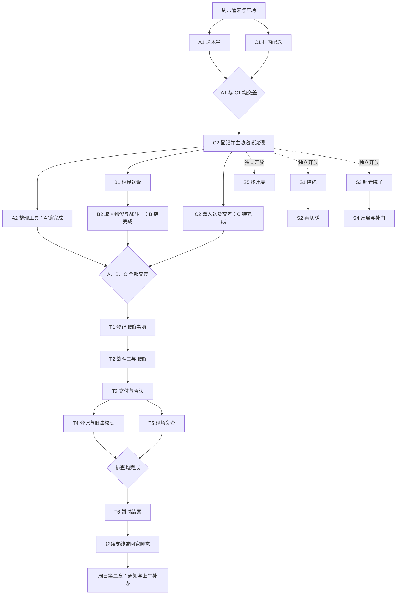

# 第一章细案：周六的委托与旧工具箱

> 2026-09-14 后续更新：[醒来与正式村庄探索](../engineering/village-wake.md)已接入。两条梦境路线均可进入住宅和村庄，并保存位置与门灯；第一章委托、居民与第二章仍未接入。本文原制作／设计轮的“独立预览、止于 ExitOpened、仅文档、存档不变”等范围描述保留为当轮事实，由该后续接入说明补充现状。

> 2026-09-13 批准叙事与任务编排，2026-09-14 更新村庄／森林地点安排。第一章详细设计统一维护在本文；人物约束见[剧情圣经](story-bible.md)，章节关系见[剧情流程](story-flow.md)，运行事实见[当前实现](../engineering/current-implementation.md)。本文不是可玩内容或最终对白。

## 状态与交付边界

- `[固定约束]` 本次只更新 Markdown；程序、JSON、对白文件、本地化、场景、资产、存档、稳定 ID 和内容版本 6 不变。当前成功路线仍止于 `ExitOpened`，刺醒仍为 `CompletedPin`，两者均未接入新第一章。
- `[计划]` 第一章在同一个周六，先完整经历正常生活，最后通过工具箱事件留下无法解释的疑惑。第二章周日早上收到下午返校处理临时事务的通知，上午可继续剩余事项。
- `[固定约束]` 主角先独自行动，在前中期主动邀请沈砚；晓雨第一章现实不出场、不远程指导。梦的模糊余韵不提供现实调查线索。
- `[固定约束]` 父母失踪真相、工具箱与委托的来源、长期主线和周日下午学校事件是**有意留白**，不是待作者自行补齐的谜底。“有意留白”是说明，不新增第五种文档状态标签。
- `[可调整草案]` 下列委托名称、配角职务分配、工具细节、对白示例与动物遭遇用于开始场景写作；具体姓名、年龄数字、外地地名、数值和资产另行细化。文档内 A1 等编号仅供阅读，不是运行时 ID。

## 活动区域与地点调整（2026-09-14）

`[固定约束]` 第一章活动范围为村庄及附近森林；村内没有敌对遭遇，允许村民自愿陪练。B 链改为林缘劳作链：B1 送饭、B2 取物都去森林入口以内的劳作点，山猴遭遇在森林；T2 的野猪遭遇与工具箱小屋同样在森林。取物后 T5 复查同一森林现场，不重复战斗。

`[计划]` 本轮先设计[村庄外景](village-exterior.md)，沈砚在活动室门前受邀，修理铺整理及验箱、杂货铺装卸都在外部工作区进行；送凳／配送／家禽院落的建筑映射见外景细案，不分配住户姓名。森林路线、劳作内容、小屋构造与箱子具体摆放另轮设计，当前纸条只保留指路信息要求，不擅自填入新地标或小屋内部结构。

`[固定约束]` 本次替代 09-13 的“山脚农活／田边山猴”和“北坡旧线路附屋取箱”地点草案。已有村庄预览中的铁路附屋保留为普通村景，与森林工具箱小屋没有预定联系；后者并非当前已开放建筑。六项必要委托、五项支线、两场必经动物战、三链解锁与无解收尾不变。

## 人物与生活基础

`[固定约束]` 主角一直生活在村中，在附近学校读高中，熟悉村庄、村民和正常生活习惯。父母两年前外出务工后失踪；他独自居住，村中长辈照应，平日放学及周末帮忙挣钱。此前积蓄暂时够生活；本章不扣生活费、不设最低收入或挣钱门槛，报酬供装备、治疗物品等使用。

`[计划]` 村民知道他的难处，专门留些力所能及的事情；广场的牌子和村长代管酬金是早已存在的日常。关照通过留饭、备好工具、合理安排差事表现，不反复讲述苦难，不让所有活都变成假装需要帮忙。主角确实交付劳动成果，并且懂得回应关照。

| 人物 | 本章作用与动机 | 写法边界 |
| --- | --- | --- |
| 主角 | 独自安排周末差事，主动邀请好友；发现与亲历不符的情况后愿意核实 | 保留观察、倾听、谨慎；成长从熟悉的事务走向承担陌生问题的不确定性，不写成此前从不帮人的旁观者 |
| 沈砚 | `[可调整草案]` 周末有空，想攒钱添置修理工具；答应共同送货并分享报酬，后续结伴 | 有玩笑、手艺、不同判断；加入无恋爱/高关系门槛，怀表不发挥超自然功能 |
| 乔姨 | 安排小额订货配送与双人搬运，方便村中住户，也让主角挣到钱 | 了解生活、讲信用；不再承担旧求助信收信人职责 |
| 彭师傅 | `[可调整草案]` 经营修理铺，处理积活；章末认出早年遗失的工具箱 | 本轮确定用作工具主人；不绑定旧公司或父母失踪，不装作忘记已知事实 |
| 村长 | 提供日常照应、登记事项、保管酬金、核实交差与结款 | 固定地点在广场附近；如实交代登记经过，不靠失忆或拒绝合作阻碍排查 |
| 林缘劳作村民、陪练村民、邻居、失主 | 各有真实日常需求，对已完成事情给出反馈 | 先使用职能称呼作为文档草案，不创建角色 catalog 或占用稳定 ID |

## 章节节拍与时间

`[计划]` 阶段由关键事情推进，站立、走路、战斗失败或做支线都不会把周六耗尽。下列时间是叙事阶段，不是现有 Legacy 移动计时规则的改名。

| 阶段 | 进入条件 | 剧情与开放事项 |
| --- | --- | --- |
| 早晨·独自办事 | 怪梦醒来 | 洗漱、简单早餐，少量生活交互后去广场。只开放 A1 修理铺送凳、C1 杂货铺配送，顺序任选；用一次正常投递演示收件箱 |
| 午间·找好友 | A1 与 C1 均已交差 | C2 双人送货事项出现，主角去活动室门前主动邀请沈砚；可以先查看说明，再找人，不强制远程入队 |
| 下午·结伴日常 | 沈砚接受邀请 | 开放 A2、B1、C2 执行及全部支线起点；B1 交差后开放 B2。可交错完成，也可暂时去做支线 |
| 下午稍晚·远路取物 | A、B、C 三链均交差收尾 | 村长整理收件，登记 T1；主角自行查看接取。已挣报酬是否领取不构成条件 |
| 傍晚·排查 | 箱子取回并交付 | 对照陈述与实物，完成登记、旧事和现场核实，仍无有效去向；进入自由收尾 |
| 傍晚·自由收尾 | T6 暂时结案 | 保留支线入口、结款与购物；主角可回家结束当天，明示进入周日第二章 |

`[计划]` 两件开场短活必须独自完成；邀请不是自动剧情传送。拒绝或中断邀请只表示暂缓，可回去再谈；沈砚接受后，当天任务中的合作可持续使用。模态、暂离及恢复不重复邀请或修改关系。本章前中段没有异象，不能给日常工具、野生动物或沈砚动作添加异常特效。

## 广场委托规则与示例

`[计划]` 村民可当面交付委托和酬金；村长不在时，也可将署名纸条和酬金装入信封，投到固定收件箱。村长整理后登记到牌子。开场让主角看见乔姨正常投件、村长正常登记，建立惯例；该正常投件不是工具箱委托。

`[计划]` 玩家看到具体事项、署名委托人、地点、约定报酬及注意事项，已接事项提供当前行动信息。不显示主支线分类、链名、链编号、前置条件、百分比或“完成三条链解锁”。未开放事项不以带锁格子预告。村民可以自然说明“货到了再托你跑一趟”。

`[计划]` 接取后在个人事项记录中保留内容，牌上可标为已有人接手；完成交差后撤下，后续独立登记。交差确认劳动结果并产生一次应付报酬，村长统一结款；可积攒后一次领取。登记、完成与领取分别防重复，领取不决定后续开放。同行分酬在接取双人差事时说明，任务板展示玩家可得份额；不临时扣掉已承诺给玩家的钱。

`[可调整草案]` 任务板措辞示例（方括号中的报酬为文档占位，实际数值待经济设计；不写入游戏数据）：

> **送一张修好的木凳**  
> 彭师傅：木凳修好了，帮我送回住宅巷那户邻居家。先到铺前待领区取，送到后回来告诉我一声。报酬：[单人短差报酬]。

> **搭把手送米面**  
> 乔姨：这一批东西有些重，需要两个人一起送。到店前交货区核对住户和份数，推车已经备好。报酬：[玩家份额；另付同伴份额]。

> **森林小屋取工具箱**  
> 署名彭师傅：请把森林小屋里的旧铁皮工具箱带回修理铺。[前往路线与箱子具体位置：森林设计完成后补入。]箱子提手缠着旧布。路远，找个人一起去。报酬：[双人远路差事的玩家份额]。

上述方括号为作者待补项，不是玩家会看到的正文。正式制作前纸条必须给出可辨认的路线和放置位置；本轮不为补齐示例预定森林地标或屋内木架。

工具箱纸条没有“求救”“秘密”“只准你来”或截止倒计时。委托中的物件外观用于找对箱子，身份认定依靠后续私人修补痕迹与彭师傅陈述。

## 必要委托场景卡

`[可调整草案]` 六项委托构成三条独立日常链。每项具备自己的生活结果，不通过异常线索串联。共通规则：取消对白不算交差；完成实物劳动后允许恢复到交差步骤，不重做或复制物品；物品无法误售、永久丢弃而卡住主线。下表的结果是未来叙事状态语义，不是已创建的状态键。

| 编号与事项 | 入口、人物动机、玩家可见事项 | 行动与选择 | 交差结果与后续条件 | 中断或失败后的继续 |
| --- | --- | --- | --- | --- |
| A1 送还木凳 | 开场牌子；彭师傅积活需要送回，邻居确实在等 | 去铺前待领区取凳、确认收件住户、选择巷道路线；与邻居简短交流后送达 | 邻居收到修好的凳子；向彭师傅交差，登记应付报酬。与 C1 均完成时进入邀请阶段 | 找错户获得方向说明，不丢物；送达后中断可直接回来交差 |
| A2 整理工具 | A1 完成且沈砚已加入后登记；彭师傅要整理混放的工具与待修物件 | 在铺前有顶工作区对照标签、器具用途和修补痕迹分类；可询问，不靠大学专业知识；沈砚可提出实用判断 | 工作台腾出、物件归位，A 链收尾。见过彭师傅常用的修补手法，但不展示章末箱子或异常 | 放错自然纠正，可再次观察；不扣必需报酬，不会永久毁坏物件 |
| B1 林缘送饭 | 沈砚加入后登记；在森林入口以内林地劳作的人不便回来 | 取饭和用品、沿路认地标、到森林内的林缘劳作点确认收件；回村交差 | 村民收到物资，主角认识存放点与路线；劳作结束后托村长登记 B2 | 走错路可回到已知路口；不因自由探索导致食物超时、NPC 永久离开 |
| B2 取回物资 | B1 交差后登记；村民收工，物资尚留在森林内的劳作点 | 去森林内存放点辨认物资；山猴被食物吸引而靠近，进入战斗一；保护搬运并赶开动物后带回 | 物资送回村民，B 链收尾；野生动物事件按普通原因解释 | 战败可即时重试或撤退准备；劳动成果在战斗完成后确认，不消耗关键任务物资；胜利后不再刷遭遇 |
| C1 村内订货 | 开场牌子；乔姨有数份小额订货待送 | 到店前交货区核对份数，按任意住户顺序配送；收件人反馈生活近况，主角认识委托制度 | 订货送达，向乔姨交差，登记应付报酬。与 A1 均完成后登记 C2 | 剩余配送清楚记录，不因取消或重复交谈重复交货、结款 |
| C2 双人送货 | A1、C1 完成后登记；乔姨备好米面和推车，需要两人 | 主角到活动室门前主动找沈砚说明工作与分酬；他有空且想添工具而接受。加入后可与 A2、B 链交错；两人核对货物、选择可通行路线、合作搬运 | 米面送到、推车归还，C 链收尾。建立正常合作与玩笑，邀请本身不算整件差事完成 | 暂缓邀请可再谈；运输中断保留已交货物和待办项。低关系、未做支线也有基本合作路径 |

`[可调整草案]` 邀请时沈砚在活动室门前的小桌旁摆弄便携小工具，先确认自己有空，再问送到哪里、两人怎么分。他可以打趣“说好了，最沉的那袋别留到最后才想起我”，收好工具后到杂货铺装货区主动检查推车轮轴。通过行动表现手艺，不插入解释怀表力量的剧情。

## 独立支线场景卡

`[计划]` 沈砚加入后开放 S1、S3、S5；S2、S4 只依赖各自前项。五项均为有限手工内容，完全跳过也能完成第一章。周六未接起点与已接进度在周日上午继续可用；保留原劳动结果、关系反馈和结款状态。

| 编号与事项 | 入口、人物动机、玩家可见事项 | 行动与选择 | 交差结果与后续条件 | 中断或失败后的继续 |
| --- | --- | --- | --- | --- |
| S1 陪人打拳 | 牌子；村民想活动筋骨找人陪练 | 在活动室旁独立空地约好点到为止，参与一场切磋；可听战斗操作说明 | 完成整场陪练即可领取基本报酬；胜负影响评价/额外奖励，开放 S2 | 输掉也算完成；主动提前退出可再约，无主线影响 |
| S2 再练一回 | S1 后登记；村民想练上次不顺的步法 | 在同一空地做短练习，再切磋一次，可采用不同战术 | 支线链结束，有新的评价与有限报酬；不生成无限邀约 | 失败仍可交差，中断可恢复；未做不影响基础可胜路线 |
| S3 照看院子 | 牌子；邻居忙于家务，需要人浇水、喂家禽 | 先确认工具和份量，完成照料，发现独立禽栏的普通松动门闩并告知邻居 | 邻居得到帮助；随后家禽从松动处跑出，登记 S4，问题来源明确且不归咎主角 | 漏做可核对补做，不因经过现实时间发生动物死亡或主线处罚 |
| S4 找回家禽并补禽栏门 | S3 后登记；邻居希望找回家禽并修好禽栏门闩 | 询问附近人、在村内院墙边与近邻菜畦沿叫声找寻，温和引回，借工具补好禽栏门；住宅院门始终可通行 | 家禽归院、门闩固定，支线链收尾；邻居具体致谢 | 寻找进度保留，错误方向可折返，不引入必胜战斗或异象 |
| S5 溪边的水壶 | 牌子；村民沿途歇过脚，丢了常用水壶 | 问清行走路线，查看溪岸陆地侧休息处，对照普通外观找回，不涉水 | 物归原主，独立结款；练习询问与观察，没有隐藏主线奖励 | 找错物件能纠正；已拾取则只需交还，不重复生成 |

## 战斗场景卡

`[固定约束]` 主路径两处必须经历战斗，不新增随机遭遇和刷怪。允许撤退准备与重试，不能用低关系、未做陪练或无钱购买装备锁死主线。非致命情境目标沿用玩法基线；本轮不确定回合、数值、技能表或战斗引擎改造。

| 场景 | 入口与动机 | 玩家行动与选择 | 结果与后续 | 中断/失败 |
| --- | --- | --- | --- | --- |
| 战斗一·森林林缘山猴 | B2 在森林内取物，食物气味引来山猴，动物争抢并阻挡搬运 | 观察靠近方向、护住物资、配合驱退；胜利为动物退开且可以搬运 | 解锁本次搬运，普通动物行为，不发现异常痕迹 | 战前有安全准备位置；失败即时重试或撤退，关键物资不永久消耗，完成后不重复战斗 |
| 战斗二·森林野猪 | T2 森林路上，野猪因幼崽在附近表现出防御性 | 掩护同伴、拉开距离并使其离开通路；不以杀死动物或伤害幼崽为目标 | 安全通行到森林小屋；复查现场不再次生成本场战斗 | 战败、模态中断和撤退恢复至安全入口；可回村补给，基础配置也可胜 |

`[计划]` 治疗物品和装备可用报酬购买，但不设购买门槛或额外必做支线。故事模式、战前检查点和重试应提供稳定继续路径；未来经济平衡须检验“无支线、基础配置”通过两战，而不是靠无限挣钱补救。

## 章末工具箱场景卡

`[固定约束]` 箱子早年遗失在外地，如今出现在附近森林的小屋；第一章正常核实后查不出有效去向。彭师傅的日常生活正常、可当面询问。外地不命名，不设为父母失踪地或未来目的地。箱中只有普通工具，没有求助信、秘密日记、受困对象、组织标记或新地址。

`[可调整草案]` 箱子为旧铁皮工具箱，提手缠布、箱扣曾补铆钉；内有一件带私人刻记的旧扳手。存在普通锈迹、灰尘和老化，不是崭新的时间复制品。彭师傅陈述它在多年前外地工作搬迁时遗失，没有发现下落；不伪造完美证明来排除所有普通解释。

| 编号与场景 | 入口、人物动机、玩家可见事项 | 行动与选择 | 结果与后续条件 | 中断或失败后的继续 |
| --- | --- | --- | --- | --- |
| T1 登记并接取 | 三链完成，村长整理收件箱；署名彭师傅，酬金合理，指向森林小屋 | 查看纸条，问村长路程；主角认识署名人，与沈砚约好取物 | 记下具体位置、物件外观、交付对象，开放 T2；是否领取其他报酬无关 | 未接可稍后查看；接取中断不复制信封、钱或任务 |
| T2 远路取箱 | T1 接取；两人从村庄出发，沿熟悉的前段路进入森林 | 通过战斗二，按正式纸条指路到普通森林小屋；小屋无另需追查的神秘钥匙，查看后取出箱子 | 亲历“箱子确在纸条描述处”；返回交付，不提供梦境印记或异象演出 | 迷路可沿路返回；提前探索仅认识地点，本次取物交互随委托开放，不能提前完成；取出后不再复制 |
| T3 交付与否认 | 返回修理铺；主角交差，彭师傅最初以为拿错别人的东西 | 看箱扣、工具刻记，听他说明没有委托及外地遗失经历；允许追问身份判断依据 | 开放登记与现场核实。普通交付变为疑问，人物都认真配合 | 取消后继续同一交付过程，不重复取箱；先前问过则用“现在拿回了实物”推进，不再次假装初闻否认 |
| T4 核对登记与旧事 | T3 后；村长愿意查，彭师傅愿意说明 | 核对原纸条、酬金记录与收件办法；检视普通工具，听取遗失情况，各项顺序任选 | 确认村长按投件登记、未见投件人；无可追踪地址，笔迹也不能认出来源。旧事只有相关陈述，没有新的联系人或去向 | 已问项目记录保留，不要求重复问话；没有靠 NPC 不在或遗忘阻碍进展 |
| T5 复查森林小屋 | T3 后可做，与 T4 顺序任选；两人想知道有谁把箱子留在那里 | 回到森林现场检视原放置处、入口与周边道路（具体构造待森林设计）；不用再战斗二 | 森林小屋为可供普通人放东西的闲置场所，杂乱旧脚印不能辨人或确定放置时间；没有有效方向 | 允许回村后再查，中断后继续；检查范围明确，不要求逐像素找不存在的线索 |
| T6 暂时结案 | T4 全部核实、T5 复查完成 | 主角、沈砚、彭师傅确认暂时没法再查；彭师傅保管箱子，村长留下原纸条并办理取物结款 | 第一章实质结束，工具主人与主角仍疑惑；约定有消息再告诉主角，开放自由收尾与睡眠 | 结算和报酬各一次；取消不结束章节；不强制睡觉或清空支线 |

`[计划]` 主路径在取回后发生否认。若玩家 T1 后提前询问彭师傅，他如实否认；村长说明委托确实已登记，主角与沈砚决定去核对描述具体的地点。报酬仍由预存酬金结算，不让彭师傅为陌生委托额外付款。不管先问还是后问，都不能恢复旧求助信或改成他联系不上。

`[可调整草案]` 结尾人物反应：彭师傅看着旧工具想不起谁可能带回；沈砚对投件和搬运过程有疑问，承认暂时想不通；主角把亲历与猜测分开记下。无幕后人镜头、惊吓尾声、突发失踪或必须立刻出村的命令。

### 记录与悬念边界

| 内容 | 记录方式 | 不得推导 |
| --- | --- | --- |
| 主角按纸条在森林小屋取到箱子 | 亲历事实 | 不等于箱子自行出现 |
| 彭师傅否认委托、认出刻记并讲述遗失 | “彭师傅这样说”的已确认谈话事实；陈述内容注明来源 | 不将多年前经过视为主角亲眼验证，更不直接确认超自然 |
| 原委托、箱扣和刻记 | 可出示的纸条/实物证据，注明村长/彭师傅保管；记录可回看 | 不为方便再创建同义的事实与线索 ID |
| 登记经过、旧物来历、取物现场 | 曾可调查的方向，核实后标为本章已查尽 | 结案后不继续显示虚假的有效任务目标 |

## 后台依赖与恢复

`[计划]` 此图仅供作者和未来实现者，不向玩家显示。A、B、C 是各链最后交差结果；不读取支线完成数、钱数或已领报酬数。

| A 完成 | B 完成 | C 完成 | 工具箱事项可登记 |
| --- | --- | --- | --- |
| 否 | 否 | 否 | 否 |
| 否 | 否 | 是 | 否 |
| 否 | 是 | 否 | 否 |
| 否 | 是 | 是 | 否 |
| 是 | 否 | 否 | 否 |
| 是 | 否 | 是 | 否 |
| 是 | 是 | 否 | 否 |
| 是 | 是 | 是 | 是，仅登记一次 |

`[计划]` 支线和结款任意变化都不改变本表。完成条件满足后，新委托在主角下次回广场与村长整理收件时可见；不要求再睡一天，也不额外刷一个任务。关闭面板、其他模态、晚到、暂缓邀请、撤退与读取中断后的进度均有继续入口。未来存档只持久化必要剧情结果；具体字段和迁移待运行时方案，不能借文档编号占用旧 ID。

## 自由收尾与第二章接口

`[固定约束]` 完成排查即为本章实质结束，主角可以继续做支线，也可直接回家睡觉。睡眠前清楚提示“结束周六，进入第二章”，不要求领完钱或完成所有委托。此前在家可以短暂休息，但“结束当天”只在结案后开放；不得靠循环睡眠跳过必要链。

`[计划]` 周日早上，主角接到下午回学校临时处理事情的通知。消息发送者、具体理由和学校事件留给第二章，不以工具箱或父母失踪作为默认原因。上午继续周六剩余事项，至少保留未接支线起点、已接/已完成劳动/待交差/待结款状态；已领奖不再发奖，已完成事项不重新发布。上午活动不因普通步行自动耗尽；下午的切换及之后事项去留须在第二章设计中明确并事先告知玩家。

`[固定约束]` 前两章仍以村庄及周边为主，学校属于附近的生活圈。后续逐渐走向外地，但不预定工具箱来源地为目的地，不把父母失踪立即写成主线，也不预定晓雨的现实出场场景。

## 下一步写作与制作门槛

`[计划]` 本文已提供场景写作起点。下一步可依场景卡写角色对白和交互节奏草稿；工具箱谜底、第二章学校事件与长期主线继续有意留白。文本稿首先复核自然动机、不同任务顺序和玩家已知信息，再细化数值与资源。

正式接入前按[内容制作规范](../engineering/content-authoring.md)单独确定事件原子结果、稳定 ID、角色/日程/地点定义、任务板与结款接口、阶段时间和梦境成功/刺醒的承接方案。当前内容版本和梦境结算均不改；不制作占位 JSON、对白或存档字段。共享状态归属继续遵守[架构](../engineering/architecture.md)。

### 叙事验收场景

- 两种开场顺序均先独自办两件事，再由主角主动邀请；中途拒绝后仍能回来邀请。
- A2、B1→B2、C2 可交错完成；三链八种组合仅全真登记工具箱，重复回广场不重复登记。
- 完全跳过支线、不领取先前报酬、低关系与基础配置仍能完成主路径；两次战败均可撤退重试。
- 提前问彭师傅如实否认；通常先取再问，两路最终核实内容一致且不伪造遗失证明。
- T4 与 T5 两种顺序均能结案；每项排查有信息收获，但不留下虚假的有效方向。
- 重复交差、取消结算和跨章恢复均不复制物品、推进或报酬；结案后既可继续支线也可睡觉。
- 周日恢复未接支线、部分完成支线、已完成待领报酬三类状态，均不重置；学校下午内容不提前填入第一章。
- 正常生活无异象，动物无异常强化；梦境余韵、父母失踪、怀表及外地地名不成为预定谜底。

实际文档检查与现有测试结果见[本轮验收记录](../production/chapter-one-doc-validation.md)；纸面走查不等于可玩章节测试、玩家盲测或图形验收。
