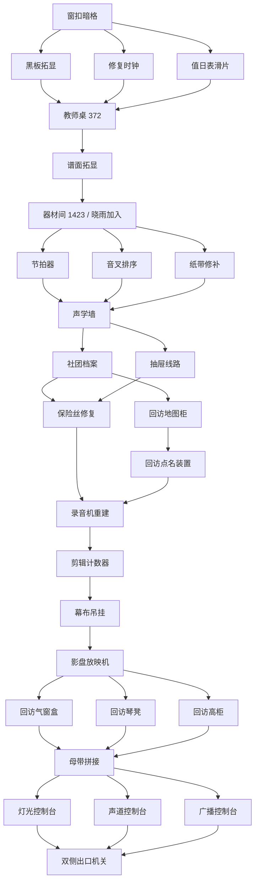

# 四室梦境密室 v2 设计冻结

> `[可调整草案]` 历史归档：当前运行时已切换为[序章 v4／内容版本 6](dream-escape-v4.md)，本文件的数量、回访与答案不再作为当前规则。

> 文档状态：`[已实现·历史冻结]`。设计冻结日期：2026-08-29；本文记录内容版本 4 的既有方案，第三/第四室 2D 表现、社团排序和幕布顺序已由 [v3 设计冻结](dream-escape-v3.md) 取代。不得据此把旧 ID 重新接回当前运行时。

## 目标与固定边界

- 保留第一室·旧教室、第二室·音乐教室、第三室·档案兼广播室、第四室·旧礼堂，以及稳定区域 ID `dream.classroom`、`dream.music`、`dream.archive`、`dream.auditorium` 和 `dream.corridor`。
- 首次无提示通关目标为 90–120 分钟。结构是依次开放房间的半开放网络；每阶段提供 2–4 个可并行目标，并包含两次有明确收获的短回访。
- 共 34 件实际进入梦境背包的道具、28 个可结算谜题。实体安装、旋钮、连线、透光、测量和声音机关约占七成。
- 第一室只有主角。第二室救出林晓雨后才出现“与晓雨商量”和三级无惩罚提示，并在后续安排四个无时间压力的必要协作机关。
- 错误答案、错误道具、错误区域和重复操作均不消耗道具、不改变机关状态。只有成功改变状态的操作触发自动保存。
- 普通道具无需预先选中；检查机关时自动应用背包内全部匹配部件，多槽机关在齐全后同次继续操作。背包只负责查看物品、记录、晓雨提示和大头针独立操作。
- 校庆母带碎片在复原前完全无法播放；复原后只播放稳定白噪声，不含语音、音乐、密码、频谱暗文或后半段主线信息。
- 成功路线只留下一个无法解读的封存载体。前半段不把它登记为 `Fact`、`Evidence` 或 `Lead`，不提供解码入口；正式正文和解码条件属于后半段剧情。
- 大头针刺醒、梦境/现实背包隔离、已开放房间可回访、成功前不揭示梦境等既有边界保持不变。

## 总体依赖图

这张图没有必须依靠尚未开放区域的循环。两次回访分别在 `A1` 和 `U2` 后开始，且所有目标都位于已开放区域。

## 房间剧本与谜题规格

### 第一室：旧教室

主角在陌生旧教室中醒来。开场不出现“梦境”“醒来”或跳过提示，也不自动开放谜题提示。第一室承担移动、观察、拾取、安装、使用场景道具和密码输入的教学职责。

| # | 稳定谜题 ID | 操作与固定解 | 前置与结果 |
| --- | --- | --- | --- |
| 1 | `dream.classroom.window_latches` | 后排左侧课桌维护卡记录三幅“上—下—中”磨损示意；西墙窗扣按记录调整。 | 线索与机关相距至少 2 米，调查为推荐线索而非强制门槛；机关完成后打开暗格，取得粉笔、上弦钥匙和值日表滑片。 |
| 2 | `dream.classroom.blackboard` | 对黑板使用粉笔，拓显“窗—钟—值日表”。 | 完成窗扣；记录观察顺序，粉笔保留给第二室。 |
| 3 | `dream.classroom.clock_restore` | 安装地面拾取的黄铜时针和上弦钥匙，将时钟恢复到 `7:00`。 | 完成窗扣并持有两部件；部件转为已安装状态，记录数字 7。 |
| 4 | `dream.classroom.roster_slider` | 插入滑片并对齐表格破损边，确认红圈落在第 `2` 项。 | 完成窗扣；滑片转入记录，记录数字 2。 |
| 5 | `dream.classroom.teacher_desk` | 按黑板顺序输入 `372`。 | 黑板、时钟和值日表均完成；取得第二室钥匙。 |
| 6 | `dream.classroom.map_cabinet` | 使用第三室取得的三角维护钥匙打开地图柜。 | 完成社团档案；取得全班合影底片和点名孔卡。 |
| 7 | `dream.classroom.transom_cache` | 使用第四室取得的舞台钩杆拉下高处气窗盒。 | 完成影盘放映机；取得教室剪带。 |

### 第二室：音乐教室

进入后约五分钟内可以救出林晓雨。双方只交换姓名并确认都不知道这里是什么地方；晓雨不预设亲密、敌意或现实旧识。救出后开放提示页。

| # | 稳定谜题 ID | 操作与固定解 | 前置与结果 |
| --- | --- | --- | --- |
| 8 | `dream.music.score` | 用剩余粉笔拓显凸起谱线，读出 `1—4—2—3`。 | 第二室开放；记录音板顺序，粉笔在最后用途后移出背包。 |
| 9 | `dream.music.cage` | 按 `1423` 操作器材间音板。 | 完成谱面拓显；救出晓雨并开放提示。 |
| 10 | `dream.music.metronome` | 安装摆锤，按排练通知和刻度将速度调到 `72 BPM`。 | 晓雨加入；记录四拍重音，摆锤转为已安装。 |
| 11 | `dream.music.tuning_forks` | 使用橡胶音槌和共鸣听筒，按衰减与波形排列 `A3—C4—E4—A4`。 | 晓雨加入；记录音高顺序，音槌和听筒完成最后用途后移除。 |
| 12 | `dream.music.piano_roll` | 用蜡纸修补条按裂口吻合关系 `2—4—1—3` 修复纸带。 | 晓雨加入；记录孔位节奏，纸带安装、修补条消耗。 |
| 13 | `dream.music.acoustic_wall` | 综合三项记录排列“木鱼—钢琴—三角铁—手铃”；晓雨负责确认隐藏低频。 | 节拍器、音叉和纸带均完成；取得第三室钥匙。 |
| 14 | `dream.music.attendance_reader` | 叠放合影底片、点名孔卡和红色滤尺，输入 `B2—D1—A3—C4`。 | 完成地图柜；取得校准带盘和录音机摇柄，三项载体转入记录或移除。 |
| 15 | `dream.music.piano_bench_cache` | 使用第四室取得的琴凳夹钥松开隐藏夹锁。 | 完成影盘放映机；取得音乐室剪带。 |

### 第三室：档案兼广播室

社团档案、抽屉线路和可见拾取的档案索引条构成并行区。完成社团档案后，晓雨明确提出旧房间中的三角锁和滤色装置可能有了答案，触发第一次回访。

| # | 稳定谜题 ID | 操作与固定解 | 前置与结果 |
| --- | --- | --- | --- |
| 16 | `dream.archive.club_order` | 按使用房间的最早时间排列“合唱—广播—美术—田径”。 | 第三室开放并观察规则；取得维护钥匙、红色滤尺和陶瓷保险管。 |
| 17 | `dream.archive.drawer_route` | 用档案索引条将抽屉节点连为 `C1—A4—D2—B3`。 | 第三室开放；取得漆包铜线和接带胶。 |
| 18 | `dream.archive.fuse_repair` | 将铜线按“左—中—右”桥接保险管，生成修复保险丝。 | 持有保险管和铜线；两部件被替换为修复保险丝，组合产物先进入背包。 |
| 19 | `dream.archive.recorder_rebuild` | 安装校准带盘、摇柄和修复保险丝；晓雨持续保持带盘张力。 | 完成点名装置和保险丝修复；记录机械停点与四个图标。校准带不播放母带内容。 |
| 20 | `dream.archive.editing_counter` | 按机械停点输入 `12—24—31—45`，并核对“幕布—时钟—校铃—点名册”图标。 | 完成录音机重建；取得第四室钥匙，索引条在最后用途后转入记录。 |
| 21 | `dream.archive.upper_vault` | 使用第四室取得的折角检视镜观察高柜背锁并拨开卡舌。 | 完成影盘放映机；取得档案室剪带。 |

### 第四室：旧礼堂

礼堂先开放幕布与投影设备，随后发放三件用途清晰的回访工具。三段剪带在取得前和单独持有时均不可放入任何播放器。

| # | 稳定谜题 ID | 操作与固定解 | 前置与结果 |
| --- | --- | --- | --- |
| 22 | `dream.auditorium.curtain_fly` | 安装幕布配重块，按磨损轨迹 `C—A—D—B` 穿过滑轮。 | 第四室开放；升起主幕，露出放映区。 |
| 23 | `dream.auditorium.shadow_projector` | 安装放映镜头，将三组影盘对齐为“窗格—人物—校铃”。 | 完成幕布吊挂；取得舞台钩杆、琴凳夹钥、折角检视镜和空母带盘芯。 |
| 24 | `dream.auditorium.master_tape_splice` | 按“教室—音乐—档案”排列三段剪带，用接带胶和盘芯拼成复原母带。 | 三处回访缓存均完成；生成复原母带并立即允许安装。播放结果只有稳定白噪声。 |
| 25 | `dream.auditorium.light_console` | 把 `372` 转换为三组遮光片高度；晓雨在舞台标记处确认投影重合。 | 复原母带开始播放；完成灯光通路。 |
| 26 | `dream.auditorium.sound_console` | 按“木鱼—钢琴—三角铁—手铃”连接四条声道。 | 复原母带开始播放；完成声学通路。 |
| 27 | `dream.auditorium.broadcast_console` | 按“幕布—时钟—校铃—点名册”排列广播通路。 | 复原母带开始播放；完成广播通路。 |
| 28 | `dream.auditorium.exit` | 先请晓雨持续按住舞台左侧机关，再由主角操作控制室总闸。 | 三台控制台均完成；出口开启。没有精确同步或限时失败。 |

## 四个必要协作机关

1. `dream.music.acoustic_wall`：晓雨辨认主角听不见的低频，但答案仍由玩家提交。
2. `dream.archive.recorder_rebuild`：晓雨保持带盘张力，玩家安装与启动设备。
3. `dream.auditorium.light_console`：晓雨站在舞台标记处报告投影是否重合，玩家调整控制台。
4. `dream.auditorium.exit`：晓雨持续按住左侧机关，玩家可自由移动到右侧总闸；不做反应速度考验。

协作只在玩家明确发出指令后开始，不自动替玩家解题。晓雨会一直保持当前协作动作，直到谜题完成、玩家取消或离开区域。

## 34 件道具生命周期

所有列出的项目都必须至少一次实际进入 `DreamEscapeState.Items`。安装件进入机关后转为已安装状态；组合产物先进入背包，不能在服务内部直接从原料跳到完成机关。

| # | 道具 ID | 取得位置 | 最后用途与移除时机 |
| --- | --- | --- | --- |
| 1 | `dream.pin` | 初始背包 | 成功结算或刺醒时随梦境背包清空。 |
| 2 | `dream.chalk` | 第一室窗边暗格 | 完成第二室谱面拓显后移除。 |
| 3 | `dream.clock_hand` | 第一室时钟下方拾取 | 安装到时钟后移出背包。 |
| 4 | `dream.clock_key` | 第一室窗边暗格 | 安装到时钟后移出背包。 |
| 5 | `dream.roster_slider` | 第一室窗边暗格 | 完成值日表后转入梦中记录。 |
| 6 | `dream.room_two_key` | 第一室教师桌 | 成功打开第二室门后消耗。 |
| 7 | `dream.class_photo_negative` | 第一室地图柜 | 完成第二室点名装置后转入梦中记录。 |
| 8 | `dream.attendance_overlay` | 第一室地图柜 | 完成第二室点名装置后转入梦中记录。 |
| 9 | `dream.tape_fragment_classroom` | 第一室气窗盒 | 拼接复原母带时消耗。此前不可播放。 |
| 10 | `dream.rubber_mallet` | 第二室器材架拾取 | 完成音叉排序后提示无其他用途并移除。 |
| 11 | `dream.listening_cone` | 第二室讲台拾取 | 完成音叉排序后提示无其他用途并移除。 |
| 12 | `dream.metronome_weight` | 第二室钢琴下拾取 | 安装到节拍器后移出背包。 |
| 13 | `dream.torn_piano_roll` | 第二室纸带柜拾取 | 完成纸带修复后安装到播放器。 |
| 14 | `dream.wax_patch` | 第二室乐器维修盒拾取 | 完成纸带修复后消耗。 |
| 15 | `dream.room_three_key` | 第二室声学墙 | 成功打开第三室门后消耗。 |
| 16 | `dream.calibration_reel` | 第二室点名装置 | 安装到第三室录音机后移出背包；不是母带碎片。 |
| 17 | `dream.recorder_crank` | 第二室点名装置 | 安装到第三室录音机后移出背包。 |
| 18 | `dream.tape_fragment_music` | 第二室琴凳 | 拼接复原母带时消耗。此前不可播放。 |
| 19 | `dream.maintenance_key` | 第三室社团档案柜 | 打开第一室地图柜后提示无其他用途并移除。 |
| 20 | `dream.red_filter` | 第三室社团档案柜 | 完成第二室点名装置后转入梦中记录。 |
| 21 | `dream.archive_index_strip` | 第三室入口档案台拾取 | 完成剪辑计数器后转入梦中记录。 |
| 22 | `dream.fuse_tube` | 第三室社团档案柜 | 保险丝组合成功时移除。 |
| 23 | `dream.copper_wire` | 第三室线路抽屉 | 保险丝组合成功时移除。 |
| 24 | `dream.repaired_fuse` | 第三室保险丝组合产物 | 安装到录音机后移出背包。 |
| 25 | `dream.splicing_tape` | 第三室线路抽屉 | 拼接复原母带时消耗。 |
| 26 | `dream.room_four_key` | 第三室剪辑计数器 | 成功打开第四室门后消耗。 |
| 27 | `dream.tape_fragment_archive` | 第三室高柜 | 拼接复原母带时消耗。此前不可播放。 |
| 28 | `dream.stage_hook` | 第四室影盘放映机 | 拉下第一室气窗盒后提示无其他用途并移除。 |
| 29 | `dream.bench_clamp_key` | 第四室影盘放映机 | 打开第二室琴凳后提示无其他用途并移除。 |
| 30 | `dream.inspection_mirror` | 第四室影盘放映机 | 打开第三室高柜后提示无其他用途并移除。 |
| 31 | `dream.curtain_counterweight` | 第四室后台拾取 | 安装到幕布吊挂后移出背包。 |
| 32 | `dream.projector_lens` | 第四室放映台拾取 | 安装到影盘放映机后移出背包。 |
| 33 | `dream.master_reel_core` | 第四室影盘放映机 | 母带组合成功时移除。 |
| 34 | `dream.restored_master_tape` | 第四室母带组合产物 | 安装到礼堂播放器后移出背包并开始白噪声。 |

## 三级提示正文

需要外部答案信息的谜题遵循“指出线索所在功能区—说明线索与机关的关系—给出近答案”；工具安装类谜题则对应为“指出工具或结构—说明用途—给出下一步”。提示不会替玩家自动操作，第三级可以明确固定顺序，因为玩家仍需亲自完成机关。

| 谜题 | 一级：目标提示 | 二级：关联提示 | 三级：近答案提示 |
| --- | --- | --- | --- |
| 窗扣暗格 | 去后排左侧课桌区找窗扣维护资料。 | 维护卡的三幅磨损示意分别对应三只窗扣的停留高度。 | 从左到右调成“上、下、中”。 |
| 黑板拓显 | 黑板上有被擦去的凹痕。 | 暗格里的粉笔可以让凹痕重新显形。 | 带着粉笔检查黑板，系统会自动使用。 |
| 修复时钟 | 去前方讲台查看晨间作息表。 | 时钟图标旁的时刻是装好时针和钥匙后应设置的值。 | 装好两件部件，再把时刻调到七点整。 |
| 值日表滑片 | 去后排右侧课桌查看值日便签。 | 便签红圈对应值日表项目，暗格滑片用于复原表格。 | 对齐后确认第二项。 |
| 教师桌 | 记录分散在黑板、维护卡、讲台作息表和后排便签。 | 按黑板顺序读取窗格数量、时钟和值日表。 | 输入 `372`。 |
| 地图柜 | 三角锁不是普通钥匙孔。 | 档案室的维护工具可能与它匹配。 | 使用三角维护钥匙。 |
| 气窗盒 | 盒子够不到，但侧面有一个金属环。 | 礼堂处理高处幕布的工具适合勾住它。 | 使用舞台钩杆。 |
| 谱面拓显 | 谱线上有与黑板相似的浅凹痕。 | 粉笔还有最后一次用途。 | 拓显后读出 `1—4—2—3`。 |
| 器材间音板 | 去西北谱面拓显台寻找音板次序。 | 拓显出的四个编号对应器材间四块音板。 | 依次按 `1、4、2、3`。 |
| 节拍器 | 去西南入口公告板查看排练通知。 | 被圈出的 BPM 是装好摆锤后应设置的刻度。 | 安装摆锤并调到 `72 BPM`。 |
| 音叉排序 | 去打开后的东北器材间查看波形/衰减对照表。 | 用听筒和音槌比较音叉，再按表换成音高文字。 | 顺序是 `A3—C4—E4—A4`。 |
| 纸带修补 | 去西侧纸带柜查看裂口模板。 | 模板编号决定四段纸带的拼合顺序，蜡纸用于固定。 | 顺序是 `2—4—1—3`。 |
| 声学墙 | 去节拍器、音叉架和纸带播放器收集三层记录。 | 依次把图形换成音高、再换成乐器；晓雨确认第四拍。 | 排成“木鱼、钢琴、三角铁、手铃”。 |
| 点名装置 | 底片本身看不清座位标记。 | 把底片、孔卡和红色滤尺叠在灯箱上。 | 输入 `B2—D1—A3—C4`。 |
| 琴凳缓存 | 琴凳下面是夹锁，不是普通锁孔。 | 礼堂放映机里的扁平夹钥适合它。 | 使用琴凳夹钥。 |
| 社团档案 | 规则牌在西墙，四张预约表分散在入口台、广播桌、画材架和器材柜。 | 按规则比较四份预约表当天最早的一栏。 | 顺序是“合唱、广播、美术、田径”。 |
| 抽屉线路 | 去入口档案台拾取独立索引条。 | 从索引条的 C1 起点沿未重复的下一站连接抽屉矩阵。 | 连成 `C1—A4—D2—B3`。 |
| 保险丝修复 | 完成分拣台后查看奖励柜中的保险丝线路图。 | 组合保险管和铜线，再按图跨过三个触点。 | 路径是“左、中、右”。 |
| 录音机重建 | 录音机缺少带盘、动力和保险装置。 | 点名柜的两件部件与修好的保险丝都属于它。 | 装入带盘、摇柄、保险丝，再请晓雨保持张力。 |
| 剪辑计数器 | 去房间另一端的计数器读取录音机记录。 | 按录音机四次机械停点的先后输入，不需要解读声音。 | 输入 `12—24—31—45`。 |
| 高柜缓存 | 正面够不到高柜背后的锁舌。 | 礼堂的折角镜可以看见并拨动背锁。 | 使用折角检视镜。 |
| 幕布吊挂 | 西南后台桌有舞台工单，配重在乐池。 | 安装配重后，按工单字母顺序在东北飞索架穿绳。 | 路径是 `C—A—D—B`。 |
| 影盘放映机 | 升幕后查看舞台背景的三联轮廓。 | 安装镜头后，让西北放映机的影盘依次对应轮廓。 | 依次对齐“窗格、人物、校铃”。 |
| 母带拼接 | 去放映机奖励柜查看母带登记卡。 | 在东南接带台按登记的房间顺序放入剪带，再加入胶和盘芯。 | 排成“教室、音乐、档案”。 |
| 灯光控制台 | 西侧灯光台复用第一室教师桌记录。 | 按第一室记录设置三组高度，晓雨从舞台确认重合。 | 高度依次设为 `3、7、2`。 |
| 声道控制台 | 中央调音台复用第二室声学墙记录。 | 按声学墙确认的四种乐器顺序连接声道。 | “木鱼、钢琴、三角铁、手铃”。 |
| 广播控制台 | 东侧广播台复用第三室剪辑计数器记录。 | 按机械停点同时显示的四个图标连接通路，不读取白噪声。 | “幕布、时钟、校铃、点名册”。 |
| 双侧出口机关 | 左侧机关必须持续受力。 | 可以请晓雨留在舞台左侧，主角去控制室。 | 先让晓雨按住左侧机关，再操作右侧总闸。 |

## 关键对白节拍

这些是后续 Dialogue Manager 写作必须覆盖的意图。当前运行时仍只显示短结果提示，不把下表误写成已接入对白。

1. **开场独处**：主角只确认教室陌生、门可以通往公共空间；不猜测自己在做梦，也不提林晓雨。
2. **器材间初见**：晓雨先确认主角是否能行动，再交换姓名。双方都说不清如何到达，不建立现实旧识。
3. **形成同行**：晓雨提出“一起行动，但机关由发现它的人先判断”，解释她既参与又不替玩家解题。
4. **第一次回访**：取得三角钥匙和红色滤尺后，晓雨指出旧房间的未解机关现在可能有用途；只提示方向，不列出答案。
5. **录音机启动**：晓雨负责带盘张力，主角读取机械计数。两人明确听到的不是母带内容。
6. **第二次回访**：取得三件工具后，晓雨以轻松语气指出“这里总在走远以后才把答案交出来”，缓和重复移动。
7. **母带白噪声**：设备状态显示正常，但只能听见白噪声。晓雨只说“不是接错了，机器确实在工作”，不解释来源。
8. **出口协作**：晓雨主动选择留下按住左侧机关并信任主角完成总闸，落点是初次合作建立的行动信任，不是亲密或恋爱确认。
9. **成功后的封存载体**：离开后才揭示梦境。主角能准确复写一组无法辨认的排列，但不能理解；前半段不产生追查目标。

### 初见对白定稿与静态 ID

下表是 Dialogue Manager v3.10.4 接入时必须原样使用的首版简体中文正文；`{player_name}` 由既有玩家姓名接口替换。它只建立“各自独处、互报姓名、不知来处、决定同行、不替玩家解题”，不创建现实关系、事实、证据或线索。

| 静态文本 ID | 说话者 | 定稿文本 |
| --- | --- | --- |
| `DREAM_CLASSROOM_INTRO_001` | 主角 | “这不是我认识的教室。” |
| `DREAM_CLASSROOM_INTRO_002` | 主角 | “门外像是公共走廊。先找能打开门的东西。” |
| `DREAM_MUSIC_INTRO_001` | 林晓雨 | “你能动吗？有没有受伤？” |
| `DREAM_MUSIC_INTRO_002` | 主角 | “我没事。你呢？” |
| `DREAM_MUSIC_INTRO_003` | 林晓雨 | “只是被锁住了。林晓雨。” |
| `DREAM_MUSIC_INTRO_004` | 主角 | “我叫{player_name}。” |
| `DREAM_MUSIC_INTRO_005` | 林晓雨 | “你知道这是哪里吗？” |
| `DREAM_MUSIC_INTRO_006` | 主角 | “不知道。我醒来时就在隔壁教室。” |
| `DREAM_MUSIC_INTRO_007` | 林晓雨 | “我也是，想不起怎么来的。先一起找出口？” |
| `DREAM_MUSIC_INTRO_008` | 主角 | “好。机关谁先发现，谁先判断；拿不准再商量。” |
| `DREAM_MUSIC_INTRO_009` | 林晓雨 | “成交。我会把看见和听见的说清楚，但不替你猜答案。” |

## 记录、道具清理与交互规则

- 普通部件安装成功后立即从背包移入 `InstalledParts`；机关外观和可用动作只从 Core 状态派生。
- 工具完成最后一个登记用途后显示“这件工具已经没有其他用途”，再从背包移除。工具不会因为仅仅离开房间而自动消失。
- 底片、孔卡、滤尺、滑片和索引条在信息提取完成后把观察结果写入梦中记录，再离开背包。记录写事实，不直接写完整谜底。
- 每个谜题只有被玩家观察或尝试后才进入 `DiscoveredPuzzles`，提示列表不能因区域开放而提前暴露未见机关。
- 装入单个部件属于有效操作并自动保存；重载后保持已安装槽位。错误部件不占槽、不消耗。
- 三段剪带在对应缓存取出后可以查看盒签和断口，但所有播放器都明确拒绝播放。只有复原母带能安装到礼堂播放器。
- 白噪声同时提供静态波形、字幕“持续白噪声”和设备工作指示，不能把听力作为通关条件。
- 所有颜色差异附带图形或文字标签；所有排列面板支持键盘、鼠标和手柄，并保留撤销、清除和取消。

## 两条完整通关脚本

### 无提示主路径

1. 第一室拾取时针，在后排左侧课桌调查维护卡后到西墙窗扣完成暗格；再分别调查讲台作息表和后排右便签，完成黑板、时钟和值日表，输入 `372`，用钥匙开启第二室。
2. 第二室拓显谱面并按 `1423` 救出晓雨；并行完成节拍器、音叉和纸带，解开声学墙并开启第三室。
3. 第三室拾取索引条，并行完成社团档案和抽屉线路，组合修复保险丝。
4. 回第一室用维护钥匙打开地图柜；去第二室完成点名装置，取得校准带盘和摇柄。
5. 返回第三室重建录音机，读取机械停点并完成剪辑计数器，开启第四室。
6. 第四室修复幕布和影盘放映机，取得三件回访工具和空盘芯。
7. 依次或任意顺序完成第一室气窗盒、第二室琴凳和第三室高柜，取得三段剪带。
8. 返回礼堂拼成复原母带；确认播放内容只有白噪声，并行完成三台控制台。
9. 请晓雨按住左侧机关，主角操作总闸，开启出口。

### 三级提示路径

1. 玩家至少观察当前机关后才能在“与晓雨商量”中选择它。
2. 一级提示后仍未完成可继续探索其他并行目标；二级提示明确相关房间或道具；三级提示给出固定顺序或下一步动作。
3. 第一次回访时，提示页同时列出地图柜、点名装置和录音机，但按当前持有物只高亮可推进目标。
4. 第二次回访时，三件工具的描述直接点明机关类型；三级提示分别点名第一室气窗、第二室琴凳和第三室高柜。
5. 任何单题在领取三级提示后都应能在约五分钟内完成，不增加惩罚、计时或奖励扣减。

## 后续实现契约

本节锁定分阶段实现后的接口方向；第一、第二室对应条目已进入源码、存档、场景或数据。

- `DreamEscapeState` 当前使用内容版本 `4`、`DiscoveredPuzzles`、`PuzzleInputClues` 和稳定槽位 ID 组成的 `InstalledParts`；现有区域、二维坐标、开放区域、解谜集合、线索集合和提示等级继续作为唯一长期状态。
- 进行中的旧梦境存档若缺少内容版本或版本小于 4，载入时明确提示“序章内容已更新，需要重新开始”；不得静默清除或猜测映射进度。无梦境的 Legacy 存档和语义不依赖谜题链的已完成终态不受影响。
- 旧谜题和道具 ID 进入保留表，不复用为不同含义。语义完全相同的现有 ID 可以继续使用；新 ID 使用本文列出的稳定名称。
- `dream.music.listening` 与 `dream.music.attendance` 已进入退役 ID 表，不得复用；语义不变的 `dream.music.score` 与 `dream.music.cage` 保持稳定。
- 物品 catalog 恰好登记本文 34 件梦境道具，并为每件提供本地化、图标和用途元数据；当前冒烟基线为 `items=34`。

## 四室实施状态

- `[已实现]` 第一室为 12×9×4 米、18 组课桌、完整天花板、七个谜题与 12 个交互目标；原方向划痕已隐藏，维护卡、作息表和值日便签与消费机关分离至少 2 米。
- `[已实现]` 第二室为约 11×8×4 米程序化 PBR 3D 音乐教室；18 个稳定交互点、16 组碰撞、Orbit/SpringArm、双向门口出生、三张分散记录和两枚 ReflectionProbe 已进入九场景冒烟。
- `[已实现]` `DreamEscapeState` 已启用内容版本 4、`PuzzleInputClues`、`DiscoveredPuzzles` 和 11 个稳定安装槽；进行中的 v3 梦境存档会明确拒绝，完成终态与无梦境 Legacy 存档继续兼容。
- `[已实现]` 第二室完成谱面 `1423`、晓雨加入、节拍器 `72 BPM`、音叉 `A3—C4—E4—A4`、纸带 `2—4—1—3`、声学墙三层转译、第三室钥匙、点名装置与琴凳回访。五件拾取物、两个安装槽和四条转译记录均由 Core 管理。
- `[已实现]` 晓雨在 3D 区域使用 Fixed-Y billboard，约 1.2 米跟随并在超距时回到玩家安全跟随点；位置和协作姿态不写存档。第二室离线自制 WAV 仅增强氛围，图形、音高、乐器名和波形/文字记录可独立完成谜题。
- `[已实现]` 第三、第四室各使用 15 个唯一 2D 交互点；档案/保险丝/录音机/剪辑计数器、幕布/放映机/母带/三控制台均为正式谜题 ID，不再使用旧兼容机关 ID。
- `[已实现]` 两轮回访取得三段剪带，组合产物先进入背包再安装；播放器循环离线确定性白噪声并同步静态波形文字。
- Core 需要覆盖全部固定答案、前置、安装槽、组合产物、最后用途清理、两次回访、提示发现规则、存档版本拒绝、刺醒和结算幂等。
- Godot 后续需要补充装配槽、连线、旋钮、叠片和三控制台面板；表现层不得保存第二份机关状态。

## 设计验收清单

- 34 个道具 ID 唯一；每件都有取得点、至少一个用途和确定的移除时机。
- 28 个谜题 ID 唯一；每题都有固定前置、成功结果、三级提示和错误无副作用规则。
- 依赖图从新游戏到出口可达，不存在必须依赖未开放区域的循环。
- 第一次回访形成“第三室→第一室→第二室→第三室”，第二次回访形成“第四室→前三室任意顺序→第四室”。
- 四个协作机关不要求快速反应，不会因晓雨位置、离开提示页或存读档造成软锁。
- 声音、颜色和高低位置信息均有非声音、非颜色和文字替代。
- 除大头针外，终局总闸前没有失去后续用途却仍占用背包的物品。
- 白噪声和封存载体都不泄露后半段正式信息，也不在前半段创建调查方向。
