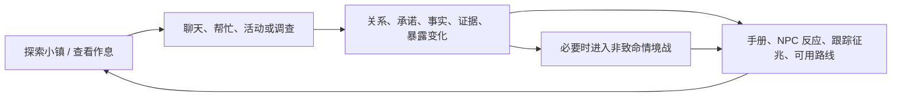

# 游戏设计规格

## 产品定位

`[固定约束]` 《雾山旧轨》是 Windows 单机、俯视像素风的剧情生活 RPG。玩家扮演暑假留在故乡的普通大学生，自由安排生活、调查旧铁路开发工程，并通过此前建立的关系决定在证据不足时谁愿意相信自己。

- 完整目标：个人全职开发 3–6 个月，3–5 小时流程，约 7 个内容日。
- 当前目标：先完成和验证 15–30 分钟“两日生活＋首次异象”切片。
- 核心主题：“信任先于证据，真相修复信任”。
- 玩家弧线：从记录和旁观，成长为愿意承担误解、风险与责任的人。
- 基调：青春奇幻冒险。日常互动应有轻快、熟悉和互相打趣，异象用声音、梦境与地质征兆保留民俗悬疑。

## 核心循环

自由度集中在行动顺序、关系经营、调查方向、风险暴露、队伍和路线选择。游戏不提供通用犯罪、农耕、制作、经营或开放世界沙盒；这些系统会稀释“信任与调查”的核心反馈。

## 时间与日程

- 一天可活动时间为 08:00–23:00，按约 20 分钟移动时间设计。
- 只有玩家实际移动时计时；站立、对话、菜单、手册、事件和战斗暂停。
- 23:00 后停止普通 NPC 活动和时间推进，但不强制传送；玩家仍可移动、换图和回家。
- 睡眠进入次日 08:00，只改变日期，不自动推进主线。
- “Day 1–7”是内容阶段和期望节奏，不是硬日历截止。玩家连续睡眠或晚调查时，关键事件必须在之后继续可用。
- 日程以剧情覆盖优先、普通兜底随后；手册逐步记录玩家已经得知的作息和下一可见时段。

## 探索与交互

- 分区式小镇，8 方向自由移动、4 朝向视觉复用。
- 邻近交互目标按距离、面向和稳定 ID 选出唯一对象；统一确认键。
- 支持键鼠及 Xbox 手柄，提示随最后输入设备切换。
- 地图计划：旧宅/住宅巷、车站广场/商店街、学校/河岸、山林/废弃铁路、旧隧道遗迹、开发公司设施和必要室内。
- 不提供唯一任务箭头。事实手册给出人物习惯、地点、线索和可能方向，让玩家自己决定先后。
- 暂停菜单必须提供“返回当前场景安全点”，处理碰撞或转场卡住而不改变剧情。

## 关系与信赖

关系是有方向的 `SourceId -> TargetId`：

- `Affinity 0–100`：相处舒适度与个人亲近。
- `Trust 0–100`：在信息不足、风险或压力下相信并支持对方的程度。

UI 不显示数字：

| 数值 | 好感 | 信赖 |
| --- | --- | --- |
| 0–24 | 陌生 | 戒备 |
| 25–49 | 熟悉 | 接纳 |
| 50–74 | 亲近 | 认可 |
| 75–100 | 深厚 | 信赖 |

- 日常聊天、帮忙、共同活动和有限礼物主要提高好感。
- 守约、保密、承担风险、承认错误和提供真相提高信赖。
- 关系永不因天数或久未互动自动下降。
- 每名居民 1–2 个偏好礼物；同一礼物在同一好感阶段只生效一次。礼物不能提高信赖。
- 救援同行资格满足任一：对主角信赖 ≥75；对林晓雨信赖 ≥75；或对两者均 ≥50。
- 无人满足时仍允许独自救援，并获得匿名基础补给，不能软锁。

## 承诺

- 关键选项显式标记【承诺】，并立即写入手册。
- 承诺没有隐藏截止日，只能处于待履行、已履行、已解释或已违约。
- 玩家可以完成、主动解释或违约；终态不可再次改写。
- 主线不得要求承诺必须完成。失约改变关系和后续对白，但必须保留调查入口。

## 调查与反馈

手册分别记录：

- 已确认事实；
- 可向第三方出示的证据；
- 尚待调查的线索；
- 已知人物与作息；
- 当前承诺；
- 暴露征兆；
- 按内容日排列的时间线摘要；
- 对话历史和已读状态。

普通事件由交互入口触发，不会因错过一次时段永久消失。危险预警优先展示，但仍由玩家确认进入。关键事实应来自始终可访问的世界交互或多个替代来源，不能只依赖关系、礼物或单个 NPC。

## 暴露与路线

林晓雨的能力暴露分四阶段，UI 不显示数字：

1. 无人注意；
2. 疑似监视；
3. 重点怀疑；
4. 身份确认。

只有公开使用能力、进入敏感设施、在被跟踪时继续高风险调查等明确选择提高阶段。每次风险选择前后都要提供可感知反馈，例如陌生人观察、公司打听、房间被搜查或路线出现重复车辆。

- 身份未确认：进入谨慎路线，玩家可观察巡逻、秘密潜入、取证并破坏一个仪式节点。被发现转入战斗，不立即失败。
- 身份确认：林晓雨被绑架，进入救援路线。公司伪造其破坏工程、引发异常的证据，只为削弱玩家的救援支持并拖延行动。
- 救援证据完整会修复全镇关系并奖励同行者；证据不全只修复原本高信赖居民，其余人需要后续说服。
- 救援路线有更高社会回报，但公司保住一个仪式节点，终战多一个阶段；谨慎路线削弱终战并保存更多补给，但没有全镇关系跃升。

## 对话与恋爱

- 对话支持历史、自动播放和只跳过已读文本。
- 选项使用完整意图文本，不用模糊的“是/否”；只有承诺、隐瞒、冒险等性质加标签。
- 林晓雨和沈砚是恋爱候选，前期两条都可体验。
- Day 6 可含蓄确认其中一人；确认后另一人自然转为友情，不扣关系、不制造三角惩罚。
- 周明仅发展深度友情，其关键回报是知识信赖与终战判断，不把友情写成“次等路线”。

## 战斗与成长

- 战斗切换到独立侧视情境场景；主角加最多两名伙伴。
- 完整版本计划 8 场不可重复战斗，单流程约经历 6–7 场，不做随机遭遇和刷怪。
- 核心行动：调查、保护、安抚、破坏装置、制服、撤退；敌人和公司普通成员尽量非致命处理。
- 关系解锁联携优势，但任何关系状态必须有基础可胜路线。
- 战败可立即重试或撤退到次日/战前检查点；不能锁死主线。
- 等级 1–10，经验来自任务和有限战斗；固定等级解锁技能，不做技能树。
- 每人仅工具槽和饰品槽，完整装备总量 15–20 件；资金来自暑假预算和帮忙报酬。
- 故事模式下战斗不损失意志，但仍保留解谜和行动选择。

## 终战与结局

终战是多阶段封印仪式：

1. 保护林晓雨维持共鸣；
2. 周明依据真相判断封印步骤；
3. 沈砚用旧铁路怀表开启遗迹节点；
4. 居民支援处理医疗、疏散、供给、记录和设施危机；
5. 玩家用证据和倒戈成员面对领袖，并承担最终选择。

三档结果：完整重新封印、付出重大代价后暂时压制、仅阻止当前苏醒。随后根据恋爱、人物关系、组织倒戈者和居民支援生成尾声。

## 内容与资产目标

- 20–25 个事件组：7 个共享主线、三名伙伴各 3 个关系事件、五名居民各 1 个事件、2 个恋爱确认事件，以及两条路线各一个核心篇章。
- 32px 地块、48px 行走角色、四向各四帧；战斗只做关键动作；对话半身立绘加少量表情。
- AI 资产从风格锚点派生并记录来源；音乐和音效离线生成与剪辑，不制作完整语音，只用短促语气音。

## 无障碍与验收目标

基础无障碍包括文字速度、字号、按键重映射、减少闪烁、震动开关、高对比交互提示、无边框全屏和故事模式。

熟人无需讲解应能：找到目标 NPC；理解承诺和风险征兆；完成低资源路线；并指出至少两项“自己的行为改变了后续反馈”。如果做不到，暂停扩充地图和剧情，先修复关系、风险提示和调查手册。
