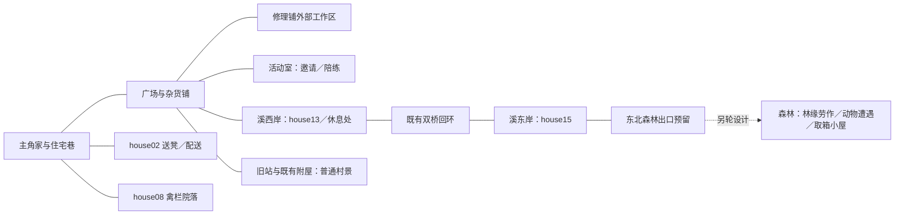

# 村庄外景设计：安全的日常生活区域

> 后续制作更新：2026-09-14，V01–V03 已获授权并完成第一批静态建模与独立漫游接入，见[村庄 v2](../engineering/village-v2.md)。下文“本轮只改 Markdown”指此前设计文档交付；其余批次及全部任务逻辑仍为计划。推车和长凳的实际落位以 v2 共享布局为准。

> 2026-09-14 负责人批准。本文是下一轮村庄外景建模的设计正文，不是资产或游戏实现说明。叙事以[剧情圣经](story-bible.md)和[第一章细案](chapter-one.md)为准，已有模型以[村庄 v1](../engineering/village-v1.md)、[住宅 v1](../engineering/home-v1.md)及源码为准。

## 已确认方向与交付边界

- `[固定约束]` 第一章活动范围为村庄与附近森林。村内没有敌对遭遇；村民自愿陪练可以在村内进行，寻找家禽不引入战斗。两场必经动物战均在森林。
- `[固定约束]` 本轮只更新 Markdown，交付外景设计和第一章地点调整。模型、场景、程序、任务数据、对白、本地化、公共 API、类型、存档、稳定 ID、内容版本 6 均不修改；当前仍止于 `ExitOpened`／`CompletedPin`。
- `[计划]` 采用近现代中式溪谷山村与自然生活感。保留主角家、溪流、双桥和主要道路关系，可局部调整重点院地、摆设及必要的建筑位置；普通建筑只做外观、门前与院落，不新增室内。
- `[计划]` 重点地点写到可继续开展建模的深度，全村 24 栋建筑逐栋登记并分级。森林路线、劳作内容、小屋构造与箱子具体摆放另行设计；本轮不制作森林、小屋、动物或 NPC 模型。
- `[固定约束]` 既有铁路附屋是普通村景，未来森林工具箱小屋是另一个待设计地点；不沿用前者的资产身份，不预定森林小屋与铁路有关。工具箱来源、父母失踪真相和长期主线继续有意留白。

## 现状、总图与尺寸约定

`[已实现]` [VillageLayout3D](../../scripts/presentation/VillageLayout3D.cs)统一现有位置、尺寸、朝向、道路和地形。现状为 208×216 米边界、18 栋住宅与 6 栋公共／铁路建筑；主角家外部通向既有室内，其他建筑只开放外部。参考[现状总平面图](../../outputs/village-v1/village-v1-site-plan.png)及[历史验收](../production/village-v1-validation.md)。现有公告牌只有模型，尚无任务功能。

`[可调整草案]` 下文尺寸单位为米；建筑尺寸按“宽×进深”书写，现有源码的 size 顺序则为宽、高、进深。门前左右均以站在院内面朝建筑为准，便于适配不同朝向。新增区域尺寸是设计目标，不能当成现有地形或碰撞已经验证；将来灰模阶段按实际院地测量，优先移物件或扩展院地，再考虑局部挪动非主角建筑，不挤压既有路桥骨架。

| 关系 | 现状依据 | 本轮设计安排 |
| --- | --- | --- |
| 家与住宅巷→生活中心 | 家到杂货铺约 90.5 米，西南巷与主路连通 | 保留熟悉的回家线路；送凳在西南邻居家，避免第一次短活横穿全村 |
| 广场、杂货铺、修理铺、活动室 | 已有中心节点及互通道路 | 在既有节点补充办事、工作和停留空间，各自朝向来路，摆设不把广场围成死胡同 |
| 配送回环 | 双桥、两岸道路已经存在 | house02、house13、house15 形成从住宅巷到溪岸的配送路线；桥与回环继续可双向走 |
| 家禽寻找 | house08 靠住宅巷与活动室 | 禽栏→院外墙边→附近菜畦的短范围寻找，避开主路中央、溪水及森林出口 |
| 溪边休息 | 溪西岸道路连接双桥 | 休息点设在西岸中段、靠陆地一侧，从原道路分出短支口；不改桥口或水岸安全边界 |
| 村庄→森林 | 溪东道路北端现止于 house18 附近，约 (80,-70) | 默认由此向东北预留 3 米宽接近段，先在现有可行走边界内落位。未来穿越地形边界、加载方式及森林落点另定；本轮不声称出口已可通行 |
| 旧站与附屋 | 北侧回环中的 station、rail_shed | 保留普通闲置站区外景，不作取箱终点，不增加悬念提示或隐藏通道 |

该图只表达空间连接，不表示任务前置条件；村内道路不会因为尚未接取委托而封锁。未来是否可提前进入森林由森林设计与第一章的提前探索规则共同确定。

## 通用建模要求

`[计划]` 重点地点以正常玩家高度和既有 Orbit 镜头检查，同时保证轮廓、用途和行走空间清楚。下列要求用于未来灰模和建模验收，本轮只做纸面设计。

| 项目 | 设计要求 |
| --- | --- |
| 路与门 | 沿用主路 4、支路 3.5、巷道 2.5；院门主通道约 2.8 净宽。搬运路线无新增台阶，门槛采用平顺过渡；不将穿墙或涉水作为捷径 |
| 合作与搬运 | 每处推车装卸区至少 3×3；双人工作区至少 2.4×2.4。工作台、箱筐和人物站位计入占地，不能把家具覆盖的面积算作净空 |
| 陪练 | 至少 8×8 净空，外围另留至少 1.5 米通行／旁观带；不与活动室正门、村路或沈砚歇脚区重叠。只是空间预留，不规定战斗玩法与数值 |
| 镜头与识别 | 雨棚下沿目标不低于 2.6；工作区面向来路，门柱、树干、招牌避开主要观察方向。保留镜头压缩空间，不能假设一个屋顶高度就保证全角度无遮挡 |
| 构造 | 墙体有墙脚、门窗收口、檐口与排水关系；雨棚有合理支撑。修补痕迹顺着受力、漏雨与常用位置分布 |
| 材质 | 浅抹灰、局部砖石墙脚、灰瓦、木材和普通金属为主体；颜色通过使用年限和维修批次形成小差异。锈迹、灰尘、磨损集中于合理部位，不全村统一刷脏 |
| 生活物件 | 按实际用途选物件：杂货铺是包装与周转，修理铺是工具与待修物，住宅是晾晒、种植或照料。避免每家复制同一组桶、盆、木箱 |
| 可变化部件 | 公告纸、空满货筐、待修／已修物件、禽栏门闩等独立列清单，未来按状态替换；本轮不创建节点契约或运行时 ID |
| 氛围 | 普通日常，没有异常符号、神秘光色或预示工具箱来源的布置。保留现有夏日上午作为外景制作基线；剧情早晚的灯光方案不在本轮实现 |

`[计划]` 复用现有民居构件、树木、标牌字形与已采用材质。未来新增资产按[内容制作规范](../engineering/content-authoring.md)记录来源，不覆盖住宅 v1 或村庄 v1 权威源；进入建模时使用独立新版本。现有资产预算与性能数据只作基线，新外景必须重新验证，不把历史通过记录移作新资产结论。

## 重点地点设计卡

`[可调整草案]` V01–V09 仅为本文编号；任务 A1–T6 来自第一章细案。下列任务站位、道具变化和 NPC 活动均未接入。尺寸与位置可在后续灰模中调整，但须保持上面的净空与空间关系。

### V01 中心广场与村长办事处

| 字段 | 设计 |
| --- | --- |
| 现状引用／生活用途／关联任务 | 现有 plaza_tree、noticeboard 与活动室相邻空地；邻里歇脚、登记事情、代管酬金。对应所有委托接取、T1 登记、T4 核实、T6 结款 |
| 外观构造／材料配色 | 保留大树、木制牌架与小顶；补旧木桌、普通椅、防雨金属收件箱和可锁纸笔柜。低饱和绿色、原木与镀锌灰，纸条大小略有差别但排列清楚 |
| 带尺寸的平面安排 | 公告牌前留 3×2.4 读牌区；侧方另设 4×4 办事区，桌约 1.4×0.7，收件箱约 0.4×0.3；桌椅退到办事区后缘，前方双人站位净空 2.4×2.4；来往道路独立绕行 |
| 道具／人物与搬运站位 | 村长坐桌后、主角与伙伴站桌前；收件箱靠桌侧便于村民直接投递，正面有投口、背面维护门；纸笔、信封和登记簿收在柜／桌上，不露天散落现金 |
| 通行与镜头 | 牌子、办事桌均面向广场来路；树干不处于主角与村长视线中；阅牌的人不挡活动室正门，长凳与柱脚在路外 |
| 未来状态变化 | 公告纸独立替换；原委托由村长保管，核实时拿到桌面。登记、交差与领钱的规则仍由剧情定义，不刻在场景招牌上 |
| 复用资产／制作批次 | 复用树、牌架、长凳、标牌字体和现有木金属材质；新增收件箱、桌柜。第一批 |

### V02 乔姨杂货铺檐下交货区

| 字段 | 设计 |
| --- | --- |
| 现状引用／生活用途／关联任务 | shop 主体 12×9，已有条纹遮阳棚、冰柜、长凳和箱筐；对应 C1 订货核对、C2 装车与归还，村民平日也能在此取货 |
| 外观构造／材料配色 | 保留浅墙灰瓦、褪色绿白棚布，补棚布压边和支撑。米面垫高并有遮雨，空筐与退货包装归到同侧，不把店门堆死 |
| 带尺寸的平面安排 | 门前作业带目标 10×5.5；左侧 2×1.5 交货区含 1.6×0.7 台，右侧 2.5×1.5 干货区；前侧另留 3×3 装卸净空。推车停放占地约 1×1.8，在装卸区侧面；中央保留约 2.8 通路 |
| 道具／人物与搬运站位 | 乔姨在交货台内侧，两人先在台前核对、再到车侧搬运；纸单、分装包、米面袋、垫板、绳子、空筐分别有位置。C1 小件与 C2 重货使用不同堆位 |
| 通行与镜头 | 棚柱放两端；长凳、冰柜允许局部移位以腾出作业带，不占广场来路。推车能从装卸区转向主路，不经过店内 |
| 未来状态变化 | 待送与已送包裹、空满推车独立表现；不以场景中货物多少直接判断三链进度；商店界面和推车操控另行设计 |
| 复用资产／制作批次 | 复用店壳、棚、箱筐与材质；新增交货台、米面袋和推车外观规格。第一批 |

### V03 彭师傅修理铺外部工作区

| 字段 | 设计 |
| --- | --- |
| 现状引用／生活用途／关联任务 | workshop 主体 12×8，现有卷帘门、柜与木料；对应 A1 取凳／交差、A2 整理、T3 验箱与 T4 旧事核实 |
| 外观构造／材料配色 | 原灰瓦、浅墙、砖墙脚与卷帘门保留；门前加有排水坡的普通雨棚，工作台有刨磨痕迹、台钳与工具挂板。柜和台架采用旧蓝灰金属与磨亮木边 |
| 带尺寸的平面安排 | 作业带目标 10×5.5；后缘两侧分别设 2×1.5 待修区与待领区，后侧工作台 2×0.8；台前保留 2.4×2.4 合作净空，门口另留约 2.8 通路；棚柱不压工作区 |
| 道具／人物与搬运站位 | 彭师傅在台侧，两位主角可从台前观察和分类；凳子、小器具、标签盒、工具挂板、短木料和可回收零件分开。章末箱子放工作台上供三人核对，不藏在角落 |
| 通行与镜头 | 从院口能认出取货与整理位置；高柜贴墙，台前无横梁遮挡；取凳或携箱均可直接回村路，不必进入卷帘门后 |
| 未来状态变化 | 待修、归类与待领物件分别可替换；预留一处空台面，章末箱子只在剧情允许时出现。普通工具无异常特效，不提前展示章末箱子 |
| 复用资产／制作批次 | 复用铺面、金属柜、木材和材质；新增台面、挂板、分类盒与普通维修道具。第一批 |

### V04 活动室：沈砚歇脚与自愿陪练

| 字段 | 设计 |
| --- | --- |
| 现状引用／生活用途／关联任务 | community 主体 10×8、正门朝东且已有门廊；C2 主动邀请地点，S1／S2 陪练地点。不指定沈砚家在这里 |
| 外观构造／材料配色 | 保留公用门廊；长凳与小桌是平常歇脚设施，桌上只有便携工具袋和正在摆弄的小物件。陪练场用普通平整硬地，边缘有座椅，不做擂台或战斗机关 |
| 带尺寸的平面安排 | 邀请区在门廊侧面，目标 3.5×3.5，容纳 1.6×0.5 凳与 0.8×0.6 小桌；陪练优先在建筑南侧独立预留 11×11，其中中央 8×8 净空、四周 1.5 米边带，不侵占东侧来路 |
| 道具／人物与搬运站位 | 沈砚在桌旁整理便携物件，主角从道路走近再邀请；接受后收好工具起身。陪练双方站在空地内，伙伴与旁观者在边带，水杯与毛巾放场边 |
| 通行与镜头 | 活动室正门保持原有通路。南侧候选空地需在灰模核对与邻近院地及道路的距离，净空不足时局部扩展场地，不把路纳入场内；环绕视角不被树冠或廊柱整片遮住 |
| 未来状态变化 | 沈砚工具袋收起／摆放、练习前后人物位置是后续表现需求；陪练空间平时也用于普通活动，不因主线进度开锁 |
| 复用资产／制作批次 | 复用活动室、门廊、桌凳与现有地面材料；新增小型便携工具道具。第二批 |

### V05 三处配送院落

| 字段 | 设计 |
| --- | --- |
| 现状引用／生活用途／关联任务 | house02（9×7）、house13（10×7）、house15（9×7），均为现有一层住宅。house02 承接 A1 送凳，三户共同承接 C1／C2 的配送空间；具体份数留给任务设计 |
| 外观构造／材料配色 | house02 以常用门廊、旧凳和补过的门框辨识；house13 以侧边晾晒、整齐收纳与偏暖墙面辨识；house15 以小菜畦、竹架和雨水容器辨识。三家都保持有人维护，不预设主人身份 |
| 带尺寸的平面安排 | 各户门到院口约 2.8 净通道连续；通道一侧各留 3×3 卸货净空，门廊另一侧留约 1.5×1 临时放物处；晾晒架或菜畦贴边，不穿过收货区；house02 另留 1.2×1 的凳子落位 |
| 道具／人物与搬运站位 | 收件人站门廊侧，主角／伙伴站卸货区；推车可停在该区外侧不堵院门，米面落在垫板上。门廊凳、晾衣架和菜畦分别是三户主要生活特征 |
| 通行与镜头 | C1 可任意顺序送三户；C2 沿原道路与桥走，无新增狭窄捷径。院门与门廊能在正常视角连续识别，晾晒不挡交谈镜头 |
| 未来状态变化 | 送回的凳子、配送货物独立显示；完成后留下合理劳动成果，不复制包裹；实际领取与交差防重复由未来任务逻辑负责 |
| 复用资产／制作批次 | 复用三户主体、院墙和民居构件，通过物件与局部修补差异化。第二批 |

### V06 house08 照料与禽栏院落

| 字段 | 设计 |
| --- | --- |
| 现状引用／生活用途／关联任务 | house08 主体 9×7、南向院落；S3 浇水喂养、S4 找家禽并补门，使用邻居职能称呼 |
| 外观构造／材料配色 | 普通住宅墙脚和整洁院地，侧边小菜畦、木竹禽栏与遮雨禽舍。局部木闩磨松有正常使用原因，不把整个住宅表现成危房 |
| 带尺寸的平面安排 | 门到院口保留约 2.8 通路；一侧设 2×2.5 禽栏，内含约 1×1.2 禽舍，独立栏门净宽约 0.8；对侧 1×2 菜畦与取水点，栏门外保留 2.4×2.4 工作净空 |
| 道具／人物与搬运站位 | 水壶、饲料容器和小勺靠取水／饲料侧；邻居在门廊交代份量，主角在栏门外照料，伙伴在工作区边协助。找回路线止于院墙外和附近菜畦，不去溪里或森林 |
| 通行与镜头 | 独立禽栏门与住宅院门明确可辨；禽栏只占侧边，寻找路线始终能返回原院口。矮栏与植物不完全遮住需观察位置 |
| 未来状态变化 | 松动／补好门闩、栏门状态及家禽位置分开列为未来部件；不会因照料失败封闭主路或失去进入院落的路径 |
| 复用资产／制作批次 | 复用主体、院墙和菜畦，新增小型禽栏、门闩及容器规格；本轮不制作家禽模型。第二批 |

### V07 溪西岸休息处

| 字段 | 设计 |
| --- | --- |
| 现状引用／生活用途／关联任务 | 既有 west_bank 双桥之间路段，S5 找水壶；普通村民走路歇脚，不新增涉水玩法 |
| 外观构造／材料配色 | 陆地侧一块碎石／旧铺地、树荫和有靠背的木凳，保留现有水岸边界。凳端和低矮承托可放随身物件，不做突出水面的平台 |
| 带尺寸的平面安排 | 从路外预留约 4×3 休息地，长凳约 2.2×0.6 靠后缘；前方保留 2.4×2.4 观察／交谈净空，1.5 米短支口连接原路；不得缩窄原路或桥头 |
| 道具／人物与搬运站位 | 水壶可放凳旁低台，轮廓从支口进入后可见；主角在凳前检查，伙伴停在侧面。问路的人与失主不必固定住址 |
| 通行与镜头 | 查找站位在陆地侧，水壶不放栏外、草丛深处或凳底难以观察的死角；树干在座椅后侧，正常镜头能看见物件轮廓 |
| 未来状态变化 | 水壶作为独立任务物件未来出现／移除，长凳与休息地始终保持日常用途；无藏在失物里的线索 |
| 复用资产／制作批次 | 复用现有长凳、树木、地面和岸边构件，新增普通水壶外观规格。第二批 |

### V08 主角家与接村道路

| 字段 | 设计 |
| --- | --- |
| 现状引用／生活用途／关联任务 | home 主体 12×9、院地 15×18；开篇离家、过程回访与结案后回家，现有往返住宅入口继续保留 |
| 外观构造／材料配色 | 完整保留住宅 v1 主体、院落主要物件与室内；院外以修过的排水边、少量野草和扫净的门前路体现日常维护，不用荒废外观反复强调父母失踪 |
| 带尺寸的平面安排 | 沿原 2.8 米院门连接至 4 米主路；院外绿化只进入路外约 0.5–1 米零散边带，正门外原交互落点与回访落点留空，不改变院地尺度 |
| 道具／人物与搬运站位 | 不新增任务关键摆件或父母线索；主角从既有院内出生点沿院门离开，伙伴未来在院外路侧等待的位置需避开进出门落点 |
| 通行与镜头 | 正门可见性、进出门视线和镜头恢复空间沿用已有验证基线；植被不遮门、不侵入碰撞路面，也不挡院内向道路观察 |
| 未来状态变化 | 新外景只增加静态维护细节；门灯仍属已有住宅表现，第一章休息与睡眠交互另行接入，不借本轮增加存档状态 |
| 复用资产／制作批次 | 直接复用住宅 v1 派生外观，禁止村庄构建覆盖住宅源。第三批环境收边 |

### V09 旧站、既有附屋与森林出口接近段

| 字段 | 设计 |
| --- | --- |
| 现状引用／生活用途／关联任务 | station 20×9、rail_shed 8×6 和东北溪东道路末端是三个现有参照点；站区是日常闲置外景，东北接口供未来 B1／B2／T2／T5 往返森林 |
| 外观构造／材料配色 | 旧站保留砖石、灰瓦、旧长凳与正常风化；附屋封闭外部保留。森林接近段从维护过的村路逐渐过渡为土石步道、灌木和树木，村内无怪物痕迹或谜团标记 |
| 带尺寸的平面安排 | 站前现有 4 米通路保持；东北候选接近段净宽 3 米，在道路末端靠村内一侧留 4×4 回转／未来返回落点净空，装饰退到两侧；延伸长度以不穿越本轮现有地形边界为限 |
| 道具／人物与搬运站位 | 站区仅普通长凳、旧设施和维护杂物；接近段允许两人并行再转为前后走。返回位置在村内安全地面，战败回村的具体落点和逻辑由后续森林方案决定 |
| 通行与镜头 | 出口方向从溪东来路可识别，不借旧站屋内穿行；现有边界碰撞本轮不拆，模型中已有铁路不能直接解释为通往森林的可走路线 |
| 未来状态变化 | 站区不因工具箱委托出现隐藏机关。未来森林开通需独立设计边界、加载／连续通行及安全恢复；本轮不制作路障开关或伪装成已开放出口 |
| 复用资产／制作批次 | 复用站房、rail_shed、树木、石土材料；只列村内收边与接近段需求，不列森林小屋模型。第三批 |

## 全部 24 栋建筑登记与制作分级

`[已实现]` 下表“现状”依据共享布局，仅说明主体层数、占地和朝向；外观差异及任务用途为 `[可调整草案]`。重点细案对应上文；一般外观只确定差异方向与批次，不冒充已完成逐户建模设计。编号引用既有布局，不分配运行时稳定 ID，也不推导常住人数。

| 现有建筑 | 现状：层数／宽×深／正门方向 | 设计等级 | 外观差异或用途草案 | 关联地点卡 | 批次 |
| --- | --- | --- | --- | --- | --- |
| home | 一层／12×9／南 | 保留基线 | 保留主角家，院外轻度维护痕迹 | V08 | 三 |
| house02 | 一层／9×7／南 | 重点细案 | 木凳、修补门框、门廊收货 | V05 | 二 |
| house03 | 两层／10×7／南 | 一般外观 | 二层栏杆与空调管线，院内不复制禽栏 | — | 三 |
| house04 | 一层／8×7／北 | 一般外观 | 紧凑院地、窗下花架、修过的墙脚 | — | 三 |
| house05 | 一层／10×7／北 | 一般外观 | 小段遮雨檐与收拢的晾晒设施 | — | 三 |
| house06 | 两层／9×7／北 | 一般外观 | 阳台、不同维修批次的抹灰、小型储物角 | — | 三 |
| house07 | 一层／10×8／南 | 一般外观 | 较深屋身、侧墙藤架，巷口留空 | — | 三 |
| house08 | 一层／9×7／南 | 重点细案 | 独立禽栏、小菜畦和取水点 | V06 | 二 |
| house09 | 一层／10×7／东 | 一般外观 | 朝巷檐下短凳、砖石墙脚 | — | 三 |
| house10 | 两层／9×7／东 | 一般外观 | 楼层窗序与排水构造，不增加可登阳台 | — | 三 |
| house11 | 一层／8×7／东 | 一般外观 | 小院、靠山侧护坡与普通修补 | — | 三 |
| house12 | 一层／10×8／东 | 一般外观 | 较深门廊、收纳架和零散盆栽 | — | 三 |
| house13 | 一层／10×7／北 | 重点细案 | 暖墙、侧边晾晒、独立卸货位置 | V05 | 二 |
| house14 | 一层／9×7／北 | 一般外观 | 靠溪墙脚湿痕与洗晒用品，不设涉水口 | — | 三 |
| house15 | 一层／9×7／北 | 重点细案 | 菜畦、竹架、雨水容器与收货垫板 | V05 | 二 |
| house16 | 两层／10×7／西 | 一般外观 | 朝溪阳台、规整院墙与门侧收纳 | — | 三 |
| house17 | 一层／9×7／西 | 一般外观 | 门廊竹椅、简洁侧院，桥边视线开敞 | — | 三 |
| house18 | 一层／10×8／北 | 一般外观 | 东北端庭院与土石路过渡，不设为森林看守人住宅 | V09 接近段 | 三 |
| shop | 一层／12×9／南 | 重点细案 | 檐下交货与米面周转 | V02 | 一 |
| clinic | 一层／10×8／南 | 一般外观 | 清洁入口、候坐凳、清楚标牌；未设计室内医疗或商店系统 | — | 三 |
| workshop | 一层／12×8／南 | 重点细案 | 门前有顶维修区、分类台与挂板 | V03 | 一 |
| community | 一层／10×8／东 | 重点细案 | 邀请沈砚、休息与独立陪练空地 | V04 | 二 |
| station | 一层／20×9／南 | 一般外观 | 普通旧站、站前长凳及合理老化 | V09 | 三 |
| rail_shed | 一层／8×6／南 | 保留普通外景 | 既有铁路附屋，不是森林工具箱小屋 | V09 | 三 |

广场 V01 与溪边 V07 是公共空地，不计入 24 栋建筑。新文档不为一般住宅分配人物姓名、家庭关系或剧情秘密。

## 制作批次与后续门槛

| 批次 | 后续建模范围 | 该批次应回答的问题 |
| --- | --- | --- |
| 一：生活中心样板 | V01 广场、V02 杂货铺、V03 修理铺 | 建筑构造与材质是否统一；读牌、交货、整理工具能否容纳两人并保持通行；自然生活感是否成立 |
| 二：村内任务空间 | V04 活动室、V05 三户配送、V06 禽栏、V07 溪边 | 邀请与陪练互不干扰；推车路线和院口连续；找家禽、找水壶有清楚的普通观察范围 |
| 三：全村外观与收边 | V08 家周边、一般建筑、V09 旧站与出口、道路两侧植被 | 村庄是否有户间差异；双桥回环与家门往返是否保持；森林接口是否明确且不冒充已开放 |

`[计划]` 实际建模前按批次落实共享布局、灰模净空和版本边界，再细化材质及独立可变化部件。新源与派生资源单独版本管理，旧 v1 与原住宅源保留。当前不执行任何批次，不选择新的森林资产版本、场景架构或加载方式。

`[计划]` 未来资产验收须重新检查实际网格／碰撞一致性、桥头与院门连续行走、双人站位、推车扫掠范围、近墙／棚下镜头、三分辨率视觉、预算与性能，并执行相应 Core／内容测试、Godot 构建及场景冒烟。人物与战斗未接入时只能验证预留空间，不得报告完整任务或战斗可玩。本机角色及含角色画面的原有提交、分发、导出限制继续有效。

## 本轮纸面走查与文档验收

| 场景 | 纸面路径与检查结论 |
| --- | --- |
| 独自送凳 | V01 接取→V03 取凳→house02 门廊落凳→V03 交差；村内安全，不需要穿店内或渡溪 |
| 小额配送 | V02 核对→house02／house13／house15 任意顺序→V02 交差；每户有收货位置，既有双桥允许回环 |
| 邀请沈砚 | 两件短活交差→C2 出现→V04 门廊侧面主动邀请→V02 装货；不把路过活动室自动算作邀请成功 |
| 双人搬运 | V02 装卸区→原路桥→三户卸货区→V02 还车；道路与 3×3 净空列为灰模验证项，纸面设计不宣称实际推车已可通过 |
| 整理／验箱 | V03 台前合作净空与左右分类架承接 A2；T3／T4 使用同一台面核实，章末前不摆出工具箱 |
| 陪练 | V04 独立空地使用 8×8 净空及外围带，正门仍可通过；自愿切磋不改变村庄无敌对遭遇的边界 |
| 照料与找家禽 | house08 的取水／饲料→独立禽栏→近邻墙边／菜畦→补栏门；全程在安全村内，住宅院门不是坏门 |
| 找水壶 | 问清路线→溪岸原路→V07 陆地侧凳旁→交还；不要求涉水、攀爬或搜不存在的暗格 |
| 外出与返回 | 村内只走到 V09 接口；B1／B2 的劳作点、山猴和 T2 的野猪／小屋全部属于未来森林。T5 复查森林现场不再刷战斗 |
| 原有剧情组合 | 开场两种顺序、三链交错、跳过支线、未领钱、提前问彭师傅、章末继续支线和周日承接保持第一章细案规则；地点调整不更改解锁条件 |

本表只说明设计路径与待实际检查的条件，不代表空间、模型、任务或战斗已经通过运行时验收。本轮实际链接、增量和现有测试结果见[文档验收记录](../production/village-exterior-doc-validation.md)。
