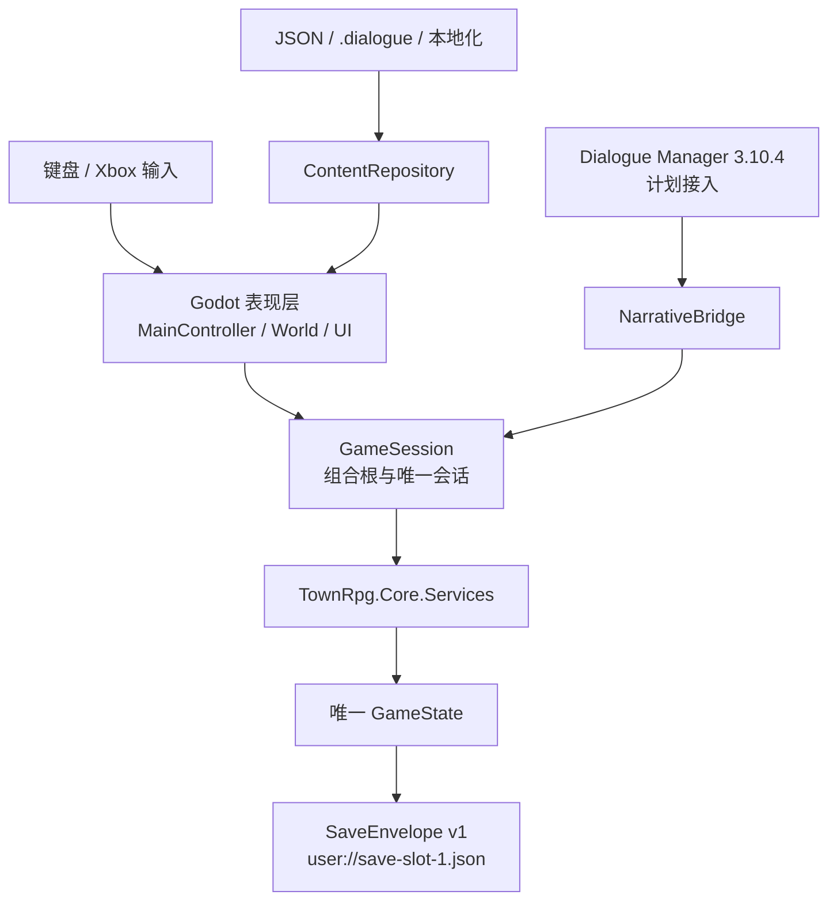
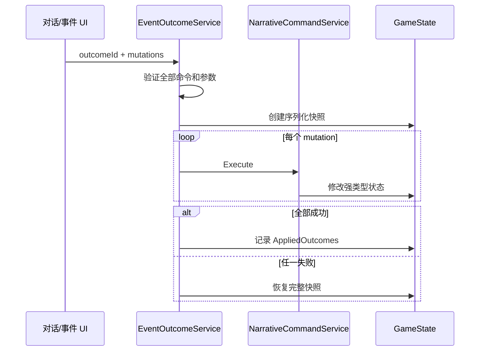

# 技术架构

> 基线：Godot 4.6.3 .NET、C#、Compatibility/OpenGL、Windows x64

## 架构目标

`[固定约束]` 游戏规则必须能够脱离 Godot 场景运行和测试。Godot 负责输入、绘制、场景和 UI；`TownRpg.Core` 负责状态、规则和持久化契约；Dialogue Manager 最终只负责对白流程。这样场景切换、插件升级风险或 UI 重做不会改变世界状态的含义。



依赖方向只能从表现层指向 Core。`TownRpg.Core.csproj` 不引用 Godot；根 `TownRpg.csproj` 引用 Core，并显式排除 `src/`、`tests/`、`work/`、`outputs/` 的重复编译。

## 运行期组成

### Autoload

- `[已实现]` `GameSession`：持有唯一 `GameState`、内容仓库、模态门、规则服务和当前战斗；负责新游戏、时间、睡眠、存读档和服务重绑定。
- `[已实现]` `Narrative`：`NarrativeBridge` 的 Autoload 名称。向对白层暴露固定参数数量的 `Evaluate`/`Execute` 重载、玩家姓名和称谓。

`GameSession` 是 composition root，不是领域模型。每次新游戏或读取存档后，它用新的 `GameState` 重建 `TimeService`、`RelationshipService`、`NarrativeCommandService`、`EventOutcomeService` 和 `DreamEscapeService`。

### Core 领域聚合

`GameState` 包含以下可存档部分：

| 部分 | 职责 |
| --- | --- |
| `Player` | 姓名、称谓、当前地图和基础坐标。 |
| `World` | 日期、分钟、剧情阶段、路线、暴露、仪式节点、事实和证据。 |
| `Relationships` | 有方向的好感、信赖、恋爱状态、共同记忆和已生效礼物阶段。 |
| `Promises` | 无期限承诺及其单向状态机。 |
| `Investigation` | 线索、已知日程和按日期记录的时间线。 |
| `Inventory` / `Progression` | 金钱、物品、1–10 级经验。 |
| `DreamEscape`（可选） | 梦境状态、区域坐标、独立物品、谜题、开放区、线索、提示等级和晓雨加入状态；旧存档为 `null`。 |
| 完成集合 | 已完成事件、已应用结果、已读对白。 |
| `Settings` | 文本速度、字号、闪烁、震动、高对比、故事模式和全屏。 |

禁止把 `Node`、Signal、`Vector2` 或插件对象加入这些类型。玩家坐标在 DTO 中拆为两个 `float`。

## 状态写入与原子性

### 普通规则

关系、承诺、时间、日程、路线和结局都通过 Core 服务修改或判断。UI 读取阶段文本，不读取内部阈值后自行复制业务规则。

`DreamEscapeService` 同样是唯一谜题判定入口。它先验证当前状态、区域、前置线索与物品，再原子完成一次小操作；`DreamActionResult.Changed=false` 表示错误或重复操作，`GameSession` 不保存。选中物品属于临时 UI 状态，不进入 `GameState`。

### 叙事命令

`NarrativeCommandService` 定义对白可用的状态写入白名单。当前允许：

```text
add_fact           1
add_evidence       1
add_lead           1
timeline           1
change_affinity    3
change_trust       3
remember           3
create_promise     4
resolve_promise    2
raise_exposure     1
complete_event     1
grant_xp           1
```

查询限于：`has_fact`、`has_lead`、`event_complete`、`trust_at_least`、`affinity_at_least`、`day_at_least`。查询缺失关系时按 0 处理，不能为了读取条件而创建关系。

`EventOutcomeService.Apply(outcomeId, mutations)` 先验证全部命令，再序列化快照并逐项执行。任何一项失败都会恢复快照；成功后写入 `AppliedOutcomes`。同一 `outcomeId` 再次应用返回无操作，防止双击、重进和载入重放重复奖励。当前可玩 C# 演示流程通过它提交具名结果。

`[计划]` 现有 `NarrativeBridge.Execute` 直接调用 `NarrativeCommandService.Execute`，因此单条命令有白名单校验，但一段 `.dialogue` 中的多条命令还不是一个原子事务。这是插件接入前必须消除的技术债，不能把“每条命令合法”误写成“整场事件原子”。



## 时间、模态与输入

- `[已实现]` 新游戏的世界时钟仍初始化为第 1 日 08:00，但先进入梦境；梦中移动只更新梦境坐标，不推进世界时间。Legacy 世界每现实移动秒推进 0.75 游戏分钟。
- `[已实现]` `PlayerController` 比较移动前后位置，只在实际位移时调用 `AdvanceMovingTime`，顶墙不走时钟。
- `[已实现]` `ModalGate` 按 owner 引用计数。对话、手册、暂停、标题、战斗和完成页持有 lease，阻止玩家移动和时间推进。
- `[固定约束]` 不使用全局 `SceneTree.Paused` 冻结业务流程；异步流程必须在 `finally` 或统一关闭方法中释放 lease。
- `[已实现]` `WorldSceneController._UnhandledInput` 处理世界交互，减少 UI 已消费确认键后重复触发的风险。
- `[已实现]` 输入提示根据最后一次键盘/手柄事件切换；梦境背包为 `I`/`Tab` 或 Xbox `X`，其余移动/交互保持 WASD/方向键、F/空格或左摇杆、A。支持旋转的 3D 区域额外使用 `Q/E` 或 `LB/RB`。

## 场景生命周期

主场景 `Main.tscn` 常驻。新游戏实例化普通 `Node` 根的 `DreamEscape.tscn`，后者在自身 `AreaHost` 中替换走廊/四室；第一室是 `Node3D`，其余梦境区域仍是 `Node2D`。Legacy 存档实例化 `OldHouse.tscn` 或 `StationQuarter.tscn`。切换时均断开普通 .NET 事件并释放旧节点，长期状态只保存稳定区域 ID 和基础坐标。

`IDreamAreaRuntime` 为 2D/3D 区域统一提供交互请求、提示变化、临时选中道具和辅助设置接口。通用 3D 表现层由 `WorldArea3D`、`PlayerController3D`、`QuarterTurnCameraRig`、`CameraRelativeMovement`、`InteractionMarker3D`、`WallCutawayController`、`StatefulObjectVisual3D` 与 `AreaCoordinateMapper3D` 组成；这些类型不引用梦境谜题答案，可继续用于后三室和未来小镇。`DreamAreaController3D` 只负责把第一室稳定 ID 与 `DreamEscapeState` 接入该通用层。

梦境存档继续只保存旧二维 `PositionX/Y`。第一室在表现层把旧活动矩形映射到 9.04×6.60 米 X/Z 平面，若旧坐标位于新家具内则解析最近安全点，并通过 `GameSession.MoveDreamToArea` 保存修正。镜头角位、裁墙 alpha、当前焦点和动画帧均为临时表现状态。

当前独立世界场景只有旧宅和车站分区；河岸、学校档案室、商店活动和废弃铁路主要通过事件段落或同一车站地图上的交互点表现。完整版本扩图时继续保持“常驻应用壳 + 可替换世界子场景”。

所有订阅普通 .NET event 的场景节点必须在 `_ExitTree` 解除订阅；Godot 自动断开 Signal 不会处理普通 .NET 事件。异步等待在节点退出时必须取消，避免 await 永久悬挂或访问已释放节点。

## 内容加载

`ContentRepository` 启动时从 `res://data/` 读取 `characters.json`、`schedules.json`、`events.json` 和 `items.json`：

- 四个 catalog 必须使用 `schemaVersion: 1`。
- 角色 ID 必须唯一且包含主角。
- 日程 NPC 必须存在，等价条件的时间段不得重叠。
- 每个事件的 `dialoguePath` 必须存在。
- 八个梦境道具 ID 必须完整唯一，本地化键和图标路径必须存在。
- 验证失败写入 `InitializationError`，标题页应阻止新游戏而不是带着残缺内容继续。

更完整的跳转、命令、本地化和资源检查由 `ContentIntegrityTests` 完成。

## 存档

- `[已实现]` 单槽路径为 `user://save-slot-1.json`，外层 `SaveEnvelope.formatVersion` 当前为 1。
- `[已实现]` 写入先落到 `.tmp`，旧档旋转为 `.bak`，新档成功换入后删除备份；提交失败尝试恢复旧档。
- `[已实现]` 正式档不存在但 `.bak` 存在时，读取会先尝试恢复备份。
- `[已实现]` 空文件、坏 JSON、缺少必要分区、非法枚举/范围、重复关系/承诺和版本不匹配都会明确拒绝。
- `[固定约束]` 手动保存只允许稳定状态；对话或战斗前使用检查点。退出战斗后应回到战前状态，而非序列化半场对象。

`ValidPlayerLocations` 包含 `old_house`、`station_quarter` 和 `dream_school`。`DreamEscape` 是 v1 内可选分区：缺失时按 Legacy 流程；存在时会严格拒绝未知区域/物品/谜题/线索、越界提示等级和不一致状态，因此本次未提升格式版本。

## Dialogue Manager 边界

`[计划]` 正式集成固定为 Dialogue Manager v3.10.4，并放在 `res://addons/dialogue_manager/`。当前八个 `.dialogue` 文件已经按 `Narrative.Execute("command", "arg"...)` 和 `Narrative.Evaluate(...)` 编写，但插件目录不存在，实际游戏仍运行 `MainController` 中的硬编码演示对白。

接入时：

1. 保留 Autoload 名 `Narrative`；若继续暴露反射方法，使用固定参数重载，避免 C# `params string[]` 无法被插件正确展开。
2. 用插件加载 `EventDefinition.dialoguePath` 和 `startTitle`，替换演示编排。
3. 插件不得保存事实、关系、承诺、暴露或路线变量。
4. 用 `eventId + outcomeId` 查询 C# 预定义 mutation，或在桥内缓冲并一次调用 `EventOutcomeService.Apply`；提交成功后才完成事件。
5. 迁移现有逐条 `Narrative.Execute` 调用，不能保留“执行到一半即可存档”的状态。
6. 插件异常或取消时不标记事件完成，允许玩家重新交互。

## 扩展点与高风险区

- 新地图：同步 `SaveGameSerializer.ValidPlayerLocations`、场景冒烟、世界转场和安全点。
- 新状态字段：同步 `GameState`、存档验证、往返测试，并决定是否提升格式版本。
- 新对白命令：同步允许集合、参数契约、执行、原子回滚测试、内容解析测试和本文档。
- 新路线条件：集中放入 `StoryRuleService`，不得散落在 UI。
- `MainController` 当前同时承担应用导航和切片事件演示，接入插件后应拆出事件呈现，但不要在插件中复制 Core。

## 不适用架构

项目没有前后端、Controller、数据库、远程 API 或运行时生成服务。`doc/api/`、`sql/schema.sql`、服务发现和 Web E2E 流程均不适用。
