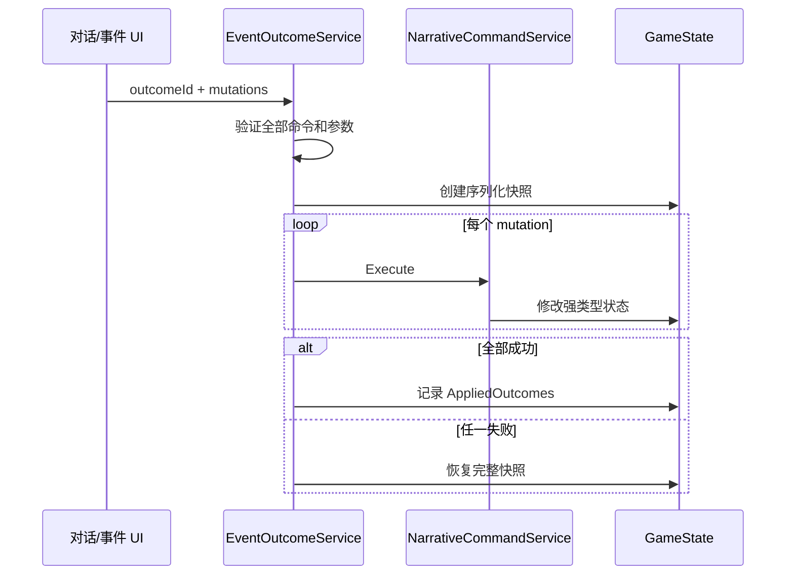

# 技术架构

> 2026-09-15：[双向推门与院外接坡](home-access.md)更新门方向的可选保存、住宅缓存恢复和 v4 局部地形／路面；[实际验收](../production/home-access-validation.md)记录连续院外往返，保留旧批次的历史结果。

`[已实现]` 2026-09-14 后续布局轮：[紧凑村庄 v4](village-v4.md)已接入正式醒后探索与默认预览，采用 v3 树木／两铺外观和独立派生 Terrain3D。固定主角家、溪流、双桥及 24 栋体量；原布局通过独立预览 `--village-v2` 回归，v1 与 v3 样板入口保留。第一章委托仍未接入。[本轮实际验证](../production/village-v4-validation.md)独立记录；下述旧批次的“正式 v2／样板待采用”均为当时状态。

`VillageLayoutProfile3D` 由外景实例持有，统一几何、碰撞、树木、路线与地标。`IVillageSurface3D` 为该实例选择对应原生地形；正式控制器固定采用 v4，不读取预览回归选项。Core、存档格式与地点标识不变。

`[已实现]` 2026-09-14 地形采用：正式村庄与默认 v2 预览使用 Terrain3D 1.0.2。地表显示、查询和碰撞由表现层 `IVillageSurface3D` 提供；进屋停用、出屋恢复缓存地形碰撞。旧档在允许的小幅高度差内保留 X/Z 并贴合当前地面，随后校验建筑碰撞；非法落点回安全点。Core、SaveEnvelope v1、地点标识与内容版本 6 不变。见[地形制作](village-terrain-sample.md)及[采用验收](../production/village-terrain-adoption.md)。

`[已实现]` 2026-09-14 后续接入：[梦境醒来与村庄自由探索](village-wake.md)。解谜成功／大头针刺醒后进入周六卧室，住宅和村庄可往返，位置及门灯写入正式存档；第一章委托、居民、森林和第二章尚未接入。此前建模轮的独立预览和验收记录继续保留，不代表本轮验证。


> 基线：Godot 4.6.3 .NET、C#、Compatibility/OpenGL、Windows x64

`[计划]` 2026-09-12 的[醒后剧情方向](../design/story-flow.md)当轮仅更新文档；09-14 后续已接入醒来与自由探索。本文的路线、暴露、仪式节点和结局描述仍是现有 Core/Legacy 状态契约，不要求新主线采用旧公司/绑架/封印结构；不新增任务章节类型或迁移日程；现实可选存档状态见本文上方入口。


> `[计划]` 2026-09-13 的[第一章细案](../design/chapter-one.md)包含阶段时间、后台任务链、任务板、交差结款与跨章继续；这些尚未实现。本轮只改文档。未来接入仍由 Core 与唯一 GameState 持有规则及持久状态，表现层只读结果；接口/字段与迁移另行设计，不把下述 Legacy 日历及事件接口当作新章节已可用。

## 架构目标

`[固定约束]` 游戏规则必须能够脱离 Godot 场景运行和测试。Godot 负责输入、绘制、场景和 UI；`TownRpg.Core` 负责状态、规则和持久化契约；Dialogue Manager 最终只负责对白流程。这样场景切换、插件升级风险或 UI 重做不会改变世界状态的含义。


依赖方向只能从表现层指向 Core。`TownRpg.Core.csproj` 不引用 Godot；根 `TownRpg.csproj` 引用 Core，并显式排除 `src/`、`tests/`、`work/`、`outputs/` 的重复编译。

## 运行期组成

### Autoload

- `[已实现]` `GameSession`：持有唯一 `GameState`、内容仓库、模态门、规则服务和当前战斗；负责新游戏、时间、睡眠、存读档和服务重绑定。
- `[已实现]` `Narrative`：`NarrativeBridge` 的 Autoload 名称。向对白层暴露固定参数数量的 `Evaluate`/`Execute` 重载、玩家姓名和称谓。

`GameSession` 是 composition root，不是领域模型。每次新游戏或读取存档后，它用新的 `GameState` 重建 `TimeService`、`RelationshipService`、`NarrativeCommandService`、`EventOutcomeService` 和 `DreamEscapeService`。

### Core 领域聚合

`GameState` 包含以下可存档部分：

| 部分 | 职责 |
| --- | --- |
| `Player` | 姓名、称谓、当前地图和基础坐标。 |
| `World` | 日期、分钟、剧情阶段、路线、暴露、仪式节点、事实和证据。 |
| `Relationships` | 有方向的好感、信赖、恋爱状态、共同记忆和已生效礼物阶段。 |
| `Promises` | 无期限承诺及其单向状态机。 |
| `Investigation` | 线索、已知日程和按日期记录的时间线。 |
| `Inventory` / `Progression` | 金钱、物品、1–10 级经验。 |
| `DreamEscape`（可选） | 梦境状态、区域坐标、独立物品、谜题、开放区、线索、提示等级和晓雨加入状态；旧存档为 `null`。 |
| `VillageExploration`（可选） | 现实米制位置、朝向、镜头、住宅门灯和醒来介绍完成状态；由正式控制器捕获，Core 服务提交。 |
| 完成集合 | 已完成事件、已应用结果、已读对白。 |
| `Settings` | 文本速度、菜单字号、独立字幕字号与背景、闪烁、震动、高对比、故事模式、窗口尺寸、全屏和镜头速度。 |

禁止把 `Node`、Signal、`Vector2` 或插件对象加入这些类型。Legacy／梦境二维坐标含义不变；新增现实坐标在独立可选 DTO 中拆为 X/Y/Z，详见[现实存档](village-wake.md)。

`[已实现]` 字幕设置以可选字段兼容旧档：`SubtitleFontScale=null` 继承旧 `FontScale`，`SubtitleBackground` 默认柔影。界面首次改变菜单倍率时保存原字幕倍率，随后两者独立；非法倍率和背景枚举在读档时失败。未改变 SaveEnvelope v1 或内容版本 6。布局、字幕分页、焦点和淡入继续由表现层持有，见 [电影感 UI 样板](ui-cinematic-samples.md)。

## 状态写入与原子性

### 普通规则

关系、承诺、时间、日程、路线和结局都通过 Core 服务修改或判断。UI 读取阶段文本，不读取内部阈值后自行复制业务规则。

`DreamEscapeService` 同样是唯一谜题判定入口。它先验证当前状态、区域、前置线索与物品，再原子完成一次小操作；`DreamActionResult.Changed=false` 表示错误或重复操作，`GameSession` 不保存。`TargetItemUses` 保存稳定的“目标→可用道具”目录，`UseAvailableItems` 按目录顺序自动应用背包内全部匹配部件；普通物品没有选中状态，批量互动只通知和保存一次。

### 叙事命令

`NarrativeCommandService` 定义对白可用的状态写入白名单。当前允许：

```text
add_fact           1
add_evidence       1
add_lead           1
timeline           1
change_affinity    3
change_trust       3
remember           3
create_promise     4
resolve_promise    2
raise_exposure     1
complete_event     1
grant_xp           1
```

查询限于：`has_fact`、`has_lead`、`event_complete`、`trust_at_least`、`affinity_at_least`、`day_at_least`。查询缺失关系时按 0 处理，不能为了读取条件而创建关系。

`EventOutcomeService.Apply(outcomeId, mutations)` 先验证全部命令，再序列化快照并逐项执行。任何一项失败都会恢复快照；成功后写入 `AppliedOutcomes`。同一 `outcomeId` 再次应用返回无操作，防止双击、重进和载入重放重复奖励。当前可玩 C# 演示流程通过它提交具名结果。

`[计划]` 现有 `NarrativeBridge.Execute` 直接调用 `NarrativeCommandService.Execute`，因此单条命令有白名单校验，但一段 `.dialogue` 中的多条命令还不是一个原子事务。这是插件接入前必须消除的技术债，不能把“每条命令合法”误写成“整场事件原子”。



## 时间、模态与输入

- `[已实现]` 新游戏的世界时钟仍初始化为第 1 日 08:00，但先进入梦境；梦中移动只更新梦境坐标，不推进世界时间。Legacy 世界每现实移动秒推进 0.75 游戏分钟。
- `[已实现]` `PlayerController` 比较移动前后位置，只在实际位移时调用 `AdvanceMovingTime`，顶墙不走时钟。
- `[已实现]` `ModalGate` 按 owner 引用计数。对话、手册、梦境暂停、标题、战斗和完成页持有 lease，阻止玩家移动和时间推进；梦境暂停不依赖 `SceneTree.Paused`。
- `[固定约束]` 不使用全局 `SceneTree.Paused` 冻结业务流程；异步流程必须在 `finally` 或统一关闭方法中释放 lease。
- `[已实现]` `WorldSceneController._UnhandledInput` 处理世界交互，减少 UI 已消费确认键后重复触发的风险。
- `[已实现]` 梦境背包为真实 `I`/`Tab` 或 Xbox `X`，Backspace 不属于该动作。背包在 `DreamEscapeController._Input` 的输入前置阶段统一开关，避免 Tab 被 GUI 焦点导航吞掉；其余移动/交互保持 WASD/方向键、F/空格或左摇杆、A。新游戏进入第一室前显示一次阻塞式 Esc、I/Tab、Menu/X 操作确认，读档和换房不重复。
- `[已实现]` 梦境没有常驻任务目标栏，只保留紧凑区域名；非交互 HUD 使用忽略鼠标的过滤策略。Orbit 3D 区域由 `ThirdPersonCameraRig._Input` 读取鼠标水平位移，并且只有 `InputActive=true` 且指针处于捕获状态时才修改 yaw。右摇杆仍在帧更新中控制水平环绕。
- `[已实现]` 进入第一室或 3D 洋房公共区游玩时捕获指针；Esc 梦境暂停、背包/谜题/确认框、失焦和转场会立即显示指针并锁定角色与镜头，恢复后重新捕获。指针意外可见时，点击游戏画面可请求重捕获。标题和梦境暂停都提供退出入口，并复用单个二次确认框，避免快速输入重复创建或重复触发。

## 场景生命周期

主场景 `Main.tscn` 常驻。新游戏实例化普通 `Node` 根的 `DreamEscape.tscn`，后者在自身 `AreaHost` 中替换洋房公共区/四室；第一至第四室与稳定 ID 仍为 `dream.corridor` 的洋房前厅内廊均是 `Node3D`。Legacy 存档实例化 `OldHouse.tscn` 或 `StationQuarter.tscn`。切换时均断开普通 .NET 事件并释放旧节点，长期状态只保存稳定区域 ID 和基础坐标。

`IDreamAreaRuntime` 为梦境区域统一提供交互请求、提示变化、辅助设置和 `CameraControlMode`，不再传递临时选中道具。通用 3D 表现层由 `WorldArea3D`、`PlayerController3D`、`ThirdPersonCameraRig`、`CameraRelativeMovement`、`InteractionMarker3D`、`StatefulObjectVisual3D` 与 `AreaCoordinateMapper3D` 组成；这些类型不引用梦境谜题答案。洋房与四室均使用透视 Orbit 跟随和 SpringArm；旧 `QuarterTurnCameraRig`、`WallCutawayController` 与裁墙着色器仅保留作历史实验对照，不由当前场景加载。`IDreamAreaExitTransition` 允许区域在 Core 切换前播放可取消的门动画并提供统一复位；五个 3D 区域控制器只负责把各自稳定 ID、门表现与 `DreamEscapeState` 接入通用层。`DreamAreaTransientState` 与可选 `IDreamAreaTransientPresentation` 只传递谜题面板预览和晓雨当前协作姿态，面板关闭、换房或重载即清除；DTO 不包含这些字段。四室机关、拾取物、安装件和灯态只从 Core 集合派生，`DreamCompanion3D` 的跟随位置和动画是临时表现状态。锁闭洋房大门只产生表现反馈，不调用 Core 道具/谜题状态。

`DreamAreaSpawnCatalog` 按来源区域与目标区域选择换场出生点和默认面向。新游戏和普通读档不使用这条覆盖规则：前者仍采用第一室 `(448, 214)`，后者恢复实际保存位置。第一室、第二室与洋房之间的 3D→3D 换场把镜头相对于出口门的水平夹角转换到目标门，2D↔3D 使用目标门默认朝向；第三、第四室门内安全点与最近交互焦点保持超过 48 像素，避免入场自动选中。该入口姿态、镜头 yaw 和门动画进度全部是临时表现状态，不进入存档。

当前第一室场景引用 12×9×4 米的写实旧教室 v6 GLB，洋房场景引用宽前厅与短内廊 v3 GLB；第二室使用 12×10×4 米音乐教室 v2 GLB，含解锁可进入的东北器材间。三个区域在 Godot 场景层使用 Filmic 和两个 ReflectionProbe；第一室使用西窗日光与 Color 环境光，洋房 v3 也明确使用 Color 环境光、侧窗透光与暖灯，音乐室 v2 使用 Color 环境光、西窗日光与工作灯，光照与反射不进入 Core。第二室四个 WAV 由确定性离线脚本生成并记录 provenance，运行时只加载文件，不合成音频；声音关闭时仍可依赖图形、波形与乐器名完成全部机关。`PlayerController3D` 优先动态加载本机非商业 `tests/mc-model-test-runtime/caelus-pbr-test.glb`，通过独立 `CharacterLocomotion` 与 `CharacterAnimationDriver` 驱动 `idle/walk/jog` 连续混合、可取消转身、Shift 慢走和近镜头隐藏（见[主角移动与动作](character-motion.md)）；这些状态均不持久化；资源不存在或结构无效时使用 Fixed-Y 二维角色 billboard。2026-09-12 起晓雨也动态加载本机 `tests/xiaoyu-model-runtime/xiaoyu-motion-v3.glb`；两位角色共用驱动但独立保存相位、动画资源副本与临时姿态。`CompanionMotionState` 只管理跟随加减速、姿态请求/到位/计时；`ModalGate.HasOwner` 只用于区分录音机结果对白与取消短姿态的其他模态。输入锁只停止移动，动画在模态期间继续，失焦和重载复位。该本机目录由 Git 排除，`export_presets.cfg` 也排除 `tests/*`，因此发布包只保留安全回退。v2/v3/v4/v5 教室与 v1/v2 洋房内廊继续作为历史/离线对照，完整洋房外观 v1 GLB不进入场景树。基于 Blender 官方 CC0 Human Base 的主角 v1 静态 GLB 只是未过视觉门槛的技术样模。原画式主角 v2 与 v1 分开保留，其静态 GLB/manifest 已通过尺寸、预算、结构和只读复导出检查，但 manifest 明确为 `runtimeReady=false`，仍等待负责人视觉确认；本机 `mc_model` 覆盖不改变 v2 的审批状态，也不替代正式可分发主角资产。

梦境存档继续只保存旧二维 `PositionX/Y`。第一室在表现层把固定存档矩形 `Rect2(16,178,608,152)` 映射到 11.4×8.4 米 X/Z 活动区；第二室把 `Rect2(16,54,608,272)` 映射到 11.36×9.36 米活动区，从洋房进入使用 `MusicRoomLayout3D.Entry=(-3.35,0,3.6)` 推算的存档坐标；洋房把存档 X `0…640` 映射到世界 Z `-8…12`，存档 Y `0…360` 映射到世界 X `-5…5`。`CreateDreamPrologue()` 只为新游戏显式使用第一室 `(448, 214)` 的安全出生点；从洋房返回第一室使用 `(592.4,305.8)`。若恢复坐标位于新家具或门障碍内，则解析最近安全点并保存修正。镜头 yaw、SpringArm 长度、当前焦点、门动画进度、晓雨位置和角色动画帧均为临时表现状态。

`DreamEscapeState.ContentVersion=6` 是当前序章 v4 的内容版本；`DiscoveredPuzzles` 控制晓雨加入后的求助可见性，`InstalledParts` 保存 11 个稳定槽位 ID。Core 的 `PuzzleInputClues` 目录提供“谜题→外部输入线索”映射与缺失查询，供 `DreamThoughtRules` 选择已知材料回想，不额外阻止正确答案提交；结构前置、安装件、区域开放和协作要求仍由服务判定。较旧版本的进行中及 ExitOpened 梦境档要求重开；真正完成且背包为空的终态和无梦境 Legacy 档兼容。

`DreamThoughtRules.Select` 只读当前状态、交互上下文和结果，返回知识完备度及本地化候选；失败白名单排除成功、重复和技术结果。`DreamEscapeController` 负责姓名呈现、同次操作单条反馈和候选轮换；轮换不持久化、不推进求助等级。19 个机关的主动求助仍由 `AdvanceHint` 管理等级，文本改为观察方向、材料联系和局部建议。规则与知识证明见[角色提示](puzzle-feedback.md)。

礼堂双侧出口的“晓雨正在按住左侧机关”和当前返听/灯光进度属于 `DreamEscapeController` 的临时协作状态：关闭机关、进入其他模态、离房或重载时清零，不写入 `DreamEscapeState`。Core 验证晓雨加入和持久交接排演；表现层只有在当前实例完成就位、返听、收光后才调用右侧出口结算。失败独白不修改这些条件。

当前 Legacy 流程的独立世界场景只有旧宅和车站分区；河岸、学校档案室、商店活动和废弃铁路主要通过事件段落或同一车站地图上的交互点表现。完整版本扩图时继续保持“常驻应用壳 + 可替换世界子场景”。独立住宅与村庄预览不属于该正式路由。

`[已实现]` `VillagePreviewController` 作为独立预览壳缓存 `VillageExterior3D` 与可选 `EmbeddedInVillage` 住宅，`AreaHost` 始终只有一个有效区域。村庄布局、离线几何和碰撞来自 `VillageLayout3D`；`TerrainMotionRules` 提供无 Godot 依赖的重力/高度筛选规则，玩家仅在村庄显式开启地形移动。门灯状态由缓存住宅实例持有，重置释放住宅；区域进入/退出树成对订阅事件。预览不访问 `GameSession` 或正式存档。见[村庄 v1](village-v1.md)。

`[已实现]` `HomePreviewController3D : WorldArea3D` 从 `HomeLayout3D` 读取住宅布局，复用角色和 Orbit 镜头；Blender 从相同 C# 内嵌 JSON 建模。`HomeDoorMotion` 只持有当前实例的门动画/防夹状态，六组灯、暂停、焦点和重置也由场景持有；不调用会话状态变更或存档接口。窗口玻璃仅在碰撞层 2 阻挡 SpringArm（mask=3），角色和交互视线继续使用层 1。正式标题、新游戏、Legacy 与梦境结算没有连接此预览，醒后故事另行接入。详见[主角家 v1](home-v1.md)。

所有订阅普通 .NET event 的场景节点必须在 `_ExitTree` 解除订阅；Godot 自动断开 Signal 不会处理普通 .NET 事件。异步等待在节点退出时必须取消，避免 await 永久悬挂或访问已释放节点。

## 内容加载

`ContentRepository` 启动时从 `res://data/` 读取 `characters.json`、`schedules.json`、`events.json` 和 `items.json`：

- 四个 catalog 必须使用 `schemaVersion: 1`。
- 角色 ID 必须唯一且包含主角。
- 日程 NPC 必须存在，等价条件的时间段不得重叠。
- 每个事件的 `dialoguePath` 必须存在。
- 34 个当前梦境道具 ID 必须完整唯一，本地化键和图标路径必须存在。
- 验证失败写入 `InitializationError`，标题页应阻止新游戏而不是带着残缺内容继续。

更完整的跳转、命令、本地化和资源检查由 `ContentIntegrityTests` 完成。

## 存档

- `[已实现]` 单槽路径为 `user://save-slot-1.json`，外层 `SaveEnvelope.formatVersion` 当前为 1。
- `[已实现]` 写入先落到 `.tmp`，旧档旋转为 `.bak`，新档成功换入后删除备份；提交失败尝试恢复旧档。
- `[已实现]` 正式档不存在但 `.bak` 存在时，读取会先尝试恢复备份。
- `[已实现]` 空文件、坏 JSON、缺少必要分区、非法枚举/范围、重复关系/承诺和版本不匹配都会明确拒绝。
- `[固定约束]` 手动保存只允许稳定状态；对话或战斗前使用检查点。退出战斗后应回到战前状态，而非序列化半场对象。

`ValidPlayerLocations` 包含 `old_house`、`station_quarter` 和 `dream_school`。`DreamEscape` 是 v1 内可选分区：缺失时按 Legacy 流程；存在时会严格拒绝未知区域/物品/谜题/线索、越界提示等级和不一致状态，因此本次未提升格式版本。

## Dialogue Manager 边界

`[已实现]` 插件 v3.10.4 位于 `addons/dialogue_manager/`，来源及扫描/引用循环/可空兼容补丁写在 `TOWN_RPG_VENDOR.md`。`DreamStoryPlayer` 按事件 catalog 的 dialoguePath/startTitle 遍历正式序章；`DialoguePanel` 负责阅读，插件不拥有业务状态。13 段序章只含一个完成命令，使用 MutationBehaviour.Skip 遍历，抵达 END 后由 DreamEscapeService.CompleteStory 验证资格并通过 EventOutcomeService 原子提交。取消不结算，完成幂等，读档重播未完成交流。

`[计划]` 八个 Legacy 文件仍为逐条命令，MainController 的旧演示流程尚未迁移。扩展它们时须将选择结果映射到预定义 outcome，禁止照搬序章“只提交完成”的适配器而漏掉真实结果。

`DreamPrologueCatalog` 将 19 个节点归为 12 组，不保存第二份进度；`DreamStageRules` 共享双视角预览与判定。实际交接步骤、晓雨站位和按压只在表现层，通过 DreamAreaTransientState 传递；关闭、其他模态、离房和重载清零。内容版本 6 拒绝旧版进行中与 ExitOpened 存档，仅保留真正完成空包终态与 Legacy 兼容。详见[序章 v4](../design/dream-escape-v4.md)。

## 扩展点与高风险区

- 新地图：同步 `SaveGameSerializer.ValidPlayerLocations`、场景冒烟、世界转场和安全点。
- 新状态字段：同步 `GameState`、存档验证、往返测试，并决定是否提升格式版本。
- 新对白命令：同步允许集合、参数契约、执行、原子回滚测试、内容解析测试和本文档。
- 新路线条件：集中放入 `StoryRuleService`，不得散落在 UI。
- `MainController` 当前同时承担应用导航和切片事件演示，接入插件后应拆出事件呈现，但不要在插件中复制 Core。

## 不适用架构

项目没有前后端、Controller、数据库、远程 API 或运行时生成服务。`doc/api/`、`sql/schema.sql`、服务发现和 Web E2E 流程均不适用。

## UI 表现层边界（2026-09-08）

`[已实现]` `UiStyles` 管理字体、语义色、纸面主题和可关闭的动效；`ManagementMenuShell`、`ArchiveReader`、`PaperDocument` 管理导航与独立阅读；`PuzzleWorkspace`、`DreamPuzzleDiagram`、`PuzzleHitButton` 管理机关编辑和图形命中，机关内不再嵌入关联资料。`Submitted`／`PreviewChanged`／`Closed` 继续接入既有会话判定与临时协作复位。

`[固定约束]` 页签、拖动、焦点、选择、撤销历史和独白轮换均为表现层状态，不进入 DTO，也不复制谜题答案。`ModalGate` 仍拥有世界输入阻断；纸片/时钟/值日表手势取消不提交。具体组件与输入规范见 [UI/UX](ui-ux.md)。

第一室 v6 新增 `ClassroomLayout3D` 桌阵常量，Blender 制作读取相同坐标并由 Godot 检查碰撞一致性。`DreamCompanion3D` 的安全落点／移动回调由各区分别配置；第一室在 `DreamClassroomVisual3D` 内按安全点连接绕行；缓存、路线与跟随位置不进入 Core 或存档。详见[第一室 v6](classroom-remodel-v6.md)。

`[已实现]` 大厅 v3 的 `MansionLayout3D` 集中维护 10×8 米前厅、7×12 米内廊、门位、家具、楼梯禁入区及安全点。Blender 生成器读取这些定义；Godot 的碰撞与标记使用同一来源。矩形存档映射后必须检查实际复合区域，修正内廊收窄处与家具中的旧位置并保存。`GroundWaypointNavigator3D` 为大厅实例提供静态障碍绕行，晓雨通过既有回调接入；路径、相对镜头朝向与门动画不持久化。见[大厅 v3](manor-remodel-v3.md)。

`[已实现]` 音乐室 v2 由 `MusicRoomLayout3D` 向 Blender、Godot 标记、分阶段碰撞和寻路提供同源布局。先恢复开门状态，再修正旧档落点；门完成后重建寻路实例。2026-09-12 起 `DreamCompanion3D` 在五区统一使用连续路线，正常同行不因距离过远瞬移，介绍模态结束后出门，校准关闭后走回；必要观察不等待动画。详见[音乐室 v2](music-remodel-v2.md)。

`[已实现]` `ArchiveRoomLayout3D`／`AuditoriumLayout3D` 分别拥有 14×12×4.2 米档案室和 22×16×7.5 米礼堂的布局。Blender 读取同一布局文件，Godot 使用其碰撞、标记、门轴、旧位置映射与晓雨路径。`LateRoomLayout` 负责平面障碍/安全点，`GroundWaypointNavigator3D` 缓存静态连通关系；路径、预览、按压与门动画均不进入 Core。详见[档案室 v2](archive-remodel-v2.md)与[礼堂 v2](auditorium-remodel-v2.md)。

`[已实现·仅测试]` `GameSession.UseTestSavePath` 仅在显式 `--prologue-e2e` 标志下接受项目 `outputs/` 内的 JSON 路径，并用可释放租约恢复默认值。`HasRecoverableSave`、临时写入、主档轮转、备份恢复及读档统一使用有效路径。正式路径仍为 `user://save-slot-1.json`，未增加设置或存档字段。完整输入测试不调用 `SuppressPersistence`，真实写盘并比较重载前后进度；大头针分支只恢复此前实际获得的文件字节。
